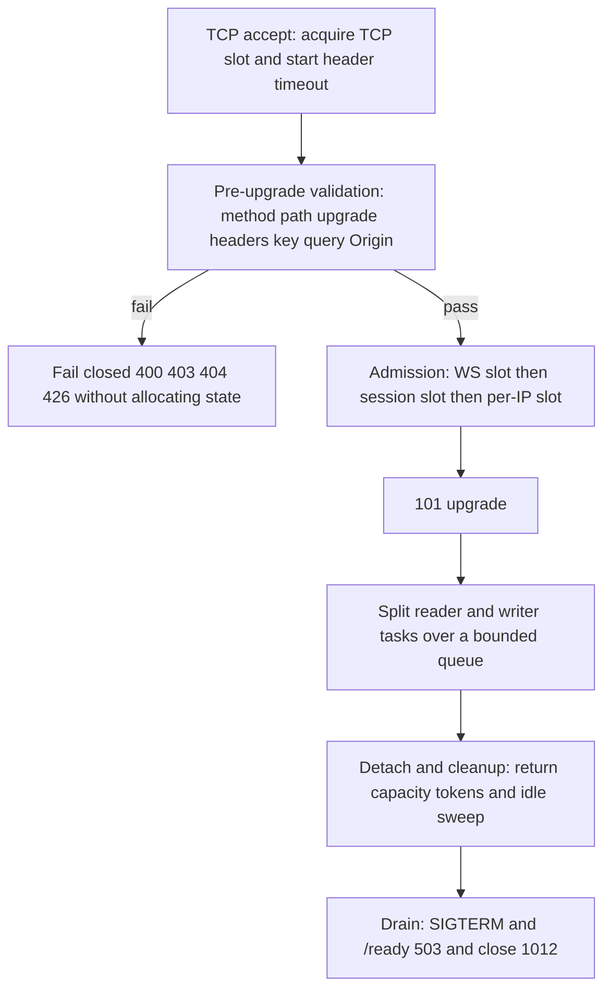

# Paseo Relay — Design

**English** | [简体中文](DESIGN.zh-CN.md)

This document describes the architecture of the single-node Rust relay and the
invariants it maintains. For operator-facing defaults and procedures see
[README.md](README.md); this document explains why the system is shaped the way
it is.

## 1. Goals

- **Protocol-compatible edge relay for Paseo.** Serve the Paseo v1 and v2
  WebSocket protocols on `/ws`, with the same routing semantics and close codes
  as the Elixir relay, so Paseo clients and daemons do not need changes.
- **Opaque payloads.** The relay never decrypts, stores, or logs Paseo payloads;
  inspection is limited to the bounded handshake-hygiene check. E2EE is
  end-to-end between the Paseo client and daemon.
- **Bounded under abuse.** Every queue, buffer, and handshake phase has a
  configured ceiling; a single unauthenticated peer cannot amplify into
  node-wide memory exhaustion.
- **Single static binary.** No Erlang/OTP, no EPMD, no distributed Erlang, no
  cookie, no runtime interpreter. One musl binary runs in a scratch container as
  a non-root user.
- **Fail closed, never half-open.** Protocol, resource, and lifecycle failures
  produce an explicit HTTP status or WebSocket close code.

Scaling is deliberately **delegated to the edge**: a load balancer consumes the
`serverId` query parameter with consistent hashing and keeps all sockets for one
`serverId` on one relay node. The relay stores only node-local sessions and has
no clustering, ownership registry, reroute protocol, or cross-node frame path.

## 2. Architecture

```
                        edge load balancer (TLS, per-IP limits, hashing on serverId)
                                             │
                        ┌────────────────────▼───────────────────────────┐
                        │                 relay process                  │
                        │  hyper HTTP/1.1 server (accept loop)           │
                        │   ├─ GET /health /ready /metrics               │
                        │   └─ GET /ws ── pre-upgrade validation         │
                        │                 └─ hyper upgrade ──┐           │
                        │  per-socket reader task            │           │
                        │   ├─ RFC 6455 frame decode         │           │
                        │   ├─ chunked ingress charging      │           │
                        │   └─ route via session registry    │           │
                        │  per-socket writer task            │           │
                        │   ├─ bounded mpsc + byte permits   │           │
                        │   └─ RFC 6455 frame encode/flush   │           │
                        │  SessionRegistry: DashMap<serverId, Session>   │
                        │   └─ per-session Mutex<topology only>          │
                        │  Capacity: WS/TCP/per-IP semaphores + budget   │
                        └────────────────────────────────────────────────┘
```

### 2.1 Runtime and HTTP layer

- **Tokio multi-threaded runtime**; no async runtime other than Tokio.
- **hyper 1** serves HTTP/1.1 on the listener, including the WebSocket upgrade
  handshake and the operations endpoints. There is no reverse proxy or HTTP/2
  requirement; WebSocket upgrades are HTTP/1.1 by definition.
- **Custom RFC 6455 codec** (`src/ws.rs`). Handshake validation, frame parsing,
  masking rules, fragmentation, control-frame rules, UTF-8 validation of text
  payloads, and close payloads are implemented directly. No third-party
  WebSocket library is used in production; `tokio-tungstenite` is a
  dev-dependency used only by integration tests.
- **TLS** is provided by `tokio-rustls`/`rustls` (ring provider) when
  `PASEO_RELAY_TLS_CERT` and `PASEO_RELAY_TLS_KEY` are set (both or neither;
  startup rejects a half-configured pair). ALPN is limited to `http/1.1`.
  Otherwise the listener is plaintext and TLS must be terminated at the edge.
- **Operations endpoints** share the listener: `GET`/`HEAD` `/health`, `/ready`,
  and `/metrics`. They are unauthenticated by design, so deployments must keep
  them on an internal network or filter them at the edge.

### 2.2 Connection lifecycle

The flowchart below sums up the lifecycle; the numbered list gives each step in
detail.



1. **TCP accept.** The listener acquires a TCP slot (`MAX_TCP_CONNECTIONS`)
   before reading a request and holds it for the whole socket lifetime,
   including after the WebSocket upgrade, so `MAX_TCP_CONNECTIONS` is the total
   OS-socket cap. The HTTP header phase is bounded by a header timeout and by
   hyper's request limits (`max_buf_size` 16 KiB, `max_header_size` 16 KiB,
   `max_headers` 64), so a slow client cannot hold a slot indefinitely or make
   the pre-upgrade path allocate without bound. Each idle accepted socket still
   costs roughly 23 KiB (hyper read/write buffers plus the task); plan for
   `MAX_TCP_CONNECTIONS × ~30 KiB` at idle, which is ~700–800 MiB at the 25,000
   default, so a 512 MB node must lower the caps. The per-IP WebSocket slot
   (`PER_IP_MAX_CONNECTIONS`, 0 = unlimited) is acquired during admission,
   before the upgrade is completed.
2. **Request classification.** `GET /ws` is the only upgradeable route; other
   paths return `404`, and operations endpoints are read-only. `/health` is
   independent of readiness so liveness probes cannot cause restarts during a
   drain.
3. **Pre-upgrade validation.** Before any relay state is allocated the
   request must pass:
   - method/path and WebSocket upgrade headers (`Connection: upgrade`,
     `Upgrade: websocket`, `Sec-WebSocket-Version: 13`);
   - a `Sec-WebSocket-Key` that is canonical padded Base64 for exactly 16 bytes;
   - query validation of `serverId` (1..=256 bytes, valid UTF-8, no control or
     whitespace characters), `role=server|client`, and `v=1|2`;
   - the optional Origin allowlist.
   Failures return `426` when the request is not an upgrade, `400` for an
   invalid upgrade/query, `403` for a disallowed Origin, or `404` for an unknown
   path — **without creating a session, writer, or capacity reservation**.
4. **Admission.** Only after validation does the relay acquire a WebSocket slot
   (`MAX_CONNECTIONS`), reserve a session slot (`MAX_SESSIONS`), acquire the
   per-IP slot, attach the socket to the session registry, and spawn its writer
   task.
5. **Split reader/writer.** The upgraded IO is split: the reader task owns frame
   decoding and routing; the writer task owns encoding and flushing for that
   socket. They communicate only through a bounded channel, so a slow peer
   exerts backpressure instead of creating an unbounded buffer.
6. **Detach and cleanup.** On close, the connection runner detaches the socket
   from the session topology exactly once (socket IDs make stale or duplicate
   detaches harmless), returns capacity tokens, and lets the idle sweep remove
   an empty session after the grace period.

### 2.3 Session registry

`SessionRegistry` is a `DashMap<String, Arc<Session>>` keyed by `serverId`.
Each `Session` is a small `Mutex<SessionState>` holding **topology only**:
socket handles (writer queue handles plus routing metadata), never payload
bytes. There is no per-session process and no shared "owner" that a caller can
kill; this is the structural fix for shared-owner failure modes.

- **v1** keeps one server slot and one client slot. Attaching a new socket for
  a role replaces the old one; the displaced socket is closed with `1008`
  ("Replaced by new connection") after the registry lock is released. Frames
  are forwarded to the opposite role.
- **v2 daemon** sockets are the control socket (`role=server` with empty
  `connectionId`) and per-connection data sockets. Attaching a control socket
  sends it a `sync` message with the sorted list of currently attached
  `connectionId`s, and replaces any previous control socket (also `1008`).
  Attaching a data socket replaces an existing socket for the same
  `connectionId`.
- **v2 clients** attach to a `connectionId`. Clients normally omit it, in which
  case the relay generates `conn_<16 hex>`; a supplied value is validated and
  used as-is for Elixir compatibility. The client is reported to the control
  socket as `connected`; the last client detach removes the data socket (close
  `1001`) and notifies the control socket with `disconnected`. A data socket
  that dies closes its clients with `1012` ("Server disconnected").
- **Idle sweep.** An empty session is removed after the configured idle grace
  period. `MAX_SESSIONS` bounds the number of `serverId` entries; a session at
  its per-`connectionId` client cap rejects further attaches.
- **No cross-session effects.** Operations under the session lock are short and
  synchronous (no `.await` while holding it); protocol actions that affect other
  sockets (replacement, data death, last client) are computed under the lock and
  executed after it is released.

### 2.4 Delivery path and backpressure

The relay's core reliability rule is **source backpressure, not buffering**:

1. The reader parses one frame at a time. A data-frame payload is read in 8 KiB
   chunks and each chunk is charged to the weighted ingress budget after it
   arrives, so at most one 8 KiB chunk per connection is allocated before it is
   accounted. The fixed 256-byte per-message overhead is charged once per
   message, not per fragment, and a message may contain at most 1024 fragments
   (fixed policy; exceeding it closes `1002`). A per-connection in-flight cap of
   `min(global budget, 4 × one-max-message charge)` bounds how much of the budget
   one connection can hold; the 4× factor covers the reader's pipelining of up
   to four messages per connection.
2. It resolves the destination from the registry and enqueues the frame on the
   destination's writer queue, waiting for a bounded byte permit.
3. The writer writes and flushes the frame, then acknowledges; the routing task
   awaits that acknowledgement (bounded by the delivery deadline) and the
   two-message read-ahead hand-off blocks the reader while it waits. Kernel TCP
   send pressure therefore reaches the producer as TCP receive-window pressure
   instead of being absorbed into relay memory.
4. If the budget cannot be reserved within the ingress wait timeout, or the
   writer queue/write does not make progress within the delivery deadline, the
   source (or the slow destination) is closed with retryable `1013`.

Per-destination writer queues are bounded twice: a 1024-message mpsc cap plus a
byte semaphore whose size is `max(control_queue_bytes, max_message_bytes +
64 KiB)`. A single maximum message always fits, so shedding happens by
deadline, not by an unreservable slot. Ping/pong entries do not take the byte
semaphore, but are capped by the mpsc count and the RFC 125-byte control limit. The per-connection reader hands at most
two completed messages to the routing task, so read-ahead is bounded too. The
control socket has its own 64 KiB frame cap.

### 2.5 Ingress budget

A node-wide semaphore bounds *in-flight* payload bytes across all connections.
The charge for a message is `(payload_len + 256) * ingress_weight`: the fixed
256-byte overhead makes empty and tiny frames non-free (charged once per
message), and the weight models the fact that a buffered payload may be retained
more than once (read buffer, writer queue, kernel). Reservations are RAII
guards, so cancellation, panic, or socket death always returns the bytes.

Charging is incremental, not one up-front reservation for a declared frame
length. The reader consumes a data-frame payload in 8 KiB chunks; each chunk is
charged after it arrives and released when the frame is delivered or the
connection dies, so at most one 8 KiB chunk per connection is allocated before
it is charged. A per-connection in-flight cap of
`min(global budget, 4 × one-max-message charge)` applies: one connection can
hold at most that much of the weighted budget, and the 4× factor covers the
reader's pipelining of up to four messages per connection. Together
with the fixed maximum of 1024 fragments per message, these bounds limit what a
stalled frame or a flood of empty fragments can reserve: the declared length of
a frame is not charged until its bytes actually arrive.

`PASEO_RELAY_INGRESS_WEIGHT` is constrained to `4..=16`. The minimum `4` leaves
room for the 2× transient copy (sender read buffer plus destination writer
queue) while keeping the accounting conservative; `256` and `4` are
configuration-reviewable constants, not measured allocator costs.

### 2.6 Lifecycle and graceful shutdown

- `SIGTERM`/`SIGINT` start a drain: the listener stops accepting, `/ready`
  returns `503`, new upgrades are rejected with `503`, existing sessions keep
  working for the configured grace window, then remaining sockets are closed
  with `1012` ("Relay shutting down") and the process exits after a short
  window for close frames to flush. `SIGKILL` is never required as a first
  signal.
- `PASEO_RELAY_DRAIN=true` starts the process already draining (useful to take
  a node out of rotation before stopping it).
- Sessions are node-local and ephemeral; a restart is always safe because Paseo
  clients and daemons reconnect. Nothing is persisted, by design.

## 3. Protocol model

### 3.1 Common

- `/ws` query parameters: `serverId` (required, 1..=256 bytes), `role`
  (`server` or `client`), `v` (`1` default, or `2`), `connectionId` (v2 only).
- IDs are validated as UTF-8 and rejected if they contain control characters or
  whitespace. Oversized IDs return `400` before state is created.
- Frames are relayed with their opcode preserved. Binary payloads are fully
  opaque; text payloads are UTF-8 validated at the framing layer (a protocol
  requirement) but not parsed for routing.
- One narrow exception to opacity: client frames of at most 64 KiB whose first
  non-whitespace byte is `{` are prefiltered as possible Paseo
  `hello`/`e2ee_hello` handshakes; only then are they parsed, and their `key`
  must be canonical padded Base64 for a canonical 32-byte X25519 public key.
  This is protocol hygiene, not a security boundary; a failure closes the client
  with `1008` and is never forwarded.

### 3.2 v1

One server and one client per `serverId`. A newer socket for a role replaces the
older one (`1008`, "Replaced by new connection"). Frames are forwarded to the
opposite role's socket. There is no buffering across reconnects; if the peer is
absent, the frame cannot be delivered and is dropped for that socket (the
session topology is unaffected).

### 3.3 v2

- The daemon opens a **control socket** (`role=server`, empty `connectionId`).
  The relay replies with `{"type":"sync","connectionIds":[...]}`. A new control
  socket replaces the old one.
- For each client connection the daemon opens a **data socket** with that
  `connectionId`. Data sockets are attached on demand; a client frame waits for
  its data socket only for `DATA_ATTACH_TIMEOUT_MS`.
- A v2 **client** omits `connectionId`; the relay assigns `conn_<16 hex>` and
  reports it to the daemon through the control socket as
  `{"type":"connected","connectionId":...}`. The last client detach emits
  `{"type":"disconnected",...}` and closes the data socket with `1001`.
- If a data socket disconnects, all clients for that `connectionId` are closed
  with `1012`.
- Control input is ignored except for text `{"type":"ping"}`, which is answered
  with `{"type":"pong","ts":<unix ms>}`; control frames are capped at 64 KiB.

## 4. Invariants

| # | Invariant | Enforcement |
|---|---|---|
| I1 | Payloads are opaque and never logged or persisted. | No payload parsing except the bounded handshake-hygiene check; metrics count bytes, never content; `serverId` and payload bytes are never logged. |
| I2 | Memory is bounded by configuration, not by peer behavior. | Frame/message caps, 1024-fragment policy, control-frame cap, writer byte semaphore for data frames, bounded mpsc, chunked ingress charging with a per-connection in-flight cap, pre-upgrade HTTP buffer/header caps, connection/session/per-IP caps, HTTP header timeout; ping/pong frames are additionally bounded by the mpsc count and 125-byte RFC limit. |
| I3 | A slow destination applies backpressure to its source; it never grows an unbounded queue. | Source waits for ingress budget and writer ack; delivery deadline sheds instead of buffering. |
| I4 | A connection failure only affects that connection and its protocol-defined peers. | Detach removes only its own handle; writer ack is independent of source liveness; the only cross-socket closes are replacement (`1008`), v2 data death (`1012`), and last-client detach (`1001`). |
| I5 | Fail closed: no half-open or silently dropped state transition. | Handshake/query errors return HTTP errors with no state; framing errors close with an explicit code; shutdown closes with `1012`. |
| I6 | One relay node is the sole authority for its sessions; there is no split-brain. | No cluster membership, no shared ownership, no cross-node session state; the edge is responsible for `serverId` affinity. |
| I7 | Drain is observable and bounded. | Readiness flips to `503` as soon as the drain starts, upgrades are rejected, the grace window is bounded, and remaining sockets close with `1012`. |
| I8 | Topology races cannot remove a newer socket. | Per-session mutex with no awaits; socket IDs checked on detach; replacement closes are performed outside the lock. |
| I9 | Admission happens before allocation. | Capacity and per-IP semaphores, upgrade validation, and session caps are checked before expensive state is created. |
| I10 | Observability never leaks routing secrets. | `/metrics` is aggregate-only (no `serverId` labels); logs never include `serverId`, `connectionId`, or payloads. |

## 5. Failure semantics

| Condition | Result |
|---|---|
| Unknown path or unsupported method | HTTP `404` |
| Non-upgrade request to `/ws` | HTTP `426` |
| Invalid `serverId`, `role`, `v`, `connectionId`, or invalid upgrade headers | HTTP `400`, no state created |
| Origin not in `PASEO_RELAY_ALLOWED_ORIGINS`, or Origin present but unparseable | HTTP `403`, no state created |
| WS capacity full, session cap reached, or draining | HTTP `503` (no upgrade) |
| Per-IP connection cap exceeded | HTTP `429` (no upgrade) |
| TLS handshake failure (native TLS mode) | TCP connection dropped before HTTP |
| Client frame/message exceeds configured limit | WebSocket close `1009` |
| Malformed frame, bad masking, bad close payload/code, non-minimal 126/127 length encoding, or more than 1024 fragments | WebSocket close `1002` |
| Invalid UTF-8 in a text frame | WebSocket close `1007` |
| Replaced by a newer socket | WebSocket close `1008` |
| Invalid Paseo handshake key | WebSocket close `1008` |
| Ingress budget exhausted past the wait timeout | WebSocket close `1013`, "Relay ingress capacity" |
| Delivery deadline exceeded / slow destination | WebSocket close `1013`, "Slow consumer" / "Delivery unavailable" |
| v2 client has no data socket within the attach timeout | WebSocket close `1013`, "Data route unavailable" |
| Graceful drain / server restart | WebSocket close `1012`, "Relay shutting down" |
| v2 server data socket disconnected | Client sockets close `1012`, "Server disconnected" |
| Last v2 client for a connection detached | Data socket closes `1001`, "Client disconnected" |
| Normal closure | `1000`; a received close code in the allowed range is echoed |

(HTTP statuses for admission rejections are part of the documented endpoint
contract; see README.)

## 6. Security design

- **Threat model.** The relay is treated as untrusted by Paseo: it sees IP
  addresses, timing, frame sizes, `serverId`/`connectionId`, and the plaintext
  handshake public keys. `serverId` is a bearer routing secret; anyone who
  learns it can attach to the session. The relay has no authentication by
  design (Paseo E2EE provides confidentiality and authenticity of content), so
  deployments must treat `serverId` as a secret and consider availability
  attacks in scope.
- **No distributed Erlang.** The binary contains no Erlang VM, EPMD, node
  cookie, or distribution listener. There is nothing to expose on 4369 or the
  distribution ports.
- **TLS.** Terminated at the edge or natively with rustls and mounted PEM files.
  Plaintext is acceptable only on loopback/private networks.
- **Rate limits.** Per-IP connection limits, global WebSocket/TCP/session caps,
  bounded handshake phases, and the ingress budget; additional per-IP and
  request-rate limits belong at the edge.
- **Secret hygiene.** `serverId`, `connectionId`, and payloads are never logged. Metrics carry
  aggregate counters only; Prometheus must not be exposed to the public
  internet.
- **Handshake validation is hygiene.** It rejects malformed X25519 encodings
  cheaply (only small JSON-looking client frames), but it does not authenticate
  peers and must not be described as a security control.

## 7. Hardening decisions

These are explicit design requirements, not a comparison with any other
implementation.

| Area | Decision |
|---|---|
| Upgrade | Validate method/path, upgrade headers, key encoding, and query parameters before any session, writer, or capacity state; rejected requests allocate nothing. Pre-upgrade HTTP is additionally capped by hyper (`max_buf_size` 16 KiB, `max_header_size` 16 KiB, `max_headers` 64) and the header timeout. |
| Message accounting | Charge every message a fixed overhead plus weighted payload; charge payload in 8 KiB chunks as it arrives (at most one uncharged chunk per connection); cap per-connection in-flight bytes and fragments; bound queues and read deadlines. |
| Isolation | No shared owner process; per-session topology lock only; source detach never closes the destination; slow consumers are shed at their own deadline. |
| Failure | Fail closed with an explicit HTTP status or WebSocket close code; no half-open state. |
| Scaling | Single-node only; edge `serverId` affinity; no ownership registry, reroute, or split-brain arbitration. |
| Runtime | No Erlang/OTP, EPMD, cookie, or distribution; static musl binary; optional native TLS. |
| Observability | Aggregate metrics only; structured logs without `serverId`, `connectionId`, or payload. |
| Lifecycle | Bounded SIGTERM/SIGINT drain; readiness flips; remaining sockets close with `1012`. |
| Supply chain | Scratch non-root runtime; digest-pinned builder; SHA-pinned CI actions; per-platform provenance/SBOM attestations. |

## 8. Non-goals

- **Built-in clustering / multi-node ownership.** The relay is single-node by
  design; the edge load balancer provides affinity and scaling.
- **Authentication or authorization.** Paseo E2EE is the confidentiality and
  authenticity layer; the relay does not add tokens, leases, or session
  revocation. `serverId` matters as a secret and must be handled as one.
- **Payload inspection, decryption, storage, or replay protection.** No message
  content is read, retained, or logged; replay/freshness is Paseo's E2EE
  responsibility.
- **Transparent failover / session migration.** Sockets are ephemeral; clients
  reconnect through normal routing.
- **HA persistence, admin APIs, per-tenant metrics, or quotas per `serverId`.**
  Edge policy is the intended control point.

## 9. Trade-offs and open questions

- **Consistent hashing is an operational dependency.** If the edge maps one
  `serverId` to two nodes (or remaps during a rollout), the two sides of a
  Paseo session can land on different relays and the session will not connect.
  Deployments should use a stable hash ring, small vnode churn, and drain before
  removal.
- **Availability is the residual risk.** With no authentication, anyone who
  learns a `serverId` can disrupt that session. This is accepted and mitigated
  by keeping `serverId`s secret and rate-limiting at the edge.
- **Per-IP limits are coarse.** NATed users share an IP, so the limit must be
  sized for the deployment (or disabled with `0`). Per-`serverId` quotas and
  connect-rate limits are intentionally not implemented in-process.
- **Fixed overhead and weight are heuristics.** The 256-byte overhead and weight
  4 are conservative rather than measured for every allocator; the weight is
  configurable in `4..=16`, and the floor of 4 leaves room for the 2× transient
  copy. They are configuration-reviewable constants.
- **HTTP status mapping** for admission rejections is documented in README;
  protocol close codes are part of the compatibility contract and should not
  change without a Paseo client/daemon compatibility review.

## 10. Testing

The test suite uses real listeners and real WebSocket clients
(`tokio-tungstenite`), not mocks:

- unit tests cover config parsing/validation (including the TLS pair and budget
  floor invariants), query parsing and ID validation, RFC 6455 upgrade and frame
  codec round-trips, handshake key validation, capacity/budget accounting and
  guard release, session topology transitions, writer queue behavior, and
  metrics rendering.
- integration tests (`tests/relay_integration.rs`) cover `/health`, `/ready`,
  and `/metrics`; v1 bidirectional forwarding and replacement (`1008`); v2
  control/data/client notifications and control ping/pong; failed upgrades
  creating no session; invalid handshake keys (`1008`); invalid UTF-8
  `connectionId` (`400`); oversized frames (`1009`); WebSocket capacity
  (`503`); per-IP limits (`429`); a missing v2 data route (`1013`); drain
  (`1012`); and forwarded-frame metrics.
- newer regression tests cover the fragmented-message deadline with only ping
  traffic, the control nudge/`1011` watchdog, per-connection client caps,
  Origin allowlisting for native vs browser clients, a stalled frame payload,
  chunked ingress charging, the 1024-fragment policy, non-minimal length
  rejection, invalid close codes, and session-capacity admission.
- container smoke tests in CI and `scripts/ci.sh` build the static image and
  poll `/health` from the host, since the scratch image has no shell.

Run everything with `cargo test` or `scripts/ci.sh`.
