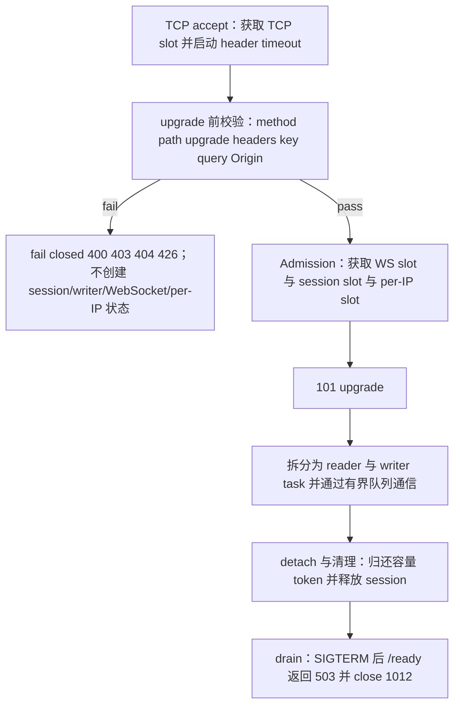

# Paseo Relay — 设计

[English](DESIGN.md) | **简体中文**

本文是英文 [DESIGN.md（英文）](DESIGN.md) 的完整中文翻译，描述单节点 Rust relay 的架构
和它维护的不变量。面向运维的默认值和操作流程见 [README.zh-CN.md](README.zh-CN.md)；
本文解释系统为什么设计成这样。

> 英文 `DESIGN.md` 是规范来源；如果翻译与英文不一致，以英文为准。

## 1. 目标

- **面向 Paseo 的协议兼容边缘 relay。** 在 `/ws` 上提供 Paseo v1 和 v2 WebSocket
  协议，路由语义和 close code 与 Elixir relay 相同，Paseo client 和 daemon 无需修改。
- **payload 不透明。** relay 从不解密、存储或记录 Paseo payload；唯一检查是有界的
  handshake 卫生检查。E2EE 存在于 Paseo client 与 daemon 之间，端到端。
- **滥用下有界。** 每个队列、缓冲和握手阶段都有配置上限；单个未认证 peer 不能放大成
  节点级内存耗尽。
- **单个静态二进制。** 无 Erlang/OTP、无 EPMD、无分布式 Erlang、无 cookie、无运行时
  解释器。一个 musl 二进制以非 root 用户运行在 scratch 容器中。
- **失败即关闭，绝不半开。** 协议、资源和生命周期失败都产生明确的 HTTP 状态码或
  WebSocket close code。

扩容被刻意 **交给边缘**：负载均衡器消费 `serverId` query 参数并做一致性哈希，把同一
`serverId` 的所有 socket 放在同一个 relay 节点上。relay 只存节点本地 session，没有
集群、所有权注册表、重路由协议或跨节点帧路径。

## 2. 架构

```
                        边缘负载均衡器（TLS、per-IP 限制、按 serverId 哈希）
                                             │
                        ┌────────────────────▼───────────────────────────┐
                        │                   relay 进程                   │
                        │  hyper HTTP/1.1 server（accept loop）          │
                        │   ├─ GET /health /ready /metrics               │
                        │   └─ GET /ws ── upgrade 前校验                 │
                        │                 └─ hyper upgrade ──┐           │
                        │  per-socket reader task            │           │
                        │   ├─ RFC 6455 frame decode         │           │
                        │   ├─ chunked ingress charging      │           │
                        │   └─ route via session registry    │           │
                        │  per-socket writer task            │           │
                        │   ├─ bounded mpsc + byte permits   │           │
                        │   └─ RFC 6455 frame encode/flush   │           │
                        │  SessionRegistry: DashMap<serverId, Session>   │
                        │   └─ per-session Mutex<仅拓扑>                 │
                        │  Capacity: WS/TCP/per-IP 信号量 + budget       │
                        └────────────────────────────────────────────────┘
```

### 2.1 运行时与 HTTP 层

- **Tokio 多线程运行时**；除 Tokio 外没有其他 async runtime。
- **hyper 1** 在 listener 上提供 HTTP/1.1，包括 WebSocket upgrade 握手和运维端点。
  不要求反向代理或 HTTP/2；按定义 WebSocket upgrade 是 HTTP/1.1。
- **自研 RFC 6455 codec**（`src/ws.rs`）。握手校验、帧解析、masking 规则、分片、
  control frame 规则、text payload 的 UTF-8 校验和 close payload 都直接实现。
  生产环境不使用第三方 WebSocket 库；`tokio-tungstenite` 只是集成测试用的
  dev-dependency。
- **TLS** 由 `tokio-rustls`/`rustls`（ring provider）提供，前提是设置了
  `PASEO_RELAY_TLS_CERT` 和 `PASEO_RELAY_TLS_KEY`（必须同时设置或同时不设置；只配
  一半会在启动时拒绝）。ALPN 限制为 `http/1.1`。否则 listener 是明文，TLS 必须在
  边缘终止。收到 `SIGHUP` 或文件发生变化（每 30 秒检查一次）时会重新读取证书和私钥；
  新的 acceptor 只用于之后的新连接，加载失败则继续使用原来的证书。
- **运维端点**（`GET`/`HEAD` `/health`、`/ready`、`/metrics`、`/version`）默认与主
  listener 共用。它们按设计没有认证，因此部署必须把它们放在内网或在边缘过滤。设置
  `PASEO_RELAY_OPS_PORT` 后，它们移到第二个明文 listener，公网 listener 只保留 `/ws`
  和 `/health`。这个 listener 有自己独立的少量连接额度，并且在 drain 期间比公网
  listener 活得更久，所以探针不依赖公网容量。

### 2.2 连接生命周期

下图概括了连接生命周期；下面的编号列表给出每个步骤的细节。



1. **TCP accept。** listener 在读取请求之前先获取 TCP slot
   （`MAX_TCP_CONNECTIONS`），并在整个 socket 生命周期内持有它（包括 WebSocket
   upgrade 之后），因此 `MAX_TCP_CONNECTIONS` 是 OS socket 总上限。upgrade 前
   HTTP 阶段在 header 读取与停滞的 HTTP 响应写回两侧都受
   `HTTP_HEADER_TIMEOUT_MS` 约束（WebSocket upgrade 完成后自动关闭该写超时），并受
   hyper 请求限制（`max_buf_size` 16 KiB、`max_header_size` 16 KiB、
   `max_headers` 64）约束，因此慢 client——或管线发送 `/metrics` 却不读取响应的
   peer——无法无限占用 slot，upgrade 前路径也不会无界分配。relay 在边缘后为明文时一个 idle 已接受 socket
   约占 23 KiB（hyper 读写缓冲加 task），原生 TLS（rustls 缓冲）时约 33 KiB；idle
   时按 `MAX_TCP_CONNECTIONS × ~30 KiB`（明文）或 `× ~35 KiB`（原生 TLS）规划，
   25,000 默认值约需 700–800 MiB（明文）或约 850–900 MiB（原生 TLS），所以
   512 MB 节点必须调低上限。`MAX_TCP_CONNECTIONS` 要比 `MAX_CONNECTIONS` 留出余量
   （至少 64–128 个空槽，探针突发时更多），否则满 WebSocket 负载会占满所有 TCP
   slot，在 accept 阶段拒绝 `/health`、`/ready`、`/metrics` 和 k8s 探针（或者用
   `PASEO_RELAY_OPS_PORT` 给探针单独的 listener）。设置了 `PER_IP_MAX_CONNECTIONS`
   （0 = 不限制）时，accept 阶段还会获取一个 per-IP TCP slot，额度为 WebSocket 上限
   再加四分之一（至少 8 个），这样单个客户端无法用从不 upgrade 的 socket 占满所有 TCP
   slot；per-IP WebSocket slot 则在 admission 阶段、upgrade 完成之前获取。两者都把
   IPv6 客户端按 /64 计数。
2. **请求分类。** `GET /ws` 是唯一可 upgrade 的路由；其他路径返回 `404`，运维端点
   只读。`/health` 与 readiness 独立，这样 liveness 探针不会在 drain 期间触发重启。
3. **upgrade 前校验。** 在分配任何 relay 状态之前，请求必须通过：
   - method/path、HTTP/1.1 版本和 WebSocket upgrade header（`Connection: upgrade`、
     `Upgrade: websocket`、`Sec-WebSocket-Version: 13`）；
   - `Sec-WebSocket-Key` 必须是恰好 16 字节的规范 padded Base64；
   - query 校验：`serverId`（1..=256 字节、合法 UTF-8、无控制字符或空白）、
     `role=server|client`、`v=1|2`；
   - 可选的 Origin allowlist（重复或无法解析的 `Origin` header 一律拒绝）。
   失败时返回 `426`（不是 upgrade）、`400`（upgrade/query 非法）、`403`
   （Origin 不允许）或 `404`（未知路径）——**不创建 session、writer、WebSocket
   slot 或 per-IP 状态**；upgrade 前 TCP slot 和有界的 hyper HTTP 缓冲在校验之前
   分配。
4. **Admission。** 只有校验通过后，relay 才获取 WebSocket slot
   （`MAX_CONNECTIONS`）、预留 session slot（`MAX_SESSIONS`）、获取 per-IP slot、
   把 socket attach 到 session registry，并 spawn writer task。
5. **读写分离。** upgrade 后的 IO 被拆分：reader task 负责帧解码和路由；writer task
   负责该 socket 的编码和 flush。两者只通过有界 channel 通信，所以慢 peer 产生的是
   背压，而不是无界缓冲。
6. **detach 与清理。** 关闭时，connection runner 只从 session 拓扑中 detach 该 socket
   一次（socket ID 让过期或重复 detach 无害），归还容量 token；如果这是该 session 的
   最后一个 socket，则立即移除 session。

### 2.3 Session registry

`SessionRegistry` 是 `DashMap<String, Arc<Session>>`，以 `serverId` 为 key。每个
`Session` 是一个小的 `Mutex<SessionState>`，只保存 **拓扑**：socket handle（writer
队列 handle 加路由元数据），绝不保存 payload 字节。没有 per-session 进程，也没有
调用方可以杀掉的共享 “owner”；这是对共享 owner 类失败的结构性修复。

- **v1** 保留一个 server slot 和一个 client slot。给某个 role attach 新 socket 会替换
  旧 socket；被替换的 socket 在释放 registry lock 之后以 `1008`
  （"Replaced by new connection"）关闭。帧转发给对端 role。
- **v2 daemon** socket 包括 control socket（`role=server`，空 `connectionId`）和每个
  connection 的 data socket。attach control socket 时会发送 `sync` 消息，内含当前
  已 attach 的 `connectionId` 排序列表，并替换之前的 control socket（同样 `1008`）。
  relay 生成的每条 `sync` 序列化后必须 ≤ 64 KiB（`CONTROL_FRAME_BYTES`）：初始
  `sync` 就超限的 control attach 会以 `1013` "Relay session sync capacity" 拒绝；
  会让下一条 `sync` 超限的新 client 同样被拒绝。这样 relay 不会发出超过 daemon
  文档化 64 KiB 入站上限的控制帧。attach data socket 会替换同一 `connectionId` 的
  已有 socket。
- **v2 client** attach 到 `connectionId`。client 通常省略它，此时 relay 生成
  `conn_<16 hex>`；如果提供，则校验后原样使用，以兼容 Elixir（query 值不做 trim，
  纯空白值会被拒绝而不是当成空值）。client 会以
  `connected` 通知 control socket；最后一个 client detach 会移除 data socket
  （close `1001`）并以 `disconnected` 通知 control socket。data socket 死亡时，它的
  所有 client 以 `1012`（"Server disconnected"）关闭。
- **Session 生命周期。** 最后一个 socket 离开、并且没有任何 connection task 还引用它
  时，session 立即被移除，所以 `MAX_SESSIONS` 统计的是有人 attach 的 `serverId`；空
  session 没有任何值得保留的状态。移除在 registry 的 shard 锁内进行并检查引用计数，
  而加入方在 attach 之前也是在同一把锁内取得引用，所以即将获得 socket 的 session 不会
  被移除。周期性清理作为兜底保留。每个 session 限制不同 v2 `connectionId` 的
  **并集**（`MAX_CONNECTIONS_PER_SESSION`，默认 `512`）：同一个 id 的 client 与 data
  路由共用一个名额；上限在新 client attach 前检查，因此不会先接入 client、15 秒后
  才因 data 路由已满而失败。同一个 session 还限制每个 `connectionId` 的 client 数
  （`MAX_CLIENTS_PER_CONNECTION`），并最多运行单个去重的 control watchdog（跨 await
  仅持 `Weak<Session>`）。
- **Watchdog 截止时间。** watchdog 维护两个时钟。`nudged_at` 从覆盖最老等待者的第一次
  nudge 开始计时，决定 `1011` deadline；后到者不会推迟它。`last_nudge_at` 是独立的覆盖
  时钟：`waiting_since` 晚于上次 nudge 的 client 会在 deadline 前收到补充 `sync`，
  但不会延长最老等待者的 `1011`。这样既落实"后到 client 收到自己的 sync"，又不让攻击者
  靠不断加入 client 无限推迟 `1011`；nudge 发送失败是 fail-closed，而不是静默跳过。
- **无跨 session 影响。** session lock 下的操作短且同步（持锁时没有 `.await`）；
  影响其他 socket 的协议动作（替换、data 死亡、最后 client）在锁内计算，锁释放后
  执行。

### 2.4 投递路径与背压

relay 的核心可靠性规则是 **源端背压，而不是缓冲**：

1. reader 一次解析一帧。data frame 的 payload 按 8 KiB chunk 读取，每个 chunk 到达后
   才计入加权 ingress 预算：计费为 `chunk_bytes × ingress_weight + 192`（192 加权
   单位用于 chunk 记账），因此每个连接在计费前最多分配一个 8 KiB chunk。每消息
   固定 256 字节开销 **每条消息只计一次**，不按分片重复计费；一条消息最多 1024 个
   分片（固定策略，超过则 close `1002`）。每连接 in-flight 上限为
   `min(全局预算, 4 × 一条最大消息的计费)`，或显式的
   `PER_CONNECTION_LIMIT_BYTES`（clamp 到 `[一条最大消息, 预算]`），限制单个连接最多
   持有的预算；4× 是默认派生方式，对应 reader 最多流水化 4 条消息。
2. 它从 registry 解析 destination，并把帧连同该帧的 `Arc<BudgetHold>`（ingress 预算
   guard）与绝对投递 deadline 一起 enqueue 到 destination 的 writer 队列，等待有界
   byte permit。
3. writer 在写入并 flush 帧的过程中强制执行该绝对 deadline，仅在写完或队列丢弃时释放
   `BudgetHold`，然后 ack；路由 task 等待该 ack（受 delivery deadline 约束），两消息
   预读的 hand-off 在等待时阻塞 reader。即使源连接在帧仍在队列中时断开或被替换，
   destination writer 依然持有预算与绝对 deadline，慢消费端无法在 `DELIVERY_TIMEOUT_MS`
   之外滞留脱账内存。于是内核 TCP 发送压力以 TCP 接收窗口压力的形式传回生产者，而不是被
   relay 内存吸收。
4. 如果在有效 ingress 等待时间
   （`min(INGRESS_WAIT_TIMEOUT_MS, 剩余 frame/message 读取 deadline)`）内无法
   预留预算，或者 writer 队列/写入在 delivery deadline 内没有进展，source（或慢
   destination）以可重试的 `1013` 关闭。source 等待期间，预算会先回收其他连接上未完成
   的消息（见 2.5 节）。frame/message 读超时，或消息在 `READ_STALL_TIMEOUT_MS` 内没有
   任何 payload 进展，同样以 `1013` 关闭 source；等待预算不会延长读取 deadline。

每个 destination 的 writer 队列有两重限制：1024 条消息的 mpsc 上限，加上一个字节
信号量，其大小为 `max(control_queue_bytes, max_message_bytes + 64 KiB)`——默认约
32 MiB，因此单条最大消息总能放下，淘汰由 deadline 触发，而不是由无法预留的 slot
触发。Ping/pong 条目不占字节信号量，但受 mpsc 条数和 RFC 125 字节 control frame
上限约束。per-connection reader 最多把两条已完成消息交给 routing task，因此预读也有界。
control socket 有自己的 64 KiB 帧上限，relay 自己生成的 `sync` 也遵守该上限。

### 2.5 Ingress 预算

节点级信号量限制所有连接中 **in-flight** 的 payload 字节。每条消息的计费是加权
payload 加固定记账：每个 payload chunk 计
`chunk_bytes × ingress_weight + 192`（192 加权单位用于连接级 guard 和 vector
余量），256 字节的每消息开销按 `256 × ingress_weight` 只计一次。weight 建模了
buffered payload 可能被保留多次的事实（read buffer、writer queue、kernel）；每
chunk 的记账费用防止大量微小 chunk 用很小的未记账 guard 堆绕过预算。预留在 RAII
guard 中，所以取消、panic 或 socket 死亡总会归还字节。

计费是增量的，不是按声明帧长度一次性预留。reader 按 8 KiB chunk 读取 data frame
payload；每个 chunk 到达后才计费，并在帧投递完成或连接死亡时释放，因此每个连接在
计费前最多分配一个 8 KiB chunk（payload vector 不会按声明长度预分配）。每连接
in-flight 上限为 `min(全局预算, 4 × 一条最大消息的计费)`，或配置的
`PER_CONNECTION_LIMIT_BYTES`：单个连接最多持有这么多加权预算，4× 默认值对应 reader
最多流水化 4 条消息。该上限至少 clamp 到一条最大消息，保证单个连接总能取得进展；最多
为全局预算，不会超过池大小。再配合每条消息最多 1024 个分片的固定策略，这些上限限制了
停滞帧或空分片洪泛能占用多少预算：帧声明的长度在字节真正到达之前不会被计费。

**两个池。** 主池（`INGRESS_BUDGET_BYTES`）接纳所有消息。第二个池
（`INGRESS_SMALL_RESERVE_BYTES`）只接纳不超过 64 KiB 的完整单帧消息，这类消息优先计
入它，它满了再计入主池。分片消息一律从主池计费，避免大传输用小首片锁占小消息预留池。
因此握手和普通小帧不会排在占满主池的大传输后面。

**回收。** 预留仅在 writer 写完或丢弃排队帧时释放，而投递由 relay 约束（delivery 和
data-attach deadline）。例外是仍在到达中的消息：只有发送方决定它何时完成。如果不加
处理，peer 就能靠"开始一条消息但不发完"来持有预算。所以连接仅在实际接收消息期间登记
活跃持仓（分别记录主池与小消息预留池的加权字节、传输时长以及最近一到两秒的接收速率——
都用一个在该连接自己等预算时会暂停的时钟来度量），而需要等预算的 source 只针对在它
可用池中确实持有字节的其他连接执行取消：

1. 已停滞或每秒不超过 `INGRESS_RECLAIM_MIN_RATE_BYTES` 的，从大到小，直到腾出足够
   预算（若慢速持仓不足以腾出所需字节，继续执行规则 2–3）；
2. 等待方用掉一半等待时间后：传输时长超过 `INGRESS_RECLAIM_AFTER_MS`、并且比等待方
   自己那条消息更久的消息中最老的一条；
3. 等待方用掉一半等待时间、且它自己是小消息时：最大的那一条，前提是其持有量至少是等待
   方的 8 倍。

规则 1 让持有预算必须付出持续上传的代价。规则 2 限制任何一条消息在有人等待时能占多久，
所以"略高于速率下限慢慢发"也行不通；比较传输时长则避免两个长传输轮流把对方挤掉。规则 3
保证两个池都满时小帧排在大传输前面。没有人等待时不会回收任何东西，已完整接收的消息永远
不会被回收，取消的决定是在"标记消息完成"所用的同一把锁内做出的。扫描节流对慢速扫描与
主池/小消息池耐心驱逐分别计时，防止不耐烦的等待方饿死已具资格的等待方。与压力无关，
`READ_STALL_TIMEOUT_MS` 会关闭未能取得至少 8 KiB payload 进展的消息（同时阻断静默停滞
与 0/1 字节续帧保活）。这套机制覆盖不到的情况见第 9 节。

`PASEO_RELAY_MAX_MESSAGE_BYTES` 的校验使用一条最大消息的最坏情况加权计费：payload
权重加 256 字节每消息开销，再加每个 chunk 192（包含 1024 分片的最坏情况）。校验器
要求 `PASEO_RELAY_INGRESS_BUDGET_BYTES` 能容纳该计费；具体数值请用
`paseo-relay --check-config` 查看。

`PASEO_RELAY_INGRESS_WEIGHT` 被限制在 `4..=16`。最小值 `4` 为 2× 临时拷贝（发送方
read buffer 加 destination writer queue）留出余量，同时保持记账保守；`256`、`192`
和 `4` 是可评审的配置常量，不是测量出来的 allocator 成本。

### 2.6 生命周期与优雅关闭

- `SIGTERM`/`SIGINT` 启动 drain：`/ready` 立即返回 `503`，新 `/ws` upgrade 以
  `503` 拒绝；现有 session 在配置的 grace window 内继续工作。配置了
  `PASEO_RELAY_OPS_PORT` 时，公网 listener 立即关闭、运维 listener 在 grace window
  内保持开放；共享端口模式下，listener 在 grace window 内保持开放，使 `/ready`
  （`503`）、`/health`（`200`）和 `/metrics` 持续可读，同时 `/ws` 返回 `503`。
  grace window 结束后关闭 listener，剩余 socket 以 `1012`（"Relay shutting down"）
  关闭，进程在短暂等待 close frame flush 后退出。`SIGKILL` 永远不需要作为第一信号。
- `SIGHUP` 重新加载 TLS 证书和私钥（见 2.1 节）；不影响会话。
- `PASEO_RELAY_DRAIN=true` 让进程启动即 draining（适合在停止节点前先把它移出轮换）。
- Session 是节点本地且临时的；重启总是安全的，因为 Paseo client 和 daemon 会重连。
  按设计不持久化任何东西。

### 2.7 可观测性

`/metrics` 只有聚合值，绝不带 `serverId`、`connectionId` 或 payload 内容。有两条刻意
保持的语义：

- **转发流量是用户流量。** `frames_forwarded_total` 和 `bytes_forwarded_total` 只统计
  relay 转发的用户帧/字节；relay 自己生成的控制 JSON（`sync`、`connected`、
  `disconnected`、v2 `pong`）不计入，所以只有控制面活动的 session 不会显示成有数据转发。
- **每类拒绝只计一个来源。** `session_rejections_total` 只统计全局 `MAX_SESSIONS`
  上限；session 级 `connectionId` 并集上限与 64 KiB `sync` 上限计入
  `session_connection_rejections_total`；每个 `connectionId` 的 client 上限计入
  `client_limit_rejections_total`；运维监听的 64 连接额度计入
  `ops_rejections_total`。`connection_rejections_total`、`per_ip_rejections_total`、
  `tcp_rejections_total` 保持原义。超过 deadline 的投递按每次 shed 只计一次
  （`delivery_timeouts_total`）：source 侧计队列等待超时，destination writer 计写入
  deadline 超时；destination 另计 `slow_consumer_disconnects_total`。control 通知超过
  1 秒发送超时时也会计一次，同时计入 `control_send_failures_total`。普通 transport
  错误不算 delivery timeout。无法入队或写出的 control 通知计入
  `control_send_failures_total`，其中 `sync` 失败是 fail-closed。

## 3. 协议模型

### 3.1 通用

- `/ws` query 参数：`serverId`（必填，1..=256 字节）、`role`（`server` 或
  `client`）、`v`（默认 `1`，或 `2`）、`connectionId`（仅 v2）。
- ID 按 UTF-8 校验；包含控制字符或空白会被拒绝。超大 ID 在创建状态之前返回 `400`
。
- 帧转发时保留 opcode。Binary payload 完全透明；text payload 在 framing 层做 UTF-8
  校验（协议要求），但不为路由解析内容。
- 透明性有一个狭窄例外：client 发来的、最多 64 KiB 且首个非空白字节为 `{` 的帧会被
  预筛为可能的 Paseo `hello`/`e2ee_hello` 握手；只有这时才解析，其 `key` 必须是
  规范 32 字节 X25519 公钥的规范 padded Base64。这是协议卫生，不是安全边界；失败会
  以 `1008` 关闭 client，且绝不转发。被这个解析器拒绝、但更宽松的解析器接受的帧（孤立
  代理项转义、超出 `f64` 范围的数字、极深的嵌套）会不经检查直接转发，超过 64 KiB 的帧
  也一样：这个检查拦的是格式良好的错误，而不是存心要把坏 key 送达的 client。

### 3.2 v1

每个 `serverId` 一个 server 和一个 client。某个 role 的新 socket 会替换旧 socket
（`1008`，"Replaced by new connection"）。帧转发给对端 role 的 socket。重连之间没有
缓冲；如果 peer 不存在，帧无法投递，会在该 socket 丢弃（session 拓扑不受影响）。

### 3.3 v2

- daemon 打开一个 **control socket**（`role=server`，空 `connectionId`）。relay 回复
  `{"type":"sync","connectionIds":[...]}`，列表有序且限制在 64 KiB；初始快照放不下的
  control attach 以 `1013` "Relay session sync capacity" 拒绝。新 control socket 会
  替换旧 control socket。
- 对每个 client connection，daemon 用对应 `connectionId` 打开一个 **data socket**。
  data socket 按需 attach；client 帧只等待 data socket `DATA_ATTACH_TIMEOUT_MS`。
- v2 **client** 省略 `connectionId`；relay 分配 `conn_<16 hex>`，并通过 control
  socket 以 `{"type":"connected","connectionId":...}` 报告给 daemon。最后一个 client
  detach 时发出 `{"type":"disconnected",...}` 并以 `1001` 关闭 data socket。
- 初始 `sync` 不保证先于并发 client 的 `connected` 或 detach 的 `disconnected` 写入；
  daemon 应把 `sync` 当作基线快照，并幂等地应用这些通知。这个顺序竞态是已知且接受的
  （Paseo v0.15.3 可容忍 connected-before-sync），不属于数据面边界。
- 如果 data socket 断开，该 `connectionId` 下所有 client 以 `1012` 关闭。
- control 输入除 text `{"type":"ping"}` 外忽略；ping 回复
  `{"type":"pong","ts":<unix ms>}`；control 帧双向都限制在 64 KiB。

## 4. 不变量

| # | 不变量 | 执行方式 |
|---|---|---|
| I1 | payload 不透明，绝不记录或持久化。 | 除有界 handshake 卫生检查外不解析 payload；指标只计字节，不记内容；`serverId` 和 payload 字节绝不记录。 |
| I2 | 内存由配置约束，而不是由 peer 行为约束。 | 帧/消息上限、1024 分片策略、包含 relay 自产 `sync` 的 control 帧上限、data frame 的 writer 字节信号量、有界 mpsc、带每连接 in-flight 上限的增量 ingress 计费（payload 权重加每 chunk 记账）、upgrade 前 HTTP 缓冲/header 上限、connection/session/per-IP 上限、HTTP header timeout；ping/pong 帧还受 mpsc 条数和 RFC 125 字节限制约束。 |
| I3 | 慢 destination 对 source 施加背压；队列绝不无界增长。 | source 等待 ingress 预算和 writer ack；delivery deadline 触发淘汰而不是缓冲。 |
| I4 | 连接失败只影响该连接及其协议定义的对端。 | detach 只移除自己的 handle；writer ack 独立于 source 存活；唯一的跨 socket 关闭是替换（`1008`）、v2 data 死亡（`1012`）和最后 client detach（`1001`）。 |
| I5 | 失败即关闭：没有半开或静默丢弃的状态转换。 | 握手/query 错误返回 HTTP 错误且不创建 session/writer/WebSocket/per-IP 状态；framing 错误用明确 close code；shutdown 用 `1012`。 |
| I6 | 一个 relay 节点是其 session 的唯一权威；没有脑裂。 | 没有集群成员、共享所有权或跨节点 session 状态；`serverId` 亲和性由边缘负责。 |
| I7 | Drain 可观测且有界。 | drain 一开始 readiness 就变 `503`，upgrade 被拒绝，grace window 有界，剩余 socket 以 `1012` 关闭。 |
| I8 | 拓扑竞态不能移除更新的 socket。 | per-session mutex，持锁无 await；detach 时校验 socket ID；替换关闭在锁外执行。 |
| I9 | admission 在分配之前发生。 | 容量和 per-IP 信号量、upgrade 校验、session 上限都在创建昂贵状态之前检查。 |
| I10 | 可观测性绝不泄漏路由秘密。 | `/metrics` 只有聚合值（没有 `serverId` label）；日志绝不包含 `serverId`、`connectionId` 或 payload。 |
| I11 | 发送方不能免费持有 ingress 预算。 | 未完成的消息必须持续有数据到达（`READ_STALL_TIMEOUT_MS`）；有压力时，停滞、过慢和传输过久的未完成消息会被回收给等待方；小消息有独立的预留池。已完成的消息由 relay 约束的投递过程释放。 |

## 5. 失败语义

| 条件 | 结果 |
|---|---|
| 未知路径或不支持的方法 | HTTP `404` |
| 对 `/ws` 的非 upgrade 请求 | HTTP `426` |
| 非法 `serverId`、`role`、`v`、`connectionId` 或非法 upgrade header | HTTP `400`，不创建 session/writer/WebSocket/per-IP 状态 |
| Origin 不在 `PASEO_RELAY_ALLOWED_ORIGINS`，或 Origin 存在但无法解析 | HTTP `403`，不创建 session/writer/WebSocket/per-IP 状态 |
| WS 容量满、session 上限达到或正在 draining | HTTP `503`（不 upgrade） |
| 超过 per-IP 连接上限 | HTTP `429`（不 upgrade）；在 accept 阶段，明文 listener 返回 `429`，原生 TLS listener 直接关闭 |
| accept 时达到 TCP 容量 | 明文 listener 返回 HTTP `503`，原生 TLS listener 直接关闭 |
| native TLS 模式下 TLS 握手失败 | 在 HTTP 之前直接断开 TCP |
| client 帧/消息超过配置上限 | WebSocket close `1009` |
| 坏帧、错误 masking、坏 close payload/code、非最小 126/127 长度编码，或分片数超过 1024 | WebSocket close `1002` |
| text 帧非法 UTF-8 | WebSocket close `1007` |
| 被更新 socket 替换 | WebSocket close `1008` |
| 非法 Paseo handshake key | WebSocket close `1008` |
| ingress 预算超过有效等待（预算等待或剩余读取 deadline） | WebSocket close `1013`，"Relay ingress capacity" |
| 未完成的消息被回收，以便给等待中的 source 腾出预算 | WebSocket close `1013`，"Relay ingress reclaimed" |
| 超过 frame/message 读取 deadline，或在停滞超时内没有 payload 进展 | WebSocket close `1013`，"Relay read timeout" |
| 在可选的 idle 超时内双向都没有任何帧 | WebSocket close `1013`，"Idle timeout" |
| 超过 delivery deadline / 慢 destination | WebSocket close `1013`，"Slow consumer" / "Delivery unavailable" |
| v2 client 在 attach timeout 内没有 data socket | WebSocket close `1013`，"Data route unavailable" |
| v2 client attach 会让 control `sync` 超过 64 KiB | WebSocket close `1013`，"Relay session sync capacity" |
| 优雅 drain / server 重启 | WebSocket close `1012`，"Relay shutting down" |
| v2 server data socket 断开 | Client socket close `1012`，"Server disconnected" |
| 一个 connection 的最后 v2 client detach | Data socket close `1001`，"Client disconnected" |
| 正常关闭 | `1000`；收到允许范围内的 close code 会回显 |

（admission 拒绝的 HTTP 状态码是文档化 endpoint contract 的一部分；见 README。）

## 6. 安全设计

- **威胁模型。** Paseo 把 relay 当作不可信：relay 能看到 IP 地址、时序、帧大小、
  `serverId`/`connectionId` 以及明文握手中的公钥。`serverId` 是 bearer 路由秘密；
  知道它的人可以 attach 到该 session。relay 按设计没有认证（Paseo E2EE 提供内容的
  机密性和真实性），因此部署必须把 `serverId` 当作秘密，并把可用性攻击纳入考虑。
- **无分布式 Erlang。** 二进制不包含 Erlang VM、EPMD、node cookie 或 distribution
  listener。4369 或 distribution 端口上没有可暴露的东西。
- **TLS。** 在边缘终止，或用 rustls 加挂载的 PEM 文件原生提供。明文只允许在
  loopback/私网使用。
- **限流。** per-IP 的 WebSocket 和 TCP 限制（IPv6 按 /64；默认关闭，因为代理会遮住
  客户端地址）、全局 WebSocket/TCP/session 上限、有界握手阶段，以及带回收策略的
  ingress 预算；额外的 per-IP 和请求速率限制属于边缘。
- **秘密卫生。** `serverId`、`connectionId` 和 payload 绝不记录。指标只带聚合计数器；
  Prometheus 绝不能暴露到公网。
- **握手校验是卫生检查。** 它廉价地拒绝畸形 X25519 编码（只处理小型 JSON 形状的
  client 帧），但不认证 peer，可以被"只有更宽松的解析器才接受的 JSON"绕过，不能描述为
  安全控制。

## 7. 加固决策

以下是明确的设计要求，不是与任何其他实现的对比。

| 方面 | 决策 |
|---|---|
| Upgrade | 在创建任何 session、writer、WebSocket 或 per-IP 状态之前校验 method/path、upgrade header、key 编码和 query 参数；被拒绝的请求不创建这些状态（upgrade 前 TCP slot 和有界 hyper HTTP 缓冲在校验之前分配）。upgrade 前 HTTP 还受 hyper 限制（`max_buf_size` 16 KiB、`max_header_size` 16 KiB、`max_headers` 64）和 header timeout 约束。 |
| 消息记账 | 每条消息计固定开销加加权 payload 和每 chunk 记账（每个 8 KiB chunk 192 加权单位）；payload 按 8 KiB chunk 随到达计费（每连接最多一个未计费 chunk）；限制每连接 in-flight 字节和分片数；限制队列和读取 deadline。 |
| 隔离 | 没有共享 owner 进程；session 只持短拓扑锁；source detach 绝不关闭 destination；慢 consumer 在自己的 deadline 被淘汰。 |
| 失败 | 失败即关闭，返回明确的 HTTP 状态或 WebSocket close code；没有半开状态。 |
| 扩展 | 单节点；边缘 `serverId` 亲和性；没有 ownership 注册表、reroute 或脑裂仲裁。 |
| 运行时 | 无 Erlang/OTP、EPMD、cookie 或 distribution；静态 musl 二进制；可选原生 TLS。 |
| 可观测性 | 只有聚合指标；结构化日志不含 `serverId`、`connectionId` 或 payload。 |
| 生命周期 | 有界 SIGTERM/SIGINT drain；readiness 翻转；剩余 socket 以 `1012` 关闭。 |
| 供应链 | scratch 非 root 运行时；digest-pinned builder；SHA-pinned CI actions；per-platform provenance/SBOM attestation；多架构镜像带签名（cosign keyless）和 GitHub 构建来源证明；fuzz targets 在 CI 中构建并运行。 |

## 8. 非目标

- **内置集群/多节点所有权。** relay 按设计是单节点；亲和性和扩展由边缘负载均衡器
  提供。
- **认证或授权。** Paseo E2EE 是机密性和真实性层；relay 不增加 token、lease 或
  session 撤销。`serverId` 作为秘密很重要，必须按秘密处理。
- **payload 检查、解密、存储或重放保护。** 不读取、保留或记录消息内容；重放/新鲜度
  是 Paseo E2EE 的职责。
- **透明 failover/session 迁移。** socket 是临时的；client 通过正常路由重连。
- **HA 持久化、管理 API、per-tenant 指标或 per-`serverId` 配额。** 边缘策略是预期
  的控制点。

## 9. 取舍与开放问题

- **一致性哈希是运维依赖。** 如果边缘把一个 `serverId` 映射到两个节点（或在 rollout
  期间重映射），Paseo session 的两端可能落在不同 relay，session 就无法连接。部署
  应使用稳定的 hash ring、较小的 vnode churn，并在移除节点前 drain。
- **可用性是残余风险。** 没有认证时，任何知道 `serverId` 的人都能扰乱该 session。
  这是接受的取舍，通过保密 `serverId` 和边缘限流缓解。能在配置上限内发送真实流量的
  peer 也仍然可以占用共享 ingress 预算；回收机制（2.5 节）决定了代价。要用未完成的
  消息占满主池，必须大约每 `INGRESS_RECLAIM_AFTER_MS` 把它们重发一遍（默认 512 MiB
  预算约需 17 Mbit/s）。已完整接收的消息不会被回收：发给不读取的 destination，或发给
  始终不 attach 的 v2 data 路由，它们会把预算占到 delivery（30 秒）或 data-attach
  （15 秒）deadline，要持续维持大约每 15–30 秒需要一整个预算量的 payload（默认约
  35–70 Mbit/s）。主池被占满期间，其他 source 大于 64 KiB 的消息可能以 `1013` 关闭；
  更小的消息走预留池。在压力下主动丢弃"未投递的消息"可以补上这个缺口，但会改变投递
  语义，留作后续工作。默认每连接上限就是整个 512 MiB 预算；可用
  `PASEO_RELAY_PER_CONNECTION_LIMIT_BYTES` 调低，但多条连接仍可占满预算，且 per-IP
  上限默认关闭，所以主要缓解手段仍是边缘的 per-source 带宽限制。默认 512 MiB 全局预算
  略小于四条最大消息的加权计费，因此最大的 4 消息流水线可能看到正常的 `1013` 预算反压。
- **回收是一种策略，而策略总有输家。** 在预算确实小于流量需求的节点上，慢于速率下限
  或超过时长上限的大文件上传会被关闭以让位给更新的上传，而不是让更新的那个超时。阈值
  可配置，规则也只在有人等待时生效，但饱和节点上的慢速上行链路会看到以前没有的、可重试
  的 `1013` 关闭。
- **per-IP 限制较粗。** NAT 用户共享 IP，因此限制必须按部署规模设置（或用 `0`
  禁用）。per-`serverId` 配额和 connect-rate 限制刻意不在进程内实现。
- **固定开销和 weight 是启发式。** 256 字节每消息开销、192 单位每 chunk 记账和
  weight 4 是保守值，而不是针对每个 allocator 测量出来的；weight 可在 `4..=16`
  配置，下限 4 为 2× 临时拷贝留余量。它们是可配置、可评审的常量。
- **HTTP 状态映射** 的 admission 拒绝在 README 中记录；协议 close code 是兼容性
  contract 的一部分，未经 Paseo client/daemon 兼容性评审不应修改。

## 10. 测试

测试套件使用真实 listener 和真实 WebSocket client（`tokio-tungstenite`），不是 mock：

- 单元测试覆盖配置解析/校验（包括 TLS 配对和预算下限不变量）、query 解析和 ID
  校验、RFC 6455 upgrade 和 frame codec round-trip、handshake key 校验、容量/预算
  记账和 guard 释放、session 拓扑转换、writer 队列行为和指标渲染。
- 集成测试（`tests/relay_integration.rs`）覆盖 `/health`、`/ready`、`/metrics`；
  v1 双向转发和替换（`1008`）；v2 control/data/client 通知和 control ping/pong；
  failed upgrade 不创建 session；非法 handshake key（`1008`）；非法 UTF-8
  `connectionId`（`400`）；超大帧（`1009`）；WebSocket 容量（`503`）；per-IP 限制
  （`429`）；缺失 v2 data route（`1013`）；drain（`1012`）；以及 forwarded-frame
  指标。
- 较新的回归测试覆盖只有 ping 流量时的分片消息 deadline、control nudge/`1011`
  watchdog、per-connection client 上限、native 与 browser client 的 Origin
  allowlist、停滞的 frame payload、增量 ingress 计费、1024 分片策略、非最小长度编码
  拒绝、非法 close code，以及 session-capacity admission。
- 针对 2026-11 评审的回归测试端到端覆盖了预算回收（停滞、慢速和过大的未完成消息；
  小消息预留池；在生产配置下重放最初的"两条连接"攻击）、停滞超时和可选的 idle 超时、
  连接抖动下 session 的立即释放、per-IP TCP 上限、运维 listener（包括公网 listener
  打满的情况），以及原生 TLS：正常服务、TLS healthcheck、不断开会话的证书重新加载。
  codec 有随机化的往返测试，reader 以任意大小的片段交付字节。
- 四个 `cargo-fuzz` target（frame reader、handshake 分类器、query 解析器、upgrade
  校验）在每个 pull request 的 CI 中构建并短时间运行，每周再长时间运行一次
  （`scripts/fuzz.sh`）。
- CI 和 `scripts/ci.sh` 中的 container smoke test 构建静态镜像并从宿主机轮询
  `/health`，因为 scratch 镜像没有 shell。

用 `cargo test` 或 `scripts/ci.sh` 运行全部检查。
