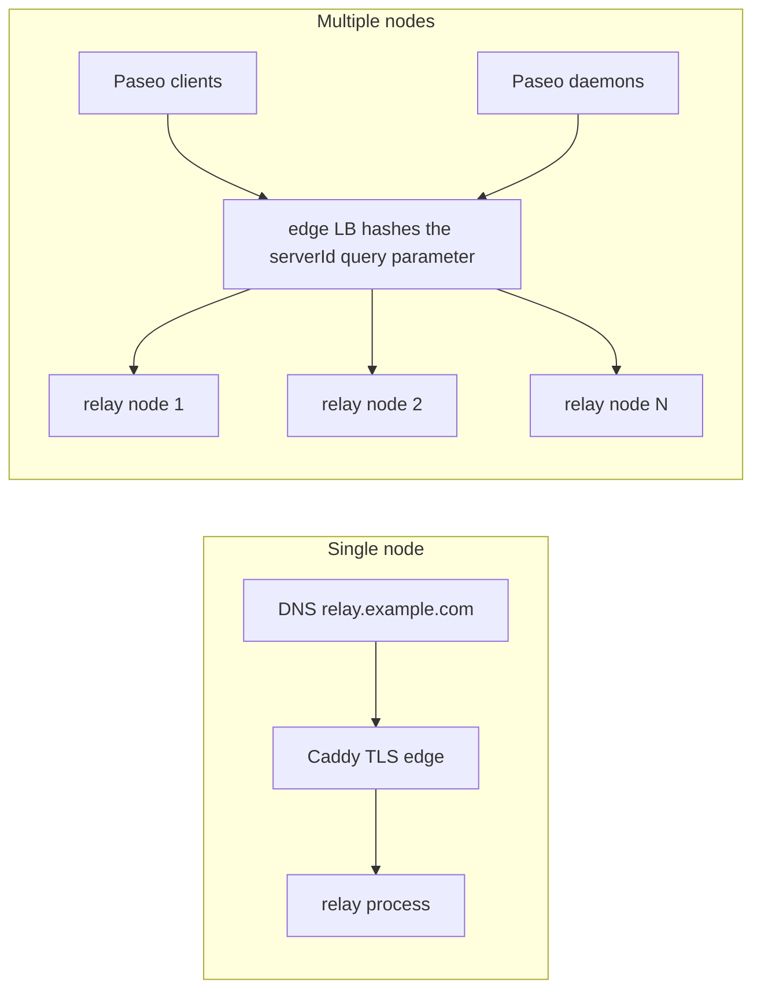

# Paseo Relay (Rust)

**English** | [简体中文](README.zh-CN.md)


[](https://github.com/kfxhjz/paseo-relay/actions/workflows/ci.yml)
[](https://github.com/kfxhjz/paseo-relay/actions/workflows/paseo-compat.yml)
[](LICENSE)
[](rust-toolchain.toml)
[](https://github.com/kfxhjz/paseo-relay/pkgs/container/paseo-relay)
[](https://github.com/kfxhjz/paseo-relay/releases)
[](https://github.com/kfxhjz/paseo-relay/stargazers)
[](https://securityscorecards.dev/viewer/?uri=github.com/kfxhjz/paseo-relay)

**Self-host Paseo's relay in five minutes.** A single-node, wire-compatible relay
written in Rust — one static musl binary in a `scratch`, non-root container; no
Erlang/OTP, no EPMD, no node cookie, no cluster. Paseo payloads are end-to-end
encrypted and forwarded opaquely.

**Docs:** [kfxhjz.github.io/paseo-relay](https://kfxhjz.github.io/paseo-relay/) ·
**Quickstart:** [five-minute VPS guide](docs/quickstart.md) ·
**中文:** [README.zh-CN.md](README.zh-CN.md)

## Start here

- **One VPS, one node (most users):** [Five-minute VPS quickstart](docs/quickstart.md)
  — Caddy automatic HTTPS + Docker Compose.
- **Multiple nodes / operators:** [Deployment guide](docs/deployment.md),
  including Nginx/HAProxy/Kubernetes and the `serverId` hashing requirement.
- **Just want to run it?** The 30-second quickstart below (foreground test and
  a detached deployment command).

## 30-second quickstart

Try the published multi-arch image in the foreground (no Rust toolchain needed):

```sh
# GHCR tags: v0.1.2 and latest
docker run --rm --read-only --cap-drop ALL \
  --security-opt no-new-privileges \
  -p 127.0.0.1:4000:4000 ghcr.io/kfxhjz/paseo-relay:v0.1.2

curl http://127.0.0.1:4000/health   # {"status":"ok"}
curl http://127.0.0.1:4000/ready    # {"status":"ready"}
```

For an actual deployment, run it detached with a restart policy (`--rm` and
`--restart` are mutually exclusive) and a stop timeout longer than the drain
grace window:

```sh
# Sized for ~512 MB; raise with RAM (see docs/deployment.md "Capacity sizing").
docker run -d \
  --name paseo-relay \
  --restart unless-stopped \
  --stop-timeout 30 \
  --read-only --cap-drop ALL \
  --security-opt no-new-privileges \
  -p 127.0.0.1:4000:4000 \
  -e PASEO_RELAY_MAX_CONNECTIONS=4000 \
  -e PASEO_RELAY_MAX_SESSIONS=4000 \
  -e PASEO_RELAY_MAX_TCP_CONNECTIONS=5000 \
  -e PASEO_RELAY_INGRESS_BUDGET_BYTES=135266304 \
  ghcr.io/kfxhjz/paseo-relay:v0.1.2
```

This keeps the relay on loopback. For public traffic terminate TLS in front of
it ([five-minute VPS quickstart](docs/quickstart.md)), or mount PEM files and
set `PASEO_RELAY_TLS_CERT` / `PASEO_RELAY_TLS_KEY`. `docker stop paseo-relay`
performs the graceful drain.

**Developers** — run from source or build the image locally (this is not the
default path for users):

```sh
cargo run                             # from source, listening on 127.0.0.1:4000
docker build -t paseo-relay .         # or build the image from source
docker run --rm --read-only --cap-drop ALL \
  --security-opt no-new-privileges \
  -p 127.0.0.1:4000:4000 paseo-relay
```

For anything public, put it behind TLS and an edge load balancer. See
[Deployment](#deployment).

**Who it's for:** self-hosters and small teams running a Paseo daemon who want a
small, auditable relay with a simple single-node failure model and no Erlang
operational surface. **Not for:** deployments that need built-in clustering,
ownership failover, or relay-level authentication (see [Limitations](#limitations-and-non-goals)).

Project status: `v0.1.2` — wire-compatible and already passing Paseo's own relay
transport E2E; interfaces may still evolve before `1.0`.

## Use it with Paseo

The Paseo daemon connects **outbound** to the relay; clients (including mobile)
meet it there. Configure the daemon with the relay endpoint and enable relay
pairing (these are Paseo daemon environment variables; you can also set them in
`config.json`):

```sh
export PASEO_RELAY_ENDPOINT=relay.example.com:443
export PASEO_RELAY_PUBLIC_ENDPOINT=relay.example.com:443
export PASEO_RELAY_USE_TLS=true
export PASEO_RELAY_PUBLIC_USE_TLS=true
export PASEO_RELAY_ENABLED=true
paseo daemon pair --relay
```

Set these in the environment of the **running daemon** (for example its
systemd/launchd/container environment) or in Paseo's `config.json`; setting them
only for a one-off `pair` command does not reconfigure a daemon that is already
running. Restart/reload the daemon as needed, then regenerate the pairing link.

Scan/open the pairing link with the Paseo app. The relay must be reachable by
the daemon and the mobile client; use `wss`/TLS for public deployments. The
pairing link/QR contains the daemon public key and `serverId` — treat it like a
password. Do not log query strings at the edge.

## Why Rust / why this relay

| | This relay | Elixir relay | Managed relay |
|---|---|---|---|
| Runtime | One static musl binary | BEAM release + Cowboy | Provider-specific |
| Erlang distribution / cookie / EPMD | none | yes (cluster mode) | n/a |
| Memory model | Explicit bounded budgets and queues; chunked payload accounting | BEAM + capacity ledger | provider |
| Multi-node | edge consistent hashing; no reroute/ownership | Syn ownership + 409 reroute | managed |
| Native TLS | rustls | terminate at edge | managed |
| Operations | SIGTERM drain, scratch non-root image, aggregate metrics | BEAM release | managed |

Choose this if you want a small, auditable, self-hosted relay with a simple
single-node failure model and no Erlang operational surface. Choose the managed
relay if you do not want to run/scale an edge with `serverId` affinity. Choose
the Elixir relay if you need its built-in cluster/ownership/reroute behavior.

## Features

- **Paseo v1/v2 protocol**: daemon/client pairing, v2 control `sync`/`connected`
  /`disconnected`, data sockets, replacement close `1008`, data/client close
  propagation, control ping/pong.
- **Opaque E2EE payloads**: no decryption, storage, or payload logging; the only
  inspection is a bounded `hello`/`e2ee_hello` key-hygiene check.
- **Bounded by default**: 20k WebSockets/sessions, weighted ingress budget
  charged chunk-by-chunk as payload arrives (at most one 8 KiB chunk per
  connection uncharged, plus per-chunk bookkeeping), a fixed 256-byte
  per-message overhead charged once, a per-connection in-flight cap, a
  1024-fragment message limit, bounded per-destination writer queues,
  frame/message read deadlines.
- **Fail closed**: explicit HTTP status or WebSocket close codes; no half-open
  state; invalid IDs are rejected with `400`.
- **Operations**: `/health`, `/ready`, `/metrics`, `/version`, structured text
  or JSON logs, graceful SIGTERM/SIGINT drain, built-in container healthcheck.
- **Security surface**: no Erlang distribution; optional native TLS; optional
  Origin allowlist; per-IP WebSocket cap; no IDs or payloads in logs.
- **No account, no telemetry, no outbound calls**: the relay only listens; there
  is no signup, analytics, or phone-home (Paseo pairing is end-to-end).
- **Deployment**: digest-pinned builder, multi-arch release workflow with
  per-platform provenance and SBOM attestations, scratch non-root runtime,
  read-only friendly.

## Architecture in one picture

```
client ──wss──┐
              ├── edge (TLS, per-IP limits, hash on serverId) ──► relay process
daemon ───────┘                                                   │
                                            ┌─────────────────────┴──────────────────┐
                                            │ hyper HTTP/1.1 + custom RFC 6455 codec │
                                            │  per-socket reader ──► session registry│
                                            │  per-socket writer ◄── bounded queues  │
                                            │  ingress budget / caps / metrics       │
                                            └────────────────────────────────────────┘
```

No payload crosses OTP distribution or a node-wide mailbox; there is no OTP.
The full design and invariants are in [DESIGN.md](DESIGN.md). Protocol details:
[docs/protocol.md](docs/protocol.md). Runtime settings:
[docs/configuration.md](docs/configuration.md).

## Compatibility

Wire-compatible with Paseo's relay transport for a single endpoint. **Verified
against Paseo v0.15.3 (`ea30d2616a6ea1ad51447cde6e2fc6da4904fe21`; also
reproduced at `f21699a37a3d49e8c61bd6d8b65f8a7070f0470c`):** Paseo's own `relay-transport.e2e.test.ts` run
against the Rust relay passed **9/9 runnable tests, 0 failed in two identical
runs** (2 tests skip in external-relay mode because they restart the relay). A manual
development-time wire probe also exercised v1 forwarding/replacement and v2
control/data/close behavior; the probe script and transcript are not committed,
so treat it as supplementary rather than reproducible evidence. The compatibility
badge reflects the latest scheduled/manual workflow run, not every commit; the
dated run summary is committed at
[docs/evidence/paseo-e2e-2026-11-07.md](docs/evidence/paseo-e2e-2026-11-07.md). See
[docs/compatibility.md](docs/compatibility.md) for the feature matrix, close
codes, and known differences from the Elixir relay.

> **Community implementation.** This project is not the managed relay behind
> `relay.paseo.sh:443`, is not affiliated with or endorsed by the Paseo project,
> and does not implement clustering/ownership failover. It is a self-hostable
> relay for Paseo v1/v2 sessions; multi-node affinity is provided by your edge
> (consistent hashing on `serverId`), not by the relay. See [Compatibility](#compatibility).

## Deployment

Release `v0.1.2` publishes a multi-arch (`linux/amd64`, `linux/arm64`) image to
GHCR with per-platform provenance and SBOM attestations (the multi-arch index
itself has no index-level attestation). Use the short version tag; the tag
includes the leading `v` (`0.1.2` without it is not published):

- **Image tag:** `ghcr.io/kfxhjz/paseo-relay:v0.1.2` (also tagged `latest`; only
  stable release tags move `latest`, so prerelease tags do not).

Inspect the published image with:

```sh
docker buildx imagetools inspect ghcr.io/kfxhjz/paseo-relay:v0.1.2
```

If your policy requires an immutable reference, pin the multi-arch index digest
for `v0.1.2` from the
[release notes](https://github.com/kfxhjz/paseo-relay/releases/tag/v0.1.2)
instead of the tag.

Both topologies use the same image; the edge in front of it does the routing
affinity:



Image contents are reproducible in spirit (pinned Rust toolchain, lockfile,
digest-pinned builder, SHA-pinned CI actions), not claimed bit-for-bit
reproducible across hosts.

- **Single node**: [docker-compose.yml](examples/docker-compose.yml) or
  `docker run`.
- **TLS**: terminate at the edge, or set `PASEO_RELAY_TLS_CERT` /
  `PASEO_RELAY_TLS_KEY` for native rustls TLS.
- **Multiple nodes**: required — an edge LB that hashes the `serverId` query
  parameter and uses `/ready` for backend health. Examples:
  [Nginx](examples/nginx.conf), [HAProxy](examples/haproxy.cfg),
  [Kubernetes](examples/kubernetes.yaml).
- **systemd**: [examples/paseo-relay.service](examples/paseo-relay.service).
- **Drain**: SIGTERM stops accepting, `/ready` flips to 503, existing sessions
  get the grace window, then close `1012`.

Full guide: [docs/deployment.md](docs/deployment.md). Do **not** use plain
round-robin/random load balancing for multiple relay nodes; a `serverId` split
across nodes will not pair. If you operate a public relay, read
[docs/operator-policy.md](docs/operator-policy.md) first.

## Operations and metrics

`/metrics` is aggregate-only Prometheus text (no `serverId` labels):
readiness/draining, active WebSockets/sessions, ingress reserved and budget
bytes, forwarded frames/bytes, slow consumers, delivery timeouts, rejections,
handshake outcomes, max frame, uptime, build info. See
[docs/operations.md](docs/operations.md),
[examples/prometheus.yml](examples/prometheus.yml), and
[examples/alerts.yml](examples/alerts.yml).

Keep `/metrics` and `/ready` on an internal network. The relay has no
authentication on ops endpoints.

## Memory model and abuse limits

Idle memory is dominated by accepted sockets, not by payload: hyper caps the
unauthenticated pre-upgrade request path (16 KiB buffers/headers, 64 headers),
but an idle socket still costs roughly 23 KiB when the relay is plaintext behind
an edge, or ~33 KiB with native TLS (rustls buffers). Plan for
`PASEO_RELAY_MAX_TCP_CONNECTIONS × ~30 KiB` (plaintext) or `× ~35 KiB` (native
TLS) at idle. The built-in 25,000 TCP / 20,000 WebSocket defaults need roughly
700–800 MiB plaintext, or ~850–900 MiB with native TLS, before any payload
traffic; a 512 MB host must lower the caps (the Compose examples use 5,000 /
4,000 / 4,000).

Payload accounting is incremental: a data-frame payload is charged in 8 KiB
chunks as bytes arrive as `chunk_bytes × weight + 192` weighted units (the 192
is per-chunk bookkeeping), the 256-byte per-message overhead is charged once per
message, one connection can hold at most `min(budget, 4 × one-max-message
charge)` of the weighted ingress budget, and one message may contain at most
1024 fragments. A stalled header therefore cannot reserve budget for a payload
it never sends, and the fragment cap bounds empty-fragment floods. Keep
`PASEO_RELAY_MAX_TCP_CONNECTIONS` above `MAX_CONNECTIONS` (at least 64–128
spare slots) so health/readiness probes still get a slot under a full WebSocket
load. See [docs/configuration.md](docs/configuration.md) and
[DESIGN.md](DESIGN.md) for the full limits.

## Benchmarks

Loopback sanity benchmark (Apple M3, 100 v1 pairs, 500 round trips, 1 KiB text,
release build, no TLS): **~41–45k round-trip msg/s, ~80–87 MiB/s both directions,
p50 ~2.2 ms, p99 ~3.3–3.6 ms, ~7.3 MiB RSS after load, ~31 ms startup**. This is not
a WAN or cross-implementation benchmark; reproduce with
`cargo run --release --example load` and read
[docs/benchmarks.md](docs/benchmarks.md) for method and caveats.

## Security model

The relay is **untrusted** by Paseo: E2EE protects content; the relay sees IPs,
timing, frame sizes, `serverId`/`connectionId`, and plaintext handshake public
keys. `serverId` is a bearer routing secret, not authentication. There is no
relay-level auth by design; deploy behind TLS and edge rate limits, keep IDs out
of logs, and treat pairing links as secrets. See [SECURITY.md](SECURITY.md) and [DESIGN.md](DESIGN.md).

## Limitations and non-goals

- **Single node**: no built-in clustering, ownership handoff, or 409 reroute;
  edge `serverId` affinity is required for multiple nodes.
- **No relay authentication**: availability attacks remain possible for anyone
  who learns a `serverId`; edge controls are the mitigation.
- **No payload inspection/decryption/storage/replay protection**: that is
  Paseo's E2EE responsibility.
- **No transparent session migration**: a node drain/replacement is a
  reconnect.
- **Per-IP limits are coarse**: default `0` because the documented topology uses
  an edge proxy; enable and size them for direct exposure.
- **Large in-flight messages**: a few maximum-size messages can consume the
  configured ingress budget (one connection is capped at `min(budget, 4 ×
  one-max-message charge)`); raise the budget or limit at the edge.
- **No per-user quotas or relay auth**: public operators must provide edge
  limits and a privacy/abuse policy; see [operator-policy.md](docs/operator-policy.md).
- **No third-party security audit**: the evidence here is code review,
  real-socket tests, fuzzing scaffolds, and the Paseo compatibility suite. Treat
  v0.1.2 as early software and review the threat model before relying on it.
- **Not proven at internet scale**: the included benchmark is loopback; run your
  own capacity tests and monitor before a large public deployment.

## Documentation

- [Documentation site](https://kfxhjz.github.io/paseo-relay/) — searchable docs, English + 中文
- [Documentation index](docs/README.md) — all guides, references, and operations docs
- [Discussions](https://github.com/kfxhjz/paseo-relay/discussions) — deployment Q&A, ideas, and Show and tell
- [Design](DESIGN.md) — architecture, invariants, failure semantics
- [Changelog](CHANGELOG.md) — release history
- [Chinese documentation](docs/zh-CN/README.md) — 中文文档索引
- [Contributing](CONTRIBUTING.md), [Security](SECURITY.md), [Support](SUPPORT.md)


## Development

```sh
cargo fmt --all --check
cargo clippy --all-targets -- -D warnings
cargo test --locked
cargo build --release --locked
scripts/ci.sh                 # local CI including a container smoke test
```

The toolchain is pinned in `rust-toolchain.toml` (Rust `1.99.1`). The suite has
85 unit tests plus 30 real-listener/real-WebSocket integration tests, with no
mocks. Contributions are welcome — see [CONTRIBUTING.md](CONTRIBUTING.md) and
[CODE_OF_CONDUCT.md](CODE_OF_CONDUCT.md). Security reports go through
[SECURITY.md](SECURITY.md), not public issues.

If this relay is useful to you, a star or a link in your Paseo setup notes helps
other self-hosters find it.

## License

Apache-2.0. See [LICENSE](LICENSE).
