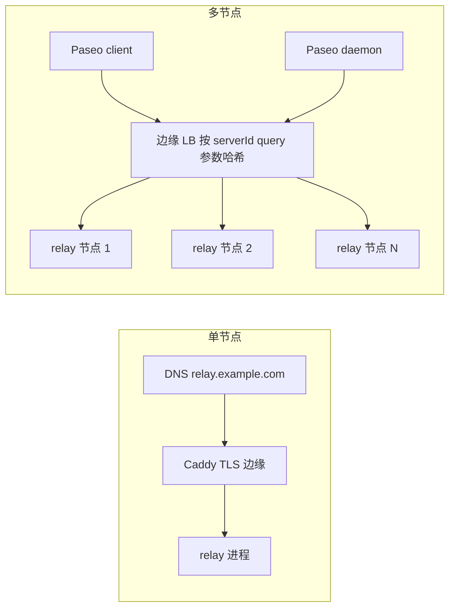

# Paseo Relay（Rust）

[English](README.md) | **简体中文**


[](https://github.com/kfxhjz/paseo-relay/actions/workflows/ci.yml)
[](https://github.com/kfxhjz/paseo-relay/actions/workflows/paseo-compat.yml)
[](LICENSE)
[](rust-toolchain.toml)
[](https://github.com/kfxhjz/paseo-relay/pkgs/container/paseo-relay)

一个用 Rust 编写的 **单节点、线协议兼容的 Paseo relay 替代实现**。整个服务是
`scratch` 镜像里的一个静态 musl 二进制，以非 root 用户运行：没有 Erlang/OTP，
没有 EPMD，没有 node cookie，也没有集群。Paseo 的 payload 端到端加密，relay
原样转发，不读取内容。

> **社区实现。** 本项目不是 `relay.paseo.sh:443` 背后的托管 relay，与 Paseo
> 项目没有隶属或背书关系，也不内置集群/ownership failover。它面向 Paseo v1/v2
> 会话的自托管；多节点亲和性由边缘代理完成（按 `serverId` 做一致性哈希），
> 而不是由 relay 自己完成。详见[兼容性](#兼容性)。

## 从哪里开始

- **一台 VPS、一个节点（大多数用户）**：[五分钟 VPS 快速部署](docs/zh-CN/quickstart.md)
  —— Caddy 自动 HTTPS + Docker Compose。
- **多节点/运营者**：[部署指南](docs/zh-CN/deployment.md)，包含 Nginx/HAProxy/
  Kubernetes 和 `serverId` 哈希要求。
- **只想跑起来？** 见下面的 30 秒快速开始（前台试跑 + 后台正式部署指令）。

## 30 秒快速开始

先在前台试跑已发布的多架构镜像（不需要 Rust 工具链）：

```sh
# GHCR tag：v0.1.2 和 latest
docker run --rm --read-only --cap-drop ALL \
  --security-opt no-new-privileges \
  -p 127.0.0.1:4000:4000 ghcr.io/kfxhjz/paseo-relay:v0.1.2

curl http://127.0.0.1:4000/health   # {"status":"ok"}
curl http://127.0.0.1:4000/ready    # {"status":"ready"}
```

正式部署时改为后台运行，并加重启策略（`--rm` 与 `--restart` 互斥）和比 drain
宽限期更长的 stop timeout：

```sh
# 按约 512 MB 主机设置；提高内存时一起调高（见 docs/zh-CN/deployment.md“容量规划”）。
docker run -d \
  --name paseo-relay \
  --restart unless-stopped \
  --stop-timeout 30 \
  --read-only --cap-drop ALL \
  --security-opt no-new-privileges \
  -p 127.0.0.1:4000:4000 \
  -e PASEO_RELAY_MAX_CONNECTIONS=4000 \
  -e PASEO_RELAY_MAX_SESSIONS=4000 \
  -e PASEO_RELAY_MAX_TCP_CONNECTIONS=5000 \
  -e PASEO_RELAY_INGRESS_BUDGET_BYTES=135266304 \
  ghcr.io/kfxhjz/paseo-relay:v0.1.2
```

这条命令只监听 loopback；公网流量请在前面终止 TLS
（[五分钟 VPS 快速部署](docs/zh-CN/quickstart.md)），或挂载 PEM 证书并设置
`PASEO_RELAY_TLS_CERT` / `PASEO_RELAY_TLS_KEY`。`docker stop paseo-relay`
会触发优雅 drain。

**开发者** —— 从源码运行，或在本地构建镜像（普通用户不需要走这条路径）：

```sh
cargo run                             # 从源码运行，监听 127.0.0.1:4000
docker build -t paseo-relay .         # 或在本地从源码构建镜像
docker run --rm --read-only --cap-drop ALL \
  --security-opt no-new-privileges \
  -p 127.0.0.1:4000:4000 paseo-relay
```

只要对公网开放，就应该放在 TLS 和边缘负载均衡之后。见[部署](#部署)。

**适合谁：** 运行 Paseo daemon 的自托管用户和小团队，希望 relay 体积小、可审计、
单节点故障模型简单，并且不想维护 Erlang 运行时。**不适合：** 需要内置集群、
ownership failover 或 relay 级认证的部署（见[限制与非目标](#限制与非目标)）。

项目状态：`v0.1.2` —— 已通过 Paseo 官方 relay 传输 E2E；`1.0` 之前接口仍可能演进。

## 与 Paseo 配合使用

Paseo daemon 会 **主动出站** 连接 relay；客户端（包括手机 App）也到这里会合。
在 daemon 上配置 relay endpoint 并开启 relay 配对（这些是 Paseo daemon 的环境变量，
也可以写入 `config.json`）：

```sh
export PASEO_RELAY_ENDPOINT=relay.example.com:443
export PASEO_RELAY_PUBLIC_ENDPOINT=relay.example.com:443
export PASEO_RELAY_USE_TLS=true
export PASEO_RELAY_PUBLIC_USE_TLS=true
export PASEO_RELAY_ENABLED=true
paseo daemon pair --relay
```

请在 **运行中的 daemon** 的环境里设置（例如 systemd/launchd/容器环境），或写入
Paseo 的 `config.json`；只给一次性的 `pair` 命令设置环境变量，不会改变已经在运行的
daemon。必要时重启/重载 daemon，然后重新生成配对链接。

用 Paseo App 扫描/打开配对链接。daemon 和手机客户端都必须能访问 relay；
公网部署请使用 `wss`/TLS。配对链接/二维码里包含 daemon 公钥和 `serverId`，
请当作密码对待；边缘代理不要记录 query string。

## 为什么用 Rust / 为什么选这个 relay

| | 本 relay | Elixir relay | 托管 relay |
|---|---|---|---|
| 运行时 | 一个静态 musl 二进制 | BEAM release + Cowboy | 由托管方决定 |
| Erlang distribution / cookie / EPMD | 无 | 有（集群模式） | 不适用 |
| 内存模型 | 显式有界预算和队列；payload 按 chunk 记账 | BEAM + capacity ledger | 由托管方决定 |
| 多节点 | 边缘按 `serverId` 一致性哈希；无 reroute/ownership | Syn ownership + 409 reroute | 托管方管理 |
| 原生 TLS | rustls | 通常在边缘终止 | 托管方管理 |
| 运维 | SIGTERM drain、scratch 非 root 镜像、聚合指标 | BEAM release | 托管方管理 |

如果你想要一个体积小、可审计、单节点故障模型简单、无需 Erlang 运维面的自托管
relay，选这个。如果你不想维护带 `serverId` 亲和性的边缘代理，选托管 relay。
如果你需要 Elixir relay 内置的集群/ownership/reroute，选 Elixir relay。

## 功能

- **Paseo v1/v2 协议**：daemon/client 配对，v2 control 的 `sync`/`connected`/
  `disconnected`、data socket、替换关闭 `1008`、data/client 断开传播、
  control ping/pong。
- **E2EE payload 不透明**：不解密、不落盘、不记录 payload；唯一的检查是有界的
  `hello`/`e2ee_hello` key 卫生检查。
- **默认有界**：2 万 WebSocket/session；payload 到达时按 8 KiB chunk 计入加权
  ingress 预算（每连接最多一个 8 KiB chunk 尚未计费，另有每 chunk 记账）；每消息
  固定 256 字节开销只计一次；每连接 in-flight 上限；每条消息最多 1024 个分片；
  每 destination writer 队列有界；帧/消息读取有 deadline。
- **Fail closed**：明确的 HTTP 状态码或 WebSocket close code；不留下半开状态；
  非法 ID 直接 `400`。
- **运维**：`/health`、`/ready`、`/metrics`、`/version`，文本或 JSON 结构化日志，
  SIGTERM/SIGINT 优雅 drain，内置容器 healthcheck。
- **安全面**：无 Erlang distribution；可选原生 TLS；可选 Origin allowlist；
  per-IP WebSocket 上限；日志不记录 ID/payload。
- **无账号、无遥测、无外呼**：relay 只监听，不注册、不统计、不 phone-home
  （Paseo 配对是端到端的）。
- **部署**：固定 digest 的 builder、多架构发布工作流（每个平台独立的
  provenance 和 SBOM attestation）、scratch 非 root 运行时、read-only 友好。

## 一图看懂架构

```
client ──wss──┐
              ├── edge (TLS, per-IP limits, hash on serverId) ──► relay process
daemon ───────┘                                                   │
                                            ┌─────────────────────┴──────────────────┐
                                            │ hyper HTTP/1.1 + custom RFC 6455 codec │
                                            │  per-socket reader ──► session registry│
                                            │  per-socket writer ◄── bounded queues  │
                                            │  ingress budget / caps / metrics       │
                                            └────────────────────────────────────────┘
```

payload 不经过 OTP distribution，也不经过节点级 mailbox；整个服务没有 OTP。
完整中文设计见 [DESIGN.zh-CN.md](DESIGN.zh-CN.md)（英文规范 [DESIGN.md（英文）](DESIGN.md)）；协议细节见
[docs/zh-CN/protocol.md](docs/zh-CN/protocol.md)；运行时配置见
[docs/zh-CN/configuration.md](docs/zh-CN/configuration.md)。

## 兼容性

与 Paseo relay 传输层在单 endpoint 上 **线协议兼容**。**已在 Paseo v0.15.3
（`ea30d2616a6ea1ad51447cde6e2fc6da4904fe21`；也在 `f21699a37a3d49e8c61bd6d8b65f8a7070f0470c` 上复现）上验证**：
Paseo 自带的 `relay-transport.e2e.test.ts` 对 Rust relay 运行 **9/9 可运行用例通过，
两次运行均 0 failed**（2 个用例在 external-relay 模式下因需要重启 relay 而跳过）。
开发期另做过手动 wire probe，覆盖 v1 转发/替换以及 v2 control/data/close 行为；
probe 脚本和输出未提交，因此只作为补充材料，不是可复现证据。
兼容性 badge 反映最近一次计划/手动工作流，而不是每个 commit；带日期的运行摘要提交在
[docs/zh-CN/evidence/paseo-e2e-2026-11-07.md](docs/zh-CN/evidence/paseo-e2e-2026-11-07.md)。
完整特性矩阵、close code 和与 Elixir relay 的已知差异见
[docs/zh-CN/compatibility.md](docs/zh-CN/compatibility.md)。

## 部署

发布 `v0.1.2` 会把多架构（`linux/amd64`、`linux/arm64`）镜像发布到 GHCR，
附带 **每个平台独立** 的 provenance 和 SBOM attestation（多架构 index 本身没有
index 级 attestation）。直接用短版本 tag 即可；tag 带前导 `v`（不带 `v` 的
`0.1.2` 没有发布）：

- **镜像 tag：** `ghcr.io/kfxhjz/paseo-relay:v0.1.2`（同时打 `latest`；只有
  stable release tag 会移动 `latest`，预发布 tag 不会）。

可以用以下命令检查已发布镜像：

```sh
docker buildx imagetools inspect ghcr.io/kfxhjz/paseo-relay:v0.1.2
```

如果部署策略要求不可变引用，请改用 [release notes](https://github.com/kfxhjz/paseo-relay/releases/tag/v0.1.2)
中 `v0.1.2` 对应的多架构 index digest，而不是 tag。

两种拓扑使用同一个镜像；区别在于前置的边缘如何做路由亲和：



镜像在供应链意义上可复现（固定 Rust 工具链、lockfile、digest-pinned builder、
SHA-pinned CI actions），不宣称跨主机 bit-for-bit 完全一致。

- **单节点**：[docker-compose.yml](examples/docker-compose.yml) 或 `docker run`。
- **TLS**：在边缘终止，或配置 `PASEO_RELAY_TLS_CERT` / `PASEO_RELAY_TLS_KEY`
  使用原生 rustls TLS。
- **多节点**：必须使用按 `serverId` query 参数做一致性哈希、并用 `/ready`
  做后端健康检查的边缘 LB。示例：
  [Nginx](examples/nginx.conf)、[HAProxy](examples/haproxy.cfg)、
  [Kubernetes](examples/kubernetes.yaml)。
- **systemd**：[examples/paseo-relay.service](examples/paseo-relay.service)。
- **Drain**：SIGTERM 后停止 accept，`/ready` 变 503，现有会话获得 grace window，
  然后以 `1012` 关闭。

完整指南：[docs/zh-CN/deployment.md](docs/zh-CN/deployment.md)。多节点时
**不要**使用普通 round-robin/随机负载均衡；同一个 `serverId` 被分到两个节点后
无法配对。如果要运营公共 relay，请先读
[docs/zh-CN/operator-policy.md](docs/zh-CN/operator-policy.md)。

## 运维与指标

`/metrics` 是只含聚合值的 Prometheus 文本（没有 `serverId` label）：readiness/
draining、活跃 WebSocket/session、ingress 已预留/预算字节、转发帧/字节、slow
consumer、delivery timeout、拒绝数、handshake 结果、最大帧、uptime、build info。见
[docs/zh-CN/operations.md](docs/zh-CN/operations.md)、
[examples/prometheus.yml](examples/prometheus.yml)、
[examples/alerts.yml](examples/alerts.yml)。

请把 `/metrics` 和 `/ready` 放在内网。relay 的运维端点没有认证。

## 内存模型与滥用上限

idle 内存主要由已接受 socket 决定，而不是 payload：hyper 限制了未认证的 upgrade 前
请求路径（缓冲/header 16 KiB、64 个 header），但 relay 在边缘后为明文时一个 idle
socket 仍约占 23 KiB，原生 TLS（rustls 缓冲）时约 33 KiB。idle 规划按
`PASEO_RELAY_MAX_TCP_CONNECTIONS × ~30 KiB`（明文）或 `× ~35 KiB`（原生 TLS）。
内置 25,000 TCP / 20,000 WebSocket 默认值在没有任何 payload 流量前就需要约
700–800 MiB（明文）或约 850–900 MiB（原生 TLS）；512 MB 主机必须调低上限
（Compose 示例使用 5,000 / 4,000 / 4,000）。

payload 记账是增量的：data frame payload 按 8 KiB chunk 在字节到达时按
`chunk_bytes × weight + 192` 加权单位计费（192 为每 chunk 记账），每消息固定
256 字节开销只计一次，单个连接最多持有
`min(budget, 4 × 一条最大消息的计费)` 的加权 ingress 预算，一条消息最多 1024 个
分片。因此停滞 header 无法为它从未发送的 payload 预留预算，分片上限也限制了空分片
洪泛。让 `PASEO_RELAY_MAX_TCP_CONNECTIONS` 高于 `MAX_CONNECTIONS`（至少 64–128 个
空槽），保证满 WebSocket 负载下健康/readiness 探针仍能拿到 slot。完整限制见
[docs/zh-CN/configuration.md](docs/zh-CN/configuration.md) 和
[DESIGN.zh-CN.md](DESIGN.zh-CN.md)。

## 性能基准

Loopback  sanity benchmark（Apple M3，100 个 v1 pair，每对 500 次往返，1 KiB 文本，
release 构建，无 TLS）：**约 41–45k 往返 msg/s，双向约 80–87 MiB/s，p50 约 2.2 ms，
p99 约 3.3–3.6 ms，load 后 RSS 约 7.3 MiB，启动约 31 ms**。这不是 WAN 或跨实现
对比；可用 `cargo run --release --example load` 复现，方法与注意事项见
[docs/zh-CN/benchmarks.md](docs/zh-CN/benchmarks.md)。

## 安全模型

Paseo 把 relay 当作 **不可信** 组件：内容由 E2EE 保护；relay 能看到 IP、时序、
帧大小、`serverId`/`connectionId`，以及明文握手中的公钥。`serverId` 是 bearer
路由秘密，不是认证凭证。relay 按设计不做认证；请放在 TLS 与边缘限流之后，
不要把 ID 写进日志，并把配对链接当作秘密。见 [SECURITY.zh-CN.md](SECURITY.zh-CN.md) 和 [DESIGN.zh-CN.md](DESIGN.zh-CN.md)。

## 限制与非目标

- **单节点**：没有内置集群、ownership handoff 或 409 reroute；多节点必须依赖
  边缘对 `serverId` 的亲和性。
- **没有 relay 认证**：知道 `serverId` 的人仍可做可用性攻击；缓解手段在边缘。
- **不检查/解密/存储 payload，也不提供重放保护**：这些是 Paseo E2EE 的职责。
- **没有透明会话迁移**：节点 drain/替换对客户端来说是一次重连。
- **per-IP 限制较粗**：默认 `0`，因为文档推荐拓扑使用边缘代理；直连部署时再启用
  并按用户规模设置。
- **大消息占用预算**：少数最大消息可能吃掉配置的 ingress 预算（单连接上限为
  `min(budget, 4 × 一条最大消息的计费)`）；可以提高预算或在边缘限流。
- **没有 per-user 配额/relay 认证**：公共运营者必须在边缘做限制并提供隐私/滥用
  政策；见 [operator-policy.md](docs/zh-CN/operator-policy.md)。
- **没有第三方安全审计**：这里的证据是代码评审、真实 socket 测试、fuzz scaffold
  和 Paseo 兼容性套件。v0.1.2 是早期软件，依赖前请先阅读威胁模型。
- **尚未在互联网规模验证**：仓库 benchmark 是 loopback；大规模公开部署前请自己
  做容量测试并持续监控。

## 文档

- [中文文档索引](docs/zh-CN/README.md) — 全部中文指南、参考和运维文档
- [完整设计（中文）](DESIGN.zh-CN.md) / [English design](DESIGN.md)
- [English documentation index](docs/README.md) — 英文规范文档
- [变更日志](CHANGELOG.md)
- [贡献指南](CONTRIBUTING.zh-CN.md)、[安全策略](SECURITY.zh-CN.md)、[支持渠道](SUPPORT.zh-CN.md)


## 开发

```sh
cargo fmt --all --check
cargo clippy --all-targets -- -D warnings
cargo test --locked
cargo build --release --locked
scripts/ci.sh                 # 本地 CI，包含容器 smoke test
```

工具链固定在 `rust-toolchain.toml`（Rust `1.99.1`）。测试套件有 85 个单元测试 +
30 个真实 listener/真实 WebSocket 集成测试，没有 mock。欢迎贡献，见
[CONTRIBUTING.zh-CN.md](CONTRIBUTING.zh-CN.md) 和
[CODE_OF_CONDUCT.zh-CN.md](CODE_OF_CONDUCT.zh-CN.md)。安全问题请走
[SECURITY.zh-CN.md](SECURITY.zh-CN.md)，不要开公开 issue。

如果这个 relay 对你有用，欢迎点一个 star，或在你的 Paseo 配置笔记里加上链接，
让更多中文用户/自托管用户找到它。也欢迎在 Paseo 中文社区、V2EX、即刻、X 等平台
分享你的部署经验（请附上 release digest 和实际压测数据）。

## 许可证

Apache-2.0。见 [LICENSE](LICENSE)。
