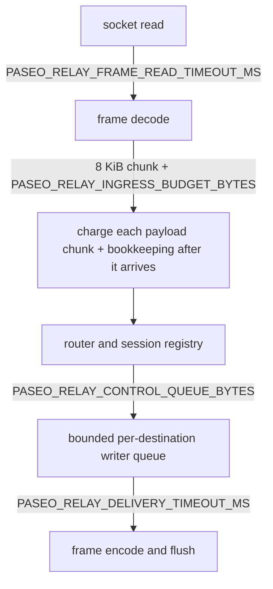

# Configuration

**English** | [简体中文](zh-CN/configuration.md)

The relay reads configuration only from environment variables. Values are
validated at startup; an invalid value (including an invalid
`PASEO_RELAY_LOG` filter) aborts startup with an explanatory error. Use
`paseo-relay --check-config` to validate a deployment environment, including
that the TLS certificate/key files are regular, readable files for the relay
user, and `paseo-relay --dump-config` to print the effective settings (no
secrets).

## Runtime contract

| Variable | Default | Meaning |
|---|---|---|
| `PASEO_RELAY_HOST` | `127.0.0.1` | Listener IP. The container image sets `0.0.0.0`. |
| `PASEO_RELAY_PORT` | `4000` | Listener port for HTTP, WebSocket, and ops endpoints. |
| `PASEO_RELAY_DRAIN` | `false` | Start already draining: `/ready` returns 503 and new `/ws` upgrades are rejected. SIGTERM/SIGINT always trigger a drain. |
| `PASEO_RELAY_MAX_CONNECTIONS` | `20000` | Maximum open WebSockets. Must be `<= PASEO_RELAY_MAX_TCP_CONNECTIONS`; keep `PASEO_RELAY_MAX_TCP_CONNECTIONS` above it (see below). |
| `PASEO_RELAY_MAX_TCP_CONNECTIONS` | `25000` | Maximum open OS sockets, including pre-upgrade HTTP and upgraded WebSockets. A slot is held for the whole socket lifetime, so keep this above `PASEO_RELAY_MAX_CONNECTIONS` (at least 64–128 spare slots, more for probe bursts) or a full WebSocket load rejects `/health`, `/ready`, `/metrics`, and probes at accept. |
| `PASEO_RELAY_MAX_SESSIONS` | `20000` | Maximum live `serverId` sessions. |
| `PASEO_RELAY_MAX_CLIENTS_PER_CONNECTION` | `32` | Maximum v2 client sockets per `connectionId`. |
| `PASEO_RELAY_INGRESS_BUDGET_BYTES` | `536870912` | Node-wide weighted budget for in-flight payload bytes. Must admit one maximum message including the 256-byte per-message overhead and per-chunk bookkeeping (192 weighted units per 8 KiB chunk, including the 1024-fragment worst case); use `--check-config` for the exact floor. The 129 MiB Compose budget (135,266,304) still passes with ~64.6 KB headroom. One connection can hold at most `min(budget, 4 × one-max-message charge)`. |
| `PASEO_RELAY_INGRESS_WEIGHT` | `4` | Memory weight charged per payload byte, plus a fixed 256-byte per-message overhead. Range `4..=16`; the minimum `4` covers the 2× transient copy safety margin. |
| `PASEO_RELAY_INGRESS_WAIT_TIMEOUT_MS` | `5000` | Maximum wait for a budget reservation before the source is closed `1013`. The effective wait is `min(this, remaining FRAME_READ_TIMEOUT_MS/MESSAGE_READ_TIMEOUT_MS)`; budget exhaustion and a read timeout both close `1013`. |
| `PASEO_RELAY_MAX_MESSAGE_BYTES` | `33554418` | Maximum data frame / reassembled message payload (`32 MiB - 14`). |
| `PASEO_RELAY_FRAME_READ_TIMEOUT_MS` | `300000` | Maximum time to receive one frame payload after its header; stalled payloads close `1013`. |
| `PASEO_RELAY_MESSAGE_READ_TIMEOUT_MS` | `600000` | Maximum time to assemble one fragmented message, measured from the first fragment header; exceeding it closes `1013`. |
| `PASEO_RELAY_DATA_ATTACH_TIMEOUT_MS` | `15000` | Maximum time a v2 client frame waits for its daemon data socket. |
| `PASEO_RELAY_DELIVERY_TIMEOUT_MS` | `30000` | Maximum wait for a destination writer permission/write; slow destinations are shed `1013`. |
| `PASEO_RELAY_CONTROL_QUEUE_BYTES` | `1048576` | Per-destination writer queue floor in bytes. The effective queue is at least `MAX_MESSAGE_BYTES + 64 KiB`. |
| `PASEO_RELAY_CONTROL_NUDGE_MS` | `10000` | While a v2 client waits for data, re-send `sync` to control after this delay. |
| `PASEO_RELAY_CONTROL_UNRESPONSIVE_MS` | `15000` | Close a still-unresponsive control socket with `1011` after this delay. Must be greater than the nudge delay. |
| `PASEO_RELAY_SESSION_IDLE_MS` | `30000` | Idle time before an empty session is swept. |
| `PASEO_RELAY_PER_IP_MAX_CONNECTIONS` | `0` | Open WebSocket cap per peer IP; `0` = unlimited. Set ~`256` for direct exposure; behind an LB leave `0` and limit at the edge. |
| `PASEO_RELAY_SHUTDOWN_GRACE_MS` | `10000` | Grace window after SIGTERM/SIGINT before sockets are closed `1012`. |
| `PASEO_RELAY_TCP_KEEPALIVE_MS` | `60000` | TCP keepalive idle time for accepted sockets; `0` disables it. |
| `PASEO_RELAY_HTTP_HEADER_TIMEOUT_MS` | `15000` | Maximum time to read HTTP headers (slowloris guard). |
| `PASEO_RELAY_TLS_CERT` | unset | Path to a PEM certificate chain. Must be set together with `PASEO_RELAY_TLS_KEY`. |
| `PASEO_RELAY_TLS_KEY` | unset | Path to the PEM private key. Both unset = plaintext (terminate TLS at the edge). |
| `PASEO_RELAY_ALLOWED_ORIGINS` | unset | Comma-separated exact `Origin` allowlist for `/ws`; empty = allow any. Requests without Origin (native clients) are allowed; an Origin header that is present but cannot be parsed is rejected with `403`. |
| `PASEO_RELAY_LOG` | `info` | `tracing` `EnvFilter` directive, e.g. `info`, `paseo_relay=debug`. Validated at startup; an invalid directive aborts startup. |
| `PASEO_RELAY_LOG_FORMAT` | `text` | `text` or `json` structured logs. |
| `PASEO_RELAY_HEALTHCHECK_HOST` | `127.0.0.1` | Host used by the `paseo-relay healthcheck` self-probe. |
| `PASEO_RELAY_BUILD_REVISION` | build-derived | Build-time revision embedded in `/version` and metrics; overrides the git-derived value. |

## Ingress budget and bounded queues

Every stage in the forwarding path is bounded. The node-wide weighted ingress
budget is charged **as payload bytes arrive**, not as one reservation for a
declared frame length:



A data-frame payload is read in 8 KiB chunks and each chunk is charged after it
arrives as `chunk_bytes × INGRESS_WEIGHT + 192` weighted units (the 192 is
per-chunk bookkeeping for the budget guard and vector slack), so at most one
8 KiB chunk per connection is allocated before it is accounted. The fixed
256-byte per-message overhead is charged **once per message**
(`256 × INGRESS_WEIGHT`), not per fragment. A per-connection in-flight cap of
`min(PASEO_RELAY_INGRESS_BUDGET_BYTES, 4 × one-max-message charge)` bounds how
much of the weighted budget one connection can hold (the 4× factor covers the
reader's pipelining of up to four messages). A message may contain at most
1024 fragments (fixed policy, not configurable); exceeding it closes the source
with `1002`.

If a source cannot reserve within
`min(PASEO_RELAY_INGRESS_WAIT_TIMEOUT_MS, remaining frame/message read
deadline)`, it is closed with `1013`; a destination whose writer queue or write
exceeds `PASEO_RELAY_DELIVERY_TIMEOUT_MS` is shed with `1013`. A frame/message
read timeout also closes the source with `1013`; the budget wait can never
extend the read deadline. Session and socket counts are bounded separately by
`PASEO_RELAY_MAX_SESSIONS` and `PASEO_RELAY_MAX_CONNECTIONS`.

## Memory sizing (pre-upgrade HTTP and idle sockets)

The hyper HTTP/1.1 builder bounds the unauthenticated pre-upgrade request path:
`max_buf_size` 16 KiB, `max_header_size` 16 KiB, and `max_headers` 64;
`PASEO_RELAY_HTTP_HEADER_TIMEOUT_MS` still bounds the header phase. An idle
accepted socket still costs roughly 23 KiB when the relay is plaintext behind an
edge, or ~33 KiB with native TLS (rustls buffers). Plan for:

```text
PASEO_RELAY_MAX_TCP_CONNECTIONS × ~30 KiB ≈ idle memory (plaintext)
PASEO_RELAY_MAX_TCP_CONNECTIONS × ~35 KiB ≈ idle memory (native TLS)
```

The built-in defaults (25,000 TCP / 20,000 WebSocket) therefore need roughly
700–800 MiB plaintext, or ~850–900 MiB with native TLS, before any payload
traffic: a 512 MB host must lower `PASEO_RELAY_MAX_TCP_CONNECTIONS`,
`PASEO_RELAY_MAX_CONNECTIONS`, and `PASEO_RELAY_MAX_SESSIONS` (the Compose
examples use 5,000 / 4,000 / 4,000).
The TCP slot is held for the whole socket lifetime, including upgraded
WebSockets, so `PASEO_RELAY_MAX_TCP_CONNECTIONS` is the documented total
OS-socket cap and `MAX_CONNECTIONS <= MAX_TCP_CONNECTIONS` stays meaningful.

## CLI

```text
paseo-relay                      # run
paseo-relay --help               # usage
paseo-relay --version            # version + build revision
paseo-relay --check-config       # validate environment and TLS files (regular, readable), exit 0/1
paseo-relay --dump-config        # print effective configuration
paseo-relay healthcheck          # container self-probe (TLS-aware)
```

The service itself has no command-line configuration; use environment
variables so the same contract works with Docker, Kubernetes, systemd, and
release images.

## Example minimal deployment

```sh
PASEO_RELAY_HOST=127.0.0.1 \
PASEO_RELAY_PORT=4000 \
PASEO_RELAY_LOG_FORMAT=json \
PASEO_RELAY_TLS_CERT=/tls/cert.pem \
PASEO_RELAY_TLS_KEY=/tls/key.pem \
./paseo-relay
```
