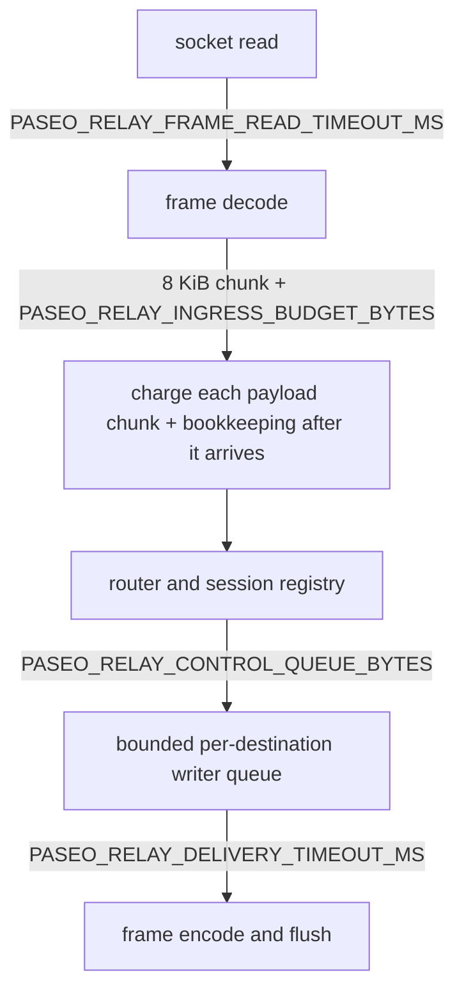

# Configuration

**English** | [简体中文](zh-CN/configuration.md)

The relay reads configuration only from environment variables. Values are
validated at startup; an invalid value (including an invalid
`PASEO_RELAY_LOG` filter) aborts startup with an explanatory error. Use
`paseo-relay --check-config` to validate a deployment environment, including
that the TLS certificate/key files are regular, readable files for the relay
user, and `paseo-relay --dump-config` to print the effective settings (no
secrets).

Because configuration is environment-only, a misspelled variable name would
otherwise be ignored silently. The relay therefore warns at startup, and
`--check-config` prints the same warnings, about any `PASEO_RELAY_*` variable
it does not know; see [Startup warnings](#startup-warnings).

## Runtime contract

| Variable | Default | Meaning |
|---|---|---|
| `PASEO_RELAY_HOST` | `127.0.0.1` | Listener IP. The container image sets `0.0.0.0`. |
| `PASEO_RELAY_PORT` | `4000` | Listener port for `/ws` and `/health`, and for the operations endpoints unless `PASEO_RELAY_OPS_PORT` moves them. |
| `PASEO_RELAY_OPS_HOST` | `127.0.0.1` | Listener IP of the operations listener; used only when `PASEO_RELAY_OPS_PORT` is set. The default is reachable only from the same host or container. Use a private address (or `0.0.0.0` inside a pod/container that does not publish the port) so probes and Prometheus can reach it. |
| `PASEO_RELAY_OPS_PORT` | unset | When set, `/ready`, `/metrics` and `/version` are served **only** on this plaintext listener (together with `/health`), and `PASEO_RELAY_PORT` keeps only `/ws` and `/health`. The listener has its own allowance of 64 connections, so probes and scrapes keep working when the public listener is at its TCP cap, and `paseo-relay healthcheck` uses it automatically. Unset = everything on `PASEO_RELAY_PORT`. |
| `PASEO_RELAY_DRAIN` | `false` | Start already draining: `/ready` returns 503 and new `/ws` upgrades are rejected. SIGTERM/SIGINT always trigger a drain. |
| `PASEO_RELAY_MAX_CONNECTIONS` | `20000` | Maximum open WebSockets. Must be `<= PASEO_RELAY_MAX_TCP_CONNECTIONS`; keep `PASEO_RELAY_MAX_TCP_CONNECTIONS` above it (see below). |
| `PASEO_RELAY_MAX_TCP_CONNECTIONS` | `25000` | Maximum open OS sockets, including pre-upgrade HTTP and upgraded WebSockets. A slot is held for the whole socket lifetime, so keep this above `PASEO_RELAY_MAX_CONNECTIONS` (at least 64–128 spare slots, more for probe bursts) or a full WebSocket load rejects `/health`, `/ready`, `/metrics`, and probes at accept. |
| `PASEO_RELAY_MAX_SESSIONS` | `20000` | Maximum live `serverId` sessions. |
| `PASEO_RELAY_MAX_CONNECTIONS_PER_SESSION` | `512` | Maximum distinct v2 `connectionId`s per `serverId` session. Excess connections close with `1013` "Relay session connection capacity". |
| `PASEO_RELAY_MAX_CLIENTS_PER_CONNECTION` | `32` | Maximum v2 client sockets per `connectionId`. |
| `PASEO_RELAY_INGRESS_BUDGET_BYTES` | `536870912` | Node-wide weighted budget for in-flight payload bytes. Must admit one maximum message including the 256-byte per-message overhead and per-chunk bookkeeping (192 weighted units per 8 KiB chunk, including the 1024-fragment worst case); use `--check-config` for the exact floor. The 129 MiB Compose budget (135,266,304) still passes with ~64.6 KB headroom. One connection can hold at most `min(budget, 4 × one-max-message charge)`. |
| `PASEO_RELAY_INGRESS_SMALL_RESERVE_BYTES` | `16777216` | Extra weighted budget, on top of `PASEO_RELAY_INGRESS_BUDGET_BYTES`, that only messages of at most 64 KiB may use, so handshakes and ordinary small frames keep flowing while large transfers fill the main budget. `0` disables it; otherwise it must admit one 64 KiB message (461,312 at the default weight). |
| `PASEO_RELAY_INGRESS_RECLAIM_MIN_RATE_BYTES` | `65536` | While another source is waiting for budget, an unfinished message that received at most this many payload bytes per second over its last one to two seconds is closed first to free its reservation. `0` limits this to messages that received nothing at all. |
| `PASEO_RELAY_INGRESS_RECLAIM_AFTER_MS` | `60000` | While another source is waiting for budget, an unfinished message that has been arriving for longer than this gives way to a newer one. `0` disables the rule; otherwise at least `5000`. |
| `PASEO_RELAY_INGRESS_WEIGHT` | `4` | Memory weight charged per payload byte, plus a fixed 256-byte per-message overhead. Range `4..=16`; the minimum `4` covers the 2× transient copy safety margin. |
| `PASEO_RELAY_INGRESS_WAIT_TIMEOUT_MS` | `5000` | Maximum wait for a budget reservation before the source is closed `1013`. While a source waits, the relay reclaims budget from stalled, slow, or long-running unfinished messages of other connections (see [When the budget is full](#when-the-budget-is-full)). The effective wait is `min(this, remaining FRAME_READ_TIMEOUT_MS/MESSAGE_READ_TIMEOUT_MS)`; budget exhaustion and a read timeout both close `1013`. |
| `PASEO_RELAY_MAX_MESSAGE_BYTES` | `33554418` | Maximum data frame / reassembled message payload (`32 MiB - 14`). |
| `PASEO_RELAY_FRAME_READ_TIMEOUT_MS` | `300000` | Maximum time to receive one frame payload after its header; stalled payloads close `1013`. |
| `PASEO_RELAY_MESSAGE_READ_TIMEOUT_MS` | `600000` | Maximum time to assemble one fragmented message, measured from the first fragment header; exceeding it closes `1013`. |
| `PASEO_RELAY_READ_STALL_TIMEOUT_MS` | `30000` | Maximum time an unfinished message may go without at least 8 KiB of payload progress (or finishing the message). A message that stalls—including one sending pings or tiny 0-/1-byte continuation frames—is closed `1013` after this long instead of holding its reservation until the frame/message deadline. |
| `PASEO_RELAY_WS_IDLE_TIMEOUT_MS` | `0` | Close a WebSocket (`1013` "Idle timeout") after this long with no frame received from it and no data frame relayed to it. `0` (the default) never closes idle sockets; otherwise at least `1000`. Any frame, including a ping, counts as activity. Upstream Paseo (checked at v0.15.3) pings the v2 control socket every 10 s and clients send a heartbeat every 10 s, so a value of a few minutes (for example `300000`) removes only dead or abandoned sockets; a socket that is silent in both directions for the whole period is closed and is expected to reconnect. |
| `PASEO_RELAY_DATA_ATTACH_TIMEOUT_MS` | `15000` | Maximum time a v2 client frame waits for its daemon data socket. |
| `PASEO_RELAY_DELIVERY_TIMEOUT_MS` | `30000` | Maximum wait for a destination writer permission/write; slow destinations are shed `1013`. |
| `PASEO_RELAY_CONTROL_QUEUE_BYTES` | `1048576` | Per-destination writer queue floor in bytes. The effective queue is at least `MAX_MESSAGE_BYTES + 64 KiB`. |
| `PASEO_RELAY_CONTROL_NUDGE_MS` | `10000` | While a v2 client waits for data, re-send `sync` to control after this delay. |
| `PASEO_RELAY_CONTROL_UNRESPONSIVE_MS` | `15000` | Close a still-unresponsive control socket with `1011` after this delay. Must be greater than the nudge delay. |
| `PASEO_RELAY_SESSION_IDLE_MS` | `30000` | Age at which the periodic safety-net sweep removes an empty session. A session is normally removed as soon as its last socket closes, so this rarely applies. |
| `PASEO_RELAY_PER_IP_MAX_CONNECTIONS` | `0` | Open WebSocket cap per client; `0` = unlimited. When set, it also caps a client's open TCP sockets (pre-upgrade HTTP included) at this value plus a quarter (at least 8 more). IPv6 clients are counted per /64 and IPv4-mapped addresses as IPv4. Set ~`256` for direct exposure; behind an LB leave `0` and limit at the edge. |
| `PASEO_RELAY_SHUTDOWN_GRACE_MS` | `10000` | Grace window after SIGTERM/SIGINT before sockets are closed `1012`. |
| `PASEO_RELAY_TCP_KEEPALIVE_MS` | `60000` | TCP keepalive idle time for accepted sockets; `0` disables it. |
| `PASEO_RELAY_HTTP_HEADER_TIMEOUT_MS` | `15000` | Maximum time to read HTTP headers (slowloris guard) and to flush stalled pre-upgrade HTTP responses. |
| `PASEO_RELAY_TLS_CERT` | unset | Path to a PEM certificate chain. Must be set together with `PASEO_RELAY_TLS_KEY`. Re-read on `SIGHUP` and when the files change; see [Signals](#signals). |
| `PASEO_RELAY_TLS_KEY` | unset | Path to the PEM private key. Both unset = plaintext (terminate TLS at the edge). |
| `PASEO_RELAY_ALLOWED_ORIGINS` | unset | Comma-separated exact `Origin` allowlist for `/ws`; empty = allow any. Requests without Origin (native clients) are allowed; duplicate or unparseable `Origin` headers are rejected with `403`. |
| `PASEO_RELAY_LOG` | `info` | `tracing` `EnvFilter` directive, e.g. `info`, `paseo_relay=debug`. Validated at startup; an invalid directive aborts startup. |
| `PASEO_RELAY_LOG_FORMAT` | `text` | `text` or `json` structured logs. |
| `PASEO_RELAY_HEALTHCHECK_HOST` | listener host / `127.0.0.1` | Host override for the `paseo-relay healthcheck` self-probe. When unset, follows `PASEO_RELAY_OPS_HOST` (if `PASEO_RELAY_OPS_PORT` is set) or `PASEO_RELAY_HOST` when bound to a specific IP, falling back to `127.0.0.1` (or `::1` for `::`) on wildcard binds. |
| `PASEO_RELAY_BUILD_REVISION` | build-derived | Build-time revision embedded in `/version` and metrics; overrides the git-derived value. |

**Added in `v0.1.3`:** `PASEO_RELAY_OPS_HOST`, `PASEO_RELAY_OPS_PORT`,
`PASEO_RELAY_MAX_CONNECTIONS_PER_SESSION`,
`PASEO_RELAY_INGRESS_SMALL_RESERVE_BYTES`,
`PASEO_RELAY_INGRESS_RECLAIM_MIN_RATE_BYTES`,
`PASEO_RELAY_INGRESS_RECLAIM_AFTER_MS`, `PASEO_RELAY_READ_STALL_TIMEOUT_MS`
and `PASEO_RELAY_WS_IDLE_TIMEOUT_MS`. The `v0.1.2` image ignores them, and it
terminates on `SIGHUP` instead of reloading TLS. See the
[changelog](https://github.com/kfxhjz/paseo-relay/blob/main/CHANGELOG.md).

## Ingress budget and bounded queues

Every stage in the forwarding path is bounded. The node-wide weighted ingress
budget is charged **as payload bytes arrive**, not as one reservation for a
declared frame length:



A data-frame payload is read in 8 KiB chunks and each chunk is charged after it
arrives as `chunk_bytes × INGRESS_WEIGHT + 192` weighted units (the 192 is
per-chunk bookkeeping for the budget guard and vector slack), so at most one
8 KiB chunk per connection is allocated before it is accounted. The fixed
256-byte per-message overhead is charged **once per message**
(`256 × INGRESS_WEIGHT`), not per fragment. A per-connection in-flight cap of
`min(PASEO_RELAY_INGRESS_BUDGET_BYTES, 4 × one-max-message charge)` bounds how
much of the weighted budget one connection can hold (the 4× factor covers the
reader's pipelining of up to four messages). A message may contain at most
1024 fragments (fixed policy, not configurable); exceeding it closes the source
with `1002`.

A destination whose writer queue or write exceeds
`PASEO_RELAY_DELIVERY_TIMEOUT_MS` is shed with `1013`. A frame/message read
timeout, or a message that makes no progress for
`PASEO_RELAY_READ_STALL_TIMEOUT_MS`, closes the source with `1013`; the budget
wait can never extend the read deadline. Session and socket counts are bounded
separately by `PASEO_RELAY_MAX_SESSIONS` and `PASEO_RELAY_MAX_CONNECTIONS`.

### Two pools

`PASEO_RELAY_INGRESS_BUDGET_BYTES` is the main pool; every message can draw on
it. `PASEO_RELAY_INGRESS_SMALL_RESERVE_BYTES` is a second pool that only
complete single-frame messages of at most 64 KiB may use. Such a message is
charged to the reserve first and falls back to the main pool when the reserve
is full, so large transfers cannot starve handshakes and ordinary small frames
merely by filling the main pool. Fragmented messages (any non-final frame and
its continuations) always draw from the main pool so a peer cannot open a small
fragment in the reserve and follow it with multi-megabyte continuations.
Worst-case in-flight accounting is the sum of the two pools.

### When the budget is full

A source that cannot reserve waits for up to
`min(PASEO_RELAY_INGRESS_WAIT_TIMEOUT_MS, remaining frame/message read
deadline)`. The one reservation whose lifetime a sender controls is that of a
message it has started and not finished. So while a source waits, the relay
frees budget from the pool(s) that waiter can actually use (a main-pool waiter
ignores holds that occupy only the small reserve) by closing such unfinished
messages on **other** connections, in this order:

1. messages that have stalled or are arriving slowly: at most
   `PASEO_RELAY_INGRESS_RECLAIM_MIN_RATE_BYTES` per second over their last one
   to two seconds, once they have been receiving for two seconds (continuing to
   rules 2–3 if slow holds alone did not free enough bytes);
2. once the waiter has used half of its wait, a message that has been arriving
   for longer than `PASEO_RELAY_INGRESS_RECLAIM_AFTER_MS` and longer than the
   waiter's own message, oldest first;
3. once the waiter has used half of its wait and is itself a small (at most
   64 KiB) message, the largest unfinished message, if it holds at least eight
   times what the waiter would.

Time a message spends waiting for budget itself counts neither as slowness nor
as age. A reclaimed source is closed `1013` "Relay ingress reclaimed"; a waiter
for which nothing could be freed in time is closed `1013` "Relay ingress
capacity". Nothing is reclaimed while nobody is waiting: on a node with spare
budget a slow upload may take the full frame/message deadline, subject only to
`PASEO_RELAY_READ_STALL_TIMEOUT_MS`.

Messages that have been received completely are never reclaimed. Their budget
is released when they are delivered, and the relay bounds that itself:
`PASEO_RELAY_DELIVERY_TIMEOUT_MS` for a destination that does not read, and
`PASEO_RELAY_DATA_ATTACH_TIMEOUT_MS` for a v2 data route that never attaches.
What this leaves open is described under "Residual availability risk" in
[SECURITY.md](https://github.com/kfxhjz/paseo-relay/blob/main/SECURITY.md).

## Memory sizing (pre-upgrade HTTP and idle sockets)

The hyper HTTP/1.1 builder bounds the unauthenticated pre-upgrade request path:
`max_buf_size` 16 KiB, `max_header_size` 16 KiB, and `max_headers` 64;
`PASEO_RELAY_HTTP_HEADER_TIMEOUT_MS` still bounds the header phase. An idle
accepted socket still costs roughly 23 KiB when the relay is plaintext behind an
edge, or ~33 KiB with native TLS (rustls buffers). Plan for:

```text
PASEO_RELAY_MAX_TCP_CONNECTIONS × ~30 KiB ≈ idle memory (plaintext)
PASEO_RELAY_MAX_TCP_CONNECTIONS × ~35 KiB ≈ idle memory (native TLS)
```

The built-in defaults (25,000 TCP / 20,000 WebSocket) therefore need roughly
700–800 MiB plaintext, or ~850–900 MiB with native TLS, before any payload
traffic: a 512 MB host must lower `PASEO_RELAY_MAX_TCP_CONNECTIONS`,
`PASEO_RELAY_MAX_CONNECTIONS`, and `PASEO_RELAY_MAX_SESSIONS` (the Compose
examples use 5,000 / 4,000 / 4,000).
The TCP slot is held for the whole socket lifetime, including upgraded
WebSockets, so `PASEO_RELAY_MAX_TCP_CONNECTIONS` is the documented total
OS-socket cap and `MAX_CONNECTIONS <= MAX_TCP_CONNECTIONS` stays meaningful.

On the payload side, plan for both pools: worst-case in-flight accounting is
`PASEO_RELAY_INGRESS_BUDGET_BYTES + PASEO_RELAY_INGRESS_SMALL_RESERVE_BYTES`
weighted bytes. The default reserve is 16 MiB weighted, about 4 MiB of payload.

Every socket is also one file descriptor. Keep the process's open-file limit
above `PASEO_RELAY_MAX_TCP_CONNECTIONS` (`LimitNOFILE=` under systemd, whose
default soft limit is 1024; `ulimits.nofile` in Compose).

## CLI

```text
paseo-relay                      # run
paseo-relay --help               # usage
paseo-relay --version            # version + build revision
paseo-relay --check-config       # validate environment and TLS files (regular, readable), print warnings, exit 0/1
paseo-relay --dump-config        # print effective configuration
paseo-relay healthcheck          # container self-probe (TLS-aware)
```

The service itself has no command-line configuration; use environment
variables so the same contract works with Docker, Kubernetes, systemd, and
release images.

## Startup warnings

These do not stop the relay. They are logged at `warn` when it starts and
printed by `--check-config`:

- **Unknown `PASEO_RELAY_*` variable.** The name is not a relay setting,
  usually a typo; the setting it was meant to change keeps its default.
  Kubernetes service-link variables (`PASEO_RELAY_SERVICE_HOST`,
  `PASEO_RELAY_PORT_4000_TCP`, ...) are recognised and not reported.
- **Open-file limit below `PASEO_RELAY_MAX_TCP_CONNECTIONS` + 128** (Linux
  only). `accept` would start failing before the relay's own caps are reached.
- **Native TLS without a per-IP cap.** With `PASEO_RELAY_TLS_CERT` set, clients
  probably connect directly, and `PASEO_RELAY_PER_IP_MAX_CONNECTIONS=0` lets
  one client take every WebSocket slot.

One Kubernetes case is an error rather than a warning: a Service named
`paseo-relay` makes the kubelet inject `PASEO_RELAY_PORT=tcp://<ip>:<port>`
into the pod. The relay refuses that value with a message that says so. Set
`PASEO_RELAY_PORT` explicitly or use `enableServiceLinks: false`.

## Signals

- `SIGTERM` / `SIGINT`: graceful drain (see
  [deployment.md](deployment.md#health-readiness-and-drain)).
- `SIGHUP`: re-read `PASEO_RELAY_TLS_CERT` and `PASEO_RELAY_TLS_KEY`. New
  connections use the new certificate; established sessions are not touched.
  If the new pair cannot be loaded, the previous certificate stays in use and
  a warning is logged. The files are also checked every 30 seconds and
  reloaded when their modification time or size changes, so a certificate
  renewed in place (or a rotated Kubernetes Secret mount) is picked up without
  a signal. Without native TLS, `SIGHUP` does nothing. `v0.1.2` and earlier do
  not handle `SIGHUP` and terminate on it.

## Example minimal deployment

```sh
PASEO_RELAY_HOST=127.0.0.1 \
PASEO_RELAY_PORT=4000 \
PASEO_RELAY_LOG_FORMAT=json \
PASEO_RELAY_TLS_CERT=/tls/cert.pem \
PASEO_RELAY_TLS_KEY=/tls/key.pem \
./paseo-relay
```
