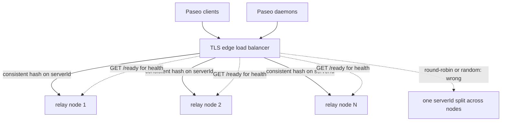
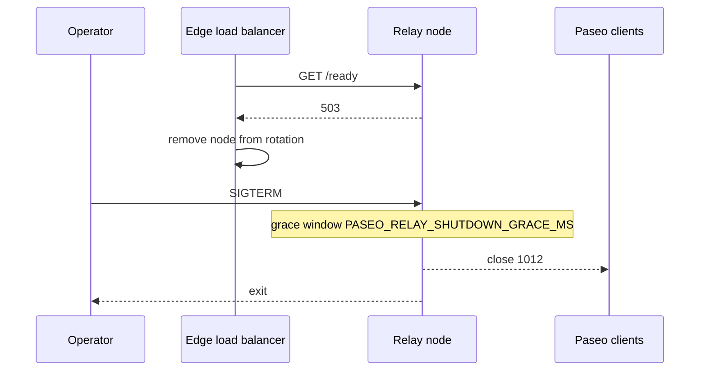

# Deployment guide

**English** | [简体中文](zh-CN/deployment.md)

Paseo Relay is a **single-node** component. Horizontal scale and high
availability come from an edge load balancer that keeps every socket for one
Paseo `serverId` on the same relay node. There is no built-in cluster, ownership
registry, or 409 reroute path; this is a deliberate trade-off (see
[DESIGN.md](../DESIGN.md)).

## Choose a topology

| Topology | When to use | What provides affinity |
|---|---|---|
| One relay node | Self-hosting for one person/team | Nothing (single process) |
| N relay nodes + edge LB | Public or multi-tenant deployment | Consistent hash on the `serverId` query parameter |
| Multiple independent relays | Separate trust domains/tenants | Separate DNS names or endpoints |

Do **not** put two relay nodes behind round-robin DNS, plain `least_conn`, or a
random load balancer. A Paseo daemon and client for the same `serverId` must
reach the same relay process for the lifetime of the session.

The recommended multi-node layout keeps every socket for one `serverId` on the
same relay node, with `/ready` as the health signal:



## TLS

Public deployments must serve `wss://`. Either:

- terminate TLS at the edge (recommended), keep the relay on a private
  interface, and forward WebSocket upgrades; or
- mount a PEM certificate chain and key into the container and set
  `PASEO_RELAY_TLS_CERT` / `PASEO_RELAY_TLS_KEY`. The relay then serves HTTPS/
  WSS directly with rustls. Both settings must be present or startup fails, and
  the files must be regular, readable files for the relay user (UID 65532 in
  the image); `paseo-relay --check-config` verifies that.

TLS is not optional for the public internet: although Paseo payloads are
end-to-end encrypted, `serverId`, connection metadata, and availability are
still exposed to a passive or active network attacker on plaintext `ws://`.

## Edge load balancer (required for more than one node)

The LB must:

1. terminate TLS and apply connection/request-rate limits per client IP;
2. parse the WebSocket query string and hash on the **`serverId` parameter
   value** (not the whole URL, not a cookie);
3. keep WebSocket connections open (long read/tunnel timeouts);
4. use `/ready` (not only `/health`) for backend health so a draining node is
   removed from rotation;
5. never expose `/metrics` publicly.

Examples:

- Nginx: [examples/nginx.conf](../examples/nginx.conf) — TLS edge, consistent
  hashing, per-IP connection/rate limits, `/metrics` and `/version` blocked with
  `/ready` limited to private ranges, and an access log that omits the query
  string.
- HAProxy: [examples/haproxy.cfg](../examples/haproxy.cfg) — consistent hashing,
  `/ready` checks, operations endpoints denied, per-source connection/rate
  limits, and a log format that omits the query string.
- Kubernetes with ingress-nginx: annotate the Ingress with
  `nginx.ingress.kubernetes.io/upstream-hash-by: "$arg_serverId"` and use
  `/health` for liveness and `/ready` for readiness probes. The example also
  includes a NetworkPolicy that admits only the ingress-nginx namespace on port
  4000. See [examples/kubernetes.yaml](../examples/kubernetes.yaml).
- Envoy: use a `RING_HASH` cluster and a route hash policy with
  `query_parameter: { name: serverId }`.

The Nginx and HAProxy examples assume they terminate TLS directly, so the
per-IP limits see the real client. If another proxy/CDN is in front, the peer
address is that proxy: move the limits to the outer edge (or configure the
proxy protocol/real-IP module) instead of tightening the inner caps. Caddy has
no built-in per-IP rate limiting in its standard build; use an external CDN/WAF
for per-client limits. The relay's own `PASEO_RELAY_PER_IP_MAX_CONNECTIONS`
sees the proxy IP for the same reason.

A small custom gateway is also acceptable if it reads the query string and
performs the same consistent hash; the relay does not require a specific
vendor.

### Important: source IP behind the proxy

When the LB terminates connections, every relay connection appears to come from
the proxy IP. The relay's `PASEO_RELAY_PER_IP_MAX_CONNECTIONS` therefore applies
to the **proxy**, not the end user. Keep the default `0` (unlimited) behind a
proxy and enforce per-client limits at the edge. If the relay is directly
exposed without a proxy, set a value appropriate for your users (for example
`256`).

## Single-node container

The published image is the default path and needs no Rust toolchain. Pull the
release, then run it detached with a restart policy and a stop timeout longer
than the drain grace window (`--rm` and `--restart` are mutually exclusive):

```sh
# Sized for ~512 MB; raise with RAM (see "Capacity sizing").
docker pull ghcr.io/kfxhjz/paseo-relay:v0.1.2
docker run -d \
  --name paseo-relay \
  --restart unless-stopped \
  --stop-timeout 30 \
  --read-only --cap-drop ALL \
  --security-opt no-new-privileges \
  -p 127.0.0.1:4000:4000 \
  -e PASEO_RELAY_MAX_CONNECTIONS=4000 \
  -e PASEO_RELAY_MAX_SESSIONS=4000 \
  -e PASEO_RELAY_MAX_TCP_CONNECTIONS=5000 \
  -e PASEO_RELAY_INGRESS_BUDGET_BYTES=135266304 \
  ghcr.io/kfxhjz/paseo-relay:v0.1.2
```

For a one-off foreground check, drop `-d`/`--restart`/`--stop-timeout`, add
`--rm`, and `curl` `/health` (see the README quickstart). Stop a detached
container with `docker stop paseo-relay`: SIGTERM starts the graceful drain.

The commands above publish on loopback because TLS is expected to terminate at
an edge proxy. To serve TLS directly from the relay, mount the PEM files, set
`PASEO_RELAY_TLS_CERT` / `PASEO_RELAY_TLS_KEY`, and publish the TLS port (for
example `-p 0.0.0.0:443:4000`).

`v0.1.2` is the current release tag and `latest` follows the newest **stable**
release. Prerelease tags (any tag containing `-`, for example `v0.2.0-rc1`) do
not move `latest`. For an immutable reference, pin the multi-arch index digest
for `v0.1.2` listed in the
[release notes](https://github.com/kfxhjz/paseo-relay/releases/tag/v0.1.2)
instead of the tag:

```sh
# Sized for ~512 MB; raise with RAM (see "Capacity sizing").
docker run -d \
  --name paseo-relay \
  --restart unless-stopped \
  --stop-timeout 30 \
  --read-only --cap-drop ALL \
  --security-opt no-new-privileges \
  -p 127.0.0.1:4000:4000 \
  -e PASEO_RELAY_MAX_CONNECTIONS=4000 \
  -e PASEO_RELAY_MAX_SESSIONS=4000 \
  -e PASEO_RELAY_MAX_TCP_CONNECTIONS=5000 \
  -e PASEO_RELAY_INGRESS_BUDGET_BYTES=135266304 \
  ghcr.io/kfxhjz/paseo-relay@sha256:<digest>
```

The image is a static musl binary in a `scratch` filesystem, runs as UID/GID
`65532`, writes nothing, and has a built-in `healthcheck` command (the image
`HEALTHCHECK` calls `/paseo-relay healthcheck`). It does not need a shell or
`curl`.

See [examples/docker-compose.yml](../examples/docker-compose.yml) for a
read-only Compose example that also pulls the published image and sizes the
connection caps for a 512 MB container (`PASEO_RELAY_MEM_LIMIT`,
`MAX_CONNECTIONS=4000`, `MAX_SESSIONS=4000`, `MAX_TCP_CONNECTIONS=5000`); raise
them together with the memory limit.

To build the relay from source (only needed while changing the relay itself),
use the build override
([examples/docker-compose.build.yml](../examples/docker-compose.build.yml)) or a
plain `docker build -t paseo-relay .`:

```sh
docker compose -f examples/docker-compose.yml \
  -f examples/docker-compose.build.yml up -d --build
```

## Kubernetes

Use [examples/kubernetes.yaml](../examples/kubernetes.yaml) as a starting point.
Key settings:

- `runAsNonRoot: true`, `runAsUser: 65532`, `readOnlyRootFilesystem: true`,
  `allowPrivilegeEscalation: false`, drop `ALL` capabilities;
- `automountServiceAccountToken: false` — the relay never calls the Kubernetes
  API;
- readiness probe `GET /ready` (removes draining nodes from Service endpoints);
- liveness/startup probe `GET /health`;
- `terminationGracePeriodSeconds` greater than
  `PASEO_RELAY_SHUTDOWN_GRACE_MS` (default 10 s), e.g. 30 s;
- capacity env sized for the container limit (the example uses a 1Gi limit with
  `MAX_CONNECTIONS=8000`, `MAX_SESSIONS=8000`, `MAX_TCP_CONNECTIONS=10000`, and a
  129 MiB ingress budget);
- NetworkPolicy: allow ingress only from the ingress controller/proxy namespace
  on port 4000; keep `/metrics` reachable only by monitoring (NetworkPolicy is
  L3/L4, so filter the operations paths at the ingress or scrape the internal
  Service). Some CNIs also apply NetworkPolicy to kubelet probe traffic; if
  probes fail, allow your node CIDR(s) to port 4000 as noted in the example;
- keep replicas stable. Scale by adding relay nodes and updating the edge's
  consistent-hash ring; do not use an HPA that reshuffles the ring frequently.

## systemd

An example unit is provided at
[examples/paseo-relay.service](../examples/paseo-relay.service). Set
`EnvironmentFile=` with the runtime contract values, use `Restart=always`, and
allow enough `TimeoutStopSec` for the drain grace window
(`TimeoutStopSec=30`).

## Health, readiness, and drain

- `GET /health` — liveness; stays 200 while draining.
- `GET /ready` — 200 only while the node admits new work; 503 while draining,
  shutting down, at WebSocket/session capacity, or during capacity failure.
- `SIGTERM`/`SIGINT` — stop accepting, `/ready` flips to 503, existing sessions
  continue for `PASEO_RELAY_SHUTDOWN_GRACE_MS`, then close `1012` and exit.
- `PASEO_RELAY_DRAIN=true` — start already unready; useful for a maintenance
  boot or to take a node out of rotation before stopping it.

Recommended rollout: remove the node from the LB (readiness), wait for the LB
to observe `/ready=503`, send `SIGTERM`, wait at least the grace window, then
kill if it has not exited.

The drain and rollout sequence for one node:



## Metrics and alerting

Scrape `/metrics` from an internal network. The metrics are aggregate-only and
contain no `serverId` labels. See
[examples/prometheus.yml](../examples/prometheus.yml) and
[examples/alerts.yml](../examples/alerts.yml), and the metrics reference in
[operations.md](operations.md).

## Capacity sizing

Memory has two parts: idle/pre-upgrade sockets and in-flight payload accounting.

- **Idle sockets.** An accepted socket costs roughly 23 KiB when the relay is
  plaintext behind an edge (hyper read/write buffers plus the task), or ~33 KiB
  with native TLS (rustls buffers), so reserve `MAX_TCP_CONNECTIONS × ~30 KiB`
  (plaintext) or `× ~35 KiB` (native TLS) at idle. The built-in defaults
  (25,000 TCP / 20,000 WebSocket) need roughly 700–800 MiB plaintext, or
  ~850–900 MiB with native TLS, before any payload traffic; a 512 MB container
  must lower `PASEO_RELAY_MAX_TCP_CONNECTIONS`, `PASEO_RELAY_MAX_CONNECTIONS`,
  and `PASEO_RELAY_MAX_SESSIONS` (the Compose examples use 5,000 / 4,000 /
  4,000). The hyper builder caps pre-upgrade request buffers (`max_buf_size`
  16 KiB, `max_header_size` 16 KiB, `max_headers` 64) and
  `PASEO_RELAY_HTTP_HEADER_TIMEOUT_MS` bounds the header phase, but those limits
  do not make an idle socket free.
- `PASEO_RELAY_INGRESS_BUDGET_BYTES` (default 512 MiB weighted) bounds
  in-flight payload accounting; each 8 KiB chunk is charged
  `chunk_bytes × weight + 192` as it arrives (per-chunk bookkeeping), and one
  connection can hold at most `min(budget, 4 × one-max-message charge)`. The
  validator requires the budget to admit one maximum message including that
  bookkeeping; use `--check-config` for the exact floor (the 129 MiB Compose
  budget still passes).
- `PASEO_RELAY_MAX_TCP_CONNECTIONS` is the total OS-socket cap and includes
  upgraded WebSockets (the slot is held for the whole socket lifetime), so
  `MAX_CONNECTIONS <= MAX_TCP_CONNECTIONS` must hold. Keep headroom above
  `MAX_CONNECTIONS` (at least 64–128 spare slots, more for probe bursts):
  otherwise a full WebSocket load consumes every TCP slot and `/health`,
  `/ready`, `/metrics`, the image HEALTHCHECK, and k8s probes are rejected at
  accept. The examples use 4000/5000 and 8000/10000; the built-in defaults are
  20000/25000.
- `PASEO_RELAY_MAX_SESSIONS` (default 20,000) bounds idle `serverId` entries.
- `PASEO_RELAY_CONTROL_QUEUE_BYTES` / writer queues bound per-destination
  buffering.

The relay's own memory is proportional to active sockets and queued payloads;
measure with `/metrics` and the container's RSS under your workload.
