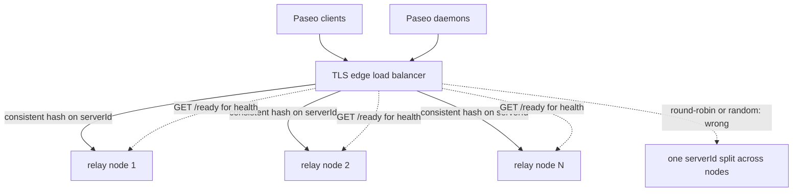
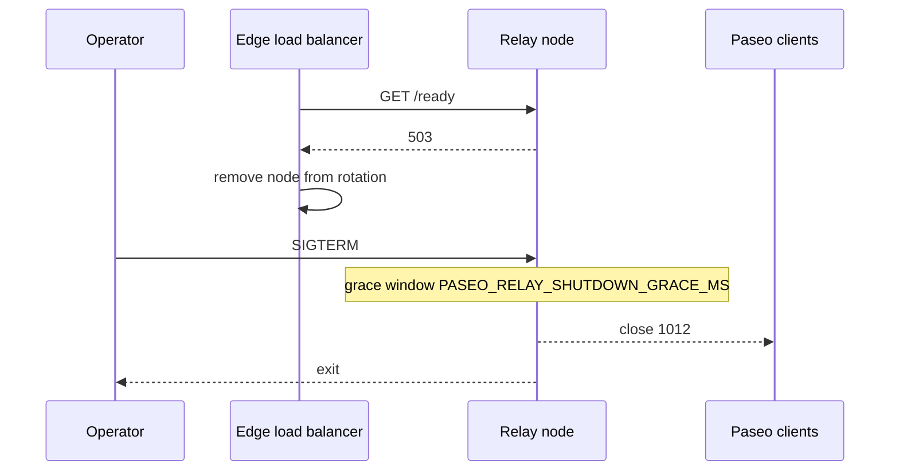

# Deployment guide

**English** | [简体中文](zh-CN/deployment.md)

Paseo Relay is a **single-node** component. Horizontal scale and high
availability come from an edge load balancer that keeps every socket for one
Paseo `serverId` on the same relay node. There is no built-in cluster, ownership
registry, or 409 reroute path; this is a deliberate trade-off (see
[DESIGN.md](../DESIGN.md)).

## Choose a topology

| Topology | When to use | What provides affinity |
|---|---|---|
| One relay node | Self-hosting for one person/team | Nothing (single process) |
| N relay nodes + edge LB | Public or multi-tenant deployment | Consistent hash on the `serverId` query parameter |
| Multiple independent relays | Separate trust domains/tenants | Separate DNS names or endpoints |

Do **not** put two relay nodes behind round-robin DNS, plain `least_conn`, or a
random load balancer. A Paseo daemon and client for the same `serverId` must
reach the same relay process for the lifetime of the session.

The recommended multi-node layout keeps every socket for one `serverId` on the
same relay node, with `/ready` as the health signal:



## TLS

Public deployments must serve `wss://`. Either:

- terminate TLS at the edge (recommended), keep the relay on a private
  interface, and forward WebSocket upgrades; or
- mount a PEM certificate chain and key into the container and set
  `PASEO_RELAY_TLS_CERT` / `PASEO_RELAY_TLS_KEY`. The relay then serves HTTPS/
  WSS directly with rustls. Both settings must be present or startup fails.

TLS is not optional for the public internet: although Paseo payloads are
end-to-end encrypted, `serverId`, connection metadata, and availability are
still exposed to a passive or active network attacker on plaintext `ws://`.

## Edge load balancer (required for more than one node)

The LB must:

1. terminate TLS and apply connection/request-rate limits per client IP;
2. parse the WebSocket query string and hash on the **`serverId` parameter
   value** (not the whole URL, not a cookie);
3. keep WebSocket connections open (long read/tunnel timeouts);
4. use `/ready` (not only `/health`) for backend health so a draining node is
   removed from rotation;
5. never expose `/metrics` publicly.

Examples:

- Nginx: [examples/nginx.conf](../examples/nginx.conf)
- HAProxy: [examples/haproxy.cfg](../examples/haproxy.cfg)
- Kubernetes with ingress-nginx: annotate the Ingress with
  `nginx.ingress.kubernetes.io/upstream-hash-by: "$arg_serverId"` and use
  `/health` for liveness and `/ready` for readiness probes. See
  [examples/kubernetes.yaml](../examples/kubernetes.yaml).
- Envoy: use a `RING_HASH` cluster and a route hash policy with
  `query_parameter: { name: serverId }`.

A small custom gateway is also acceptable if it reads the query string and
performs the same consistent hash; the relay does not require a specific
vendor.

### Important: source IP behind the proxy

When the LB terminates connections, every relay connection appears to come from
the proxy IP. The relay's `PASEO_RELAY_PER_IP_MAX_CONNECTIONS` therefore applies
to the **proxy**, not the end user. Keep the default `0` (unlimited) behind a
proxy and enforce per-client limits at the edge. If the relay is directly
exposed without a proxy, set a value appropriate for your users (for example
`256`).

## Single-node container

The published image is the default path and needs no Rust toolchain. Pull and
run the current release:

```sh
docker pull ghcr.io/kfxhjz/paseo-relay:v0.1.1
docker run --rm --read-only --cap-drop ALL \
  --security-opt no-new-privileges \
  -p 127.0.0.1:4000:4000 \
  ghcr.io/kfxhjz/paseo-relay:v0.1.1
```

`v0.1.1` is the current release tag and `latest` follows the newest release. For
an immutable reference, pin the multi-arch index digest for `v0.1.1` listed in
the [release notes](https://github.com/kfxhjz/paseo-relay/releases/tag/v0.1.1)
instead of the tag:

```sh
docker run --rm --read-only --cap-drop ALL \
  --security-opt no-new-privileges \
  -p 127.0.0.1:4000:4000 \
  ghcr.io/kfxhjz/paseo-relay@sha256:<digest>
```

The image is a static musl binary in a `scratch` filesystem, runs as UID/GID
`65532`, writes nothing, and has a built-in `healthcheck` command (the image
`HEALTHCHECK` calls `/paseo-relay healthcheck`). It does not need a shell or
`curl`.

See [examples/docker-compose.yml](../examples/docker-compose.yml) for a
read-only Compose example that also pulls the published image.

To build the relay from source (only needed while changing the relay itself),
use the build override
([examples/docker-compose.build.yml](../examples/docker-compose.build.yml)) or a
plain `docker build -t paseo-relay .`:

```sh
docker compose -f examples/docker-compose.yml \
  -f examples/docker-compose.build.yml up -d --build
```

## Kubernetes

Use [examples/kubernetes.yaml](../examples/kubernetes.yaml) as a starting point.
Key settings:

- `runAsNonRoot: true`, `runAsUser: 65532`, `readOnlyRootFilesystem: true`,
  `allowPrivilegeEscalation: false`, drop `ALL` capabilities;
- readiness probe `GET /ready` (removes draining nodes from Service endpoints);
- liveness/startup probe `GET /health`;
- `terminationGracePeriodSeconds` greater than
  `PASEO_RELAY_SHUTDOWN_GRACE_MS` (default 10 s), e.g. 30 s;
- Service accounts need no API permissions; the process needs no filesystem
  writes;
- NetworkPolicy: allow ingress only from the ingress controller/proxy; keep
  `/metrics` reachable only by monitoring;
- keep replicas stable. Scale by adding relay nodes and updating the edge's
  consistent-hash ring; do not use an HPA that reshuffles the ring frequently.

## systemd

An example unit is provided at
[examples/paseo-relay.service](../examples/paseo-relay.service). Set
`EnvironmentFile=` with the runtime contract values, use `Restart=always`, and
allow enough `TimeoutStopSec` for the drain grace window
(`TimeoutStopSec=30`).

## Health, readiness, and drain

- `GET /health` — liveness; stays 200 while draining.
- `GET /ready` — 200 only while the node admits new work; 503 while draining,
  shutting down, at WebSocket/session capacity, or during capacity failure.
- `SIGTERM`/`SIGINT` — stop accepting, `/ready` flips to 503, existing sessions
  continue for `PASEO_RELAY_SHUTDOWN_GRACE_MS`, then close `1012` and exit.
- `PASEO_RELAY_DRAIN=true` — start already unready; useful for a maintenance
  boot or to take a node out of rotation before stopping it.

Recommended rollout: remove the node from the LB (readiness), wait for the LB
to observe `/ready=503`, send `SIGTERM`, wait at least the grace window, then
kill if it has not exited.

The drain and rollout sequence for one node:



## Metrics and alerting

Scrape `/metrics` from an internal network. The metrics are aggregate-only and
contain no `serverId` labels. See
[examples/prometheus.yml](../examples/prometheus.yml) and
[examples/alerts.yml](../examples/alerts.yml), and the metrics reference in
[operations.md](operations.md).

## Capacity sizing

Size the container memory above the configured ingress budget plus per-socket
overhead:

- `PASEO_RELAY_INGRESS_BUDGET_BYTES` (default 512 MiB weighted) bounds
  in-flight payload accounting;
- `PASEO_RELAY_MAX_CONNECTIONS` (default 20,000) bounds WebSockets;
- `PASEO_RELAY_MAX_TCP_CONNECTIONS` (default 25,000) bounds all TCP sockets,
  including pre-upgrade HTTP;
- `PASEO_RELAY_MAX_SESSIONS` (default 20,000) bounds idle `serverId` entries;
- `PASEO_RELAY_CONTROL_QUEUE_BYTES` / writer queues bound per-destination
  buffering.

The relay's own memory is small and proportional to active sockets and queued
payloads; measure with `/metrics` and the container's RSS under your workload.
