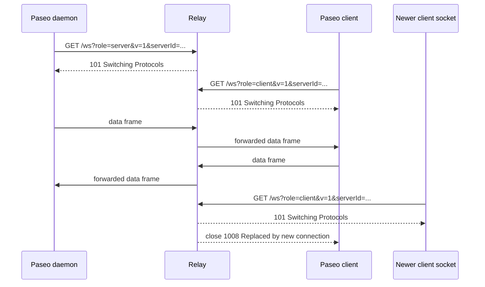
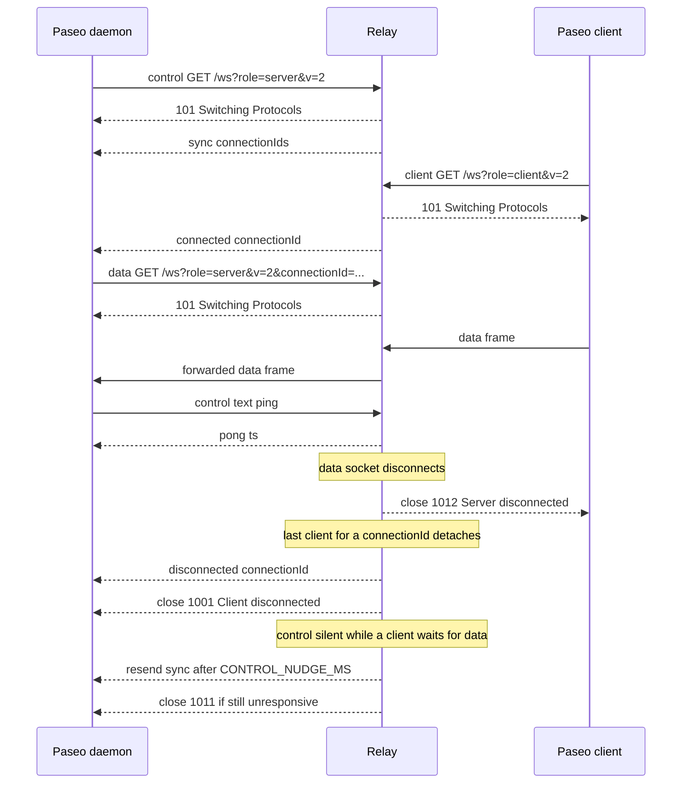

# Wire protocol

**English** | [简体中文](zh-CN/protocol.md)

This page is the detailed Paseo relay protocol contract. For the operator
runtime settings see [configuration.md](configuration.md); for compatibility
differences see [compatibility.md](compatibility.md).

## Endpoint and query

`GET /ws` with a standard RFC 6455 WebSocket upgrade. The relay validates the
upgrade headers (including a 16-byte `Sec-WebSocket-Key` and
`Sec-WebSocket-Version: 13`) before creating any session state.

| Parameter | Required | Meaning |
|---|---|---|
| `serverId` | yes | Routing key; 1..=256 bytes, valid UTF-8, no control characters or whitespace |
| `role` | yes | `server` (daemon) or `client` |
| `v` | no | `1` (default) or `2` |
| `connectionId` | v2 only | Daemon data socket routing id. Clients normally omit it; the relay generates `conn_<16 hex>`. A v2 daemon control socket uses an empty value |

Paseo clients and daemons treat `serverId` as a bearer secret: anyone who knows
it can attach to the session. The relay does not add authentication by design;
see the security model in README and `SECURITY.md`.

Send exactly one unencoded `serverId`. If a query parameter appears more than
once, the relay uses the **last** occurrence (last-wins, matching the Elixir
implementation's `Map.new/1`). Edge consistent hashing normally hashes the raw
query value, so duplicate or percent-encoded forms can route the two sides of a
session to different relay nodes.

## v1

One server socket and one client socket per `serverId`. A newer socket for a
role replaces the older socket for that role with close `1008` "Replaced by new
connection". Data frames are forwarded to the opposite role, preserving the
WebSocket opcode. If the opposite peer is absent, the frame is dropped for that
socket; the session topology is unchanged.

The v1 pairing and replacement flow:

## v2

The daemon opens:

- a **control socket** with `role=server` and empty `connectionId`;
- one **data socket** per client connection, with the non-empty
  `connectionId` assigned to that client.

Behavior:

- On control attach, the relay sends
  `{"type":"sync","connectionIds":[...]}` with the currently attached client
  connection ids and replaces any previous control socket (`1008`).
- On client attach, the relay reports
  `{"type":"connected","connectionId":"..."}` to the control socket.
- When the last client for a `connectionId` detaches, the relay sends
  `{"type":"disconnected","connectionId":"..."}` to control and closes the data
  socket with `1001` "Client disconnected".
- When a data socket disconnects, all clients for that `connectionId` are closed
  with `1012` "Server disconnected".
- Client frames wait for their data socket for up to
  `DATA_ATTACH_TIMEOUT_MS` (default 15 s); if it never attaches, the client is
  closed with `1013` "Data route unavailable".
- While a client is waiting for data, the control watchdog re-sends `sync`
  after `CONTROL_NUDGE_MS` and closes a still-unresponsive control socket with
  `1011` after `CONTROL_UNRESPONSIVE_MS`.
- Control input is ignored except text `{"type":"ping"}`, answered with
  `{"type":"pong","ts":<unix ms>}`. Binary frames on the control socket are
  ignored.

The v2 control/data flow and close propagation:

## Frames and limits

| Item | Limit / behavior |
|---|---|
| Client data frame / reassembled message | `32 MiB - 14` bytes; overflow closes `1009` |
| Fragments per message | At most 1024; exceeding closes `1002` |
| Length encoding | The 126/127 length forms must be minimal; a non-minimal encoding closes `1002` |
| v2 control frames | 64 KiB per frame/message |
| WebSocket control frames | RFC 6455 (≤125 bytes, not fragmented) |
| Close payload | Empty, or at least 2 bytes with a valid status code; an invalid code closes `1002` |
| Compression | Not negotiated |
| Masking | Client frames must be masked; unmasked closes `1002` |
| Invalid UTF-8 in a text message | Closes `1007` |
| Fragmented messages | Reassembled and forwarded as one message; opcode preserved |
| Frame payload read | Must complete within `FRAME_READ_TIMEOUT_MS`; closes `1013` |
| Fragmented message | Must complete within `MESSAGE_READ_TIMEOUT_MS`; closes `1013` |
| Idle/header timeout between frames | None between WebSocket frames; idle connections hold their slots by design, so enforce idle limits at the edge |
| Source payload accounting | Data payload is read in 8 KiB chunks and each chunk is charged after it arrives; at most one 8 KiB chunk per connection is allocated before charging |
| Per-connection in-flight cap | `min(PASEO_RELAY_INGRESS_BUDGET_BYTES, 4 × one-max-message charge)` |
| Slow destination | Bounded writer queue + deadline; destination sheds `1013` |

Ingress accounting has two refinements that matter for abuse limits:

- the fixed 256-byte per-message overhead is charged **once per message**, not
  once per fragment, so a fragmented message is not billed thousands of times
  for its headers;
- a data-frame payload is read in 8 KiB chunks and each chunk is charged after
  it arrives, so at most one 8 KiB chunk per connection is allocated before it
  is accounted. A stalled frame therefore cannot reserve budget for bytes it
  never sends.

## Handshake key hygiene

For client text/binary frames of at most 64 KiB whose first non-whitespace byte
is `{`, the relay parses the JSON. If `type` is `hello` or `e2ee_hello`, the
`key` must be canonical padded Base64 for a canonical 32-byte X25519 public key
and must not be a known low-order/unsupported point. A mismatch closes `1008`
"Invalid handshake key" and is not forwarded.

This is protocol hygiene, **not** a security boundary: Paseo's E2EE handshake is
authenticated by the endpoints, and the relay is untrusted by design. Frames
larger than 64 KiB that look like JSON are not inspected by this check.

## Close codes

| Code | Meaning |
|---|---|
| `1000` | Normal closure; a received allowed code is echoed |
| `1001` | Last v2 client detached, data socket closed |
| `1002` | Protocol error: bad frame or masking, non-minimal length encoding, too many fragments, or invalid close payload/code |
| `1007` | Invalid UTF-8 in a text message |
| `1008` | Replaced by a newer socket, invalid handshake key, or policy close |
| `1009` | Frame or message too large |
| `1011` | Control socket unresponsive |
| `1012` | Relay shutting down, or v2 server data socket disconnected |
| `1013` | Ingress budget/read timeout, data route unavailable, or delivery unavailable (retryable) |

Valid close codes are `1000..=1003`, `1007..=1014`, and `3000..=4999`. An empty
close payload is allowed; a one-byte payload is not. `1005`/`1006`/`1015` are
reserved for local use and are never sent on the wire. Codes below `1000`,
`1004`, `1005`, `1006`, `1015`, `1016..=2999`, and codes above `4999` are
rejected with `1002`. `1002` means the peer violated the framing/protocol
contract; the relay closes the socket and does not retry.

## HTTP endpoints

- `GET /health` — liveness, 200 while the process is alive.
- `GET /ready` — 200 only while admitting new work; 503 while draining,
  shutting down, or at WebSocket/session capacity.
- `GET /metrics` — Prometheus text, aggregate-only, no IDs.
- `GET /version` — `{"version":"...","revision":"..."}`.
- `GET /ws` — WebSocket upgrade.
- Anything else — 404.

Admission failures for the upgrade: `400` invalid query/handshake, `403`
disallowed Origin, `426` not an upgrade, `429` per-IP WebSocket limit, `503`
draining/capacity.
