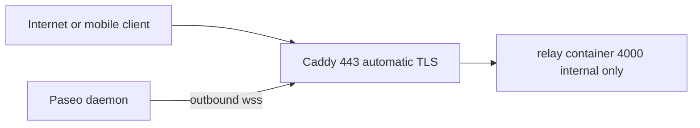

# Five-minute VPS quickstart

**English** | [简体中文](zh-CN/quickstart.md)

This is the path for **most self-hosters**: one public VPS, one relay node,
`relay.example.com` with automatic HTTPS. You do not need a load balancer or a
cluster.

## What you need

- A VPS with a public IPv4 (a domain is required for automatic TLS).
- A DNS `A` record (and `AAAA` if you use IPv6) for e.g.
  `relay.example.com` pointing at the VPS.
- Docker with Compose v2, and inbound TCP `80`/`443` (UDP `443` optional for
  HTTP/3) open in the firewall/security group.
- **512 MB RAM for the relay container** (the Compose defaults set
  `PASEO_RELAY_MEM_LIMIT=512m`, a 129 MiB ingress budget, and connection caps
  sized for 512 MB), plus headroom for Caddy and connection bursts. An idle
  accepted socket still costs ~23 KiB; leave room for that and for Caddy. If you
  raise `PASEO_RELAY_MEM_LIMIT`, raise the connection caps with it. If you raise
  `PASEO_RELAY_INGRESS_BUDGET_BYTES` to the built-in 512 MiB default, use at
  least ~1 GB. Building from source needs at least ~1 GB and several minutes.

## Deploy the published image

The published image is ready to run; this path needs no Rust toolchain.

```sh
git clone https://github.com/kfxhjz/paseo-relay.git
cd paseo-relay

cp examples/.env.example examples/.env
# edit examples/.env if your domain is not relay.example.com
docker compose -f examples/docker-compose.caddy.yml up -d
```

The Compose file pulls the current release,
`ghcr.io/kfxhjz/paseo-relay:v0.1.4`; `latest` follows the newest stable release
(prerelease tags do not move it). The release workflow smoke-tests and
signs/attests the image by digest before promoting the version tag or `latest`,
so following `latest` does not pick up an unverified build. Set
`PASEO_RELAY_IMAGE` to override the
version, and see [deployment.md](deployment.md) if you need an immutable digest
pin. The example also caps `PASEO_RELAY_MAX_CONNECTIONS` (4,000),
`PASEO_RELAY_MAX_SESSIONS` (4,000), and `PASEO_RELAY_MAX_TCP_CONNECTIONS`
(5,000) so the 512 MB memory limit is realistic; raise them together with
`PASEO_RELAY_MEM_LIMIT`. `examples/.env` is local and git-ignored, so the domain
survives `git pull` and later `up -d` commands.

The example pins the current stable Caddy image,
`caddy:2.11.9-alpine` (multi-arch digest). Update that pin deliberately after
checking the Caddy release notes rather than floating on `latest`. Caddy will
obtain a certificate automatically. Verify:

```sh
curl https://relay.example.com/health   # {"status":"ok"}
```

The relay itself is not published on a host port: only Caddy is public. The
relay runs read-only, non-root, with all capabilities dropped. `/metrics` and
`/ready` are blocked by Caddy; scrape metrics on the private Compose network if
you run Prometheus.

What runs where:



## Existing Caddy or other domains

If the VPS already serves other domains, only one process can bind TCP 80/443.
In that case **do not start the `caddy` service from this example**; reuse the
reverse proxy that is already running.

**Existing Caddy.** Merge the relay site block into the existing Caddyfile
(Caddy selects the site by SNI/Host and obtains one certificate per hostname):

```caddyfile
relay.example.com {
    encode zstd gzip

    @operations path /metrics /ready /version
    handle @operations {
        respond 404
    }

    handle {
        reverse_proxy relay:4000
    }
}
```

- If it runs in Docker (this project or another Compose project), start only
  the relay first so the `paseo-relay` network exists:
  `docker compose -f examples/docker-compose.caddy.yml up -d relay`.
  Compose reads `examples/.env`; if you did not create it, prefix the command
  with `RELAY_DOMAIN=...`.
  Then attach the Caddy container to that network and keep
  `reverse_proxy relay:4000`. For a manual container:
  `docker network connect paseo-relay <caddy-container-name>`. If Caddy is
  managed by Compose, add the external `paseo-relay` network to that project
  instead; a manual `docker network connect` is lost when the container is
  recreated.
- If it runs on the host, publish the relay only on loopback (override below)
  and use `reverse_proxy 127.0.0.1:4000`. A loopback port is not reachable from
  inside another bridge-network container.

For a host Caddy, a minimal override plus a relay-only start command:

```yaml
# docker-compose.override.yml
services:
  relay:
    ports: ["127.0.0.1:4000:4000"]
```

```sh
# examples/.env provides RELAY_DOMAIN
docker compose \
  -f examples/docker-compose.caddy.yml \
  -f docker-compose.override.yml \
  up -d relay
```

**Other domains on this Caddy.** The example imports every
`examples/sites-enabled/*.caddy` file, so add one file per domain instead of
editing the relay block:

```caddyfile
# examples/sites-enabled/app.caddy
app.example.com {
    reverse_proxy app:3000
}
```

`app` must be a service reachable on the `paseo-relay` network (or use
`root`/`file_server` with a mounted content directory).

Validate and reload (without dropping relay sessions):

```sh
docker compose -f examples/docker-compose.caddy.yml exec caddy \
  caddy validate --config /etc/caddy/Caddyfile
docker compose -f examples/docker-compose.caddy.yml exec caddy \
  caddy reload --config /etc/caddy/Caddyfile
```

Caddy keeps the previous configuration if validation or reload fails. Each
public name needs its own DNS record; Caddy obtains the certificates
automatically. Keep one Caddy process and do not run two Caddy/nginx containers
that both publish 80/443.

**Existing Nginx/Traefik/HAProxy.** Add a virtual host that proxies
`relay.example.com/ws` and `/health` (or the whole site) to the relay and
preserves WebSocket upgrades; see [deployment.md](deployment.md) for the edge
requirements and multi-node examples.

Multiple public names for one relay are fine, but configure Paseo with the exact
hostname users will reach. Certificate issuance rate limits apply per domain;
use a staging CA for repeated tests.

## Build from source instead

Only use this if you are changing the relay itself; the published image covers
normal deployments. It needs at least ~1 GB RAM and a Rust-capable Docker
builder:

```sh
RELAY_DOMAIN=relay.example.com \
docker compose \
  -f examples/docker-compose.caddy.yml \
  -f examples/docker-compose.caddy.build.yml \
  up -d --build
```

If you already created `examples/.env` from the template, the `RELAY_DOMAIN=`
prefix is optional; Compose reads the file automatically.

## Point Paseo at it

On the machine running the Paseo daemon:

```sh
export PASEO_RELAY_ENDPOINT=relay.example.com:443
export PASEO_RELAY_PUBLIC_ENDPOINT=relay.example.com:443
export PASEO_RELAY_USE_TLS=true
export PASEO_RELAY_PUBLIC_USE_TLS=true
export PASEO_RELAY_ENABLED=true
paseo daemon pair --relay
```

Set these in the environment of the **running daemon** (or in `config.json`), not
only in the shell where you run `pair`; a daemon that is already running may not
pick up a one-off environment change.

Scan/open the pairing link with the Paseo app. The daemon connects **outbound**
to the relay; you do not forward a port to the daemon. The mobile client must be
able to reach `relay.example.com:443`.

## Upgrade

If you have not created `examples/.env` yet, do it once (it is git-ignored and
survives later `git pull` runs):

```sh
cp examples/.env.example examples/.env
# set RELAY_DOMAIN to the hostname already in use
```

Then upgrade; no inline `RELAY_DOMAIN` is needed:

```sh
git pull
docker compose -f examples/docker-compose.caddy.yml up -d
```

If you prefer not to create the file, pass `RELAY_DOMAIN=relay.example.com`
inline on the `up` command.

Relay state is ephemeral: Paseo clients reconnect, and E2EE pairing is
end-to-end, not stored by the relay. Do not `SIGKILL`; Compose sends `SIGTERM`
and the relay drains existing sessions within its grace window.

## Troubleshooting

| Symptom | Check |
|---|---|
| Caddy cannot get a certificate | DNS points to the VPS; ports 80/443 reachable; Caddy logs |
| `/health` works but pairing fails | Use `wss`/443; the mobile client must reach the same public endpoint |
| 502/504 from Caddy | Relay container healthy? `docker compose logs relay` |
| All connections rejected | Check `PASEO_RELAY_MAX_CONNECTIONS`, `/ready`, and relay logs |
| `healthcheck` fails with "not loopback" | Native TLS configured but `PASEO_RELAY_TLS_CERT` unreadable: the probe only trusts loopback. Fix the certificate or use a loopback target. Plaintext non-loopback probes are allowed but unauthenticated |
| Metrics missing | `/metrics` and `/ready` are blocked at Caddy; scrape the relay over the internal network |
| Need to take the node down | Remove from any edge, send SIGTERM, wait for the grace window |
| OOM or build fails | Use the prebuilt image; raise `PASEO_RELAY_MEM_LIMIT` and the connection caps together (idle sockets cost ~23 KiB each), or give the build at least ~1 GB RAM |

## When not to use this path

- **Multiple relay nodes**: you need an edge that consistently hashes the
  `serverId` query parameter (Nginx/HAProxy/Envoy); see
  [deployment.md](deployment.md).
- **You need relay-level authentication**: this project has none by design;
  put it behind a VPN/mTLS or an authenticated edge.
- **You cannot open 80/443**: use a tunnel/VPN or terminate TLS elsewhere; see
  [deployment.md](deployment.md).
