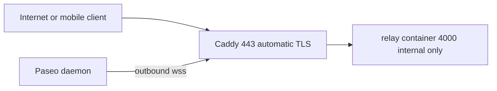

# Five-minute VPS quickstart

**English** | [简体中文](zh-CN/quickstart.md)

This is the path for **most self-hosters**: one public VPS, one relay node,
`relay.example.com` with automatic HTTPS. You do not need a load balancer or a
cluster.

## What you need

- A VPS with a public IPv4 (a domain is required for automatic TLS).
- A DNS `A` record (and `AAAA` if you use IPv6) for e.g.
  `relay.example.com` pointing at the VPS.
- Docker with Compose v2, and inbound TCP `80`/`443` (UDP `443` optional for
  HTTP/3) open in the firewall/security group.
- **512 MB RAM** for the Compose defaults below (128 MiB ingress budget). The
  relay itself is tiny; leave headroom for Caddy and connection bursts. If you
  raise `PASEO_RELAY_INGRESS_BUDGET_BYTES` to the built-in 512 MiB default, use
  at least ~1 GB. Building from source needs at least ~1 GB and several minutes.

## Deploy the published image

The published image is ready to run; this path needs no Rust toolchain.

```sh
git clone https://github.com/kfxhjz/paseo-relay.git
cd paseo-relay

RELAY_DOMAIN=relay.example.com \
docker compose -f examples/docker-compose.caddy.yml up -d
```

The Compose file pulls the current release,
`ghcr.io/kfxhjz/paseo-relay:v0.1.1`; `latest` follows the newest release. Set
`PASEO_RELAY_IMAGE` to override the version, and see
[deployment.md](deployment.md) if you need an immutable digest pin.

Caddy will obtain a certificate automatically. Verify:

```sh
curl https://relay.example.com/health   # {"status":"ok"}
```

The relay itself is not published on a host port: only Caddy is public. The
relay runs read-only, non-root, with all capabilities dropped. `/metrics` and
`/ready` are blocked by Caddy; scrape metrics on the private Compose network if
you run Prometheus.

What runs where:



## Build from source instead

Only use this if you are changing the relay itself; the published image covers
normal deployments. It needs at least ~1 GB RAM and a Rust-capable Docker
builder:

```sh
RELAY_DOMAIN=relay.example.com \
docker compose \
  -f examples/docker-compose.caddy.yml \
  -f examples/docker-compose.caddy.build.yml \
  up -d --build
```

## Point Paseo at it

On the machine running the Paseo daemon:

```sh
export PASEO_RELAY_ENDPOINT=relay.example.com:443
export PASEO_RELAY_PUBLIC_ENDPOINT=relay.example.com:443
export PASEO_RELAY_USE_TLS=true
export PASEO_RELAY_PUBLIC_USE_TLS=true
export PASEO_RELAY_ENABLED=true
paseo daemon pair --relay
```

Set these in the environment of the **running daemon** (or in `config.json`), not
only in the shell where you run `pair`; a daemon that is already running may not
pick up a one-off environment change.

Scan/open the pairing link with the Paseo app. The daemon connects **outbound**
to the relay; you do not forward a port to the daemon. The mobile client must be
able to reach `relay.example.com:443`.

## Upgrade

```sh
git pull
docker compose -f examples/docker-compose.caddy.yml up -d
```

Relay state is ephemeral: Paseo clients reconnect, and E2EE pairing is
end-to-end, not stored by the relay. Do not `SIGKILL`; Compose sends `SIGTERM`
and the relay drains existing sessions within its grace window.

## Troubleshooting

| Symptom | Check |
|---|---|
| Caddy cannot get a certificate | DNS points to the VPS; ports 80/443 reachable; Caddy logs |
| `/health` works but pairing fails | Use `wss`/443; the mobile client must reach the same public endpoint |
| 502/504 from Caddy | Relay container healthy? `docker compose logs relay` |
| All connections rejected | Check `PASEO_RELAY_MAX_CONNECTIONS`, `/ready`, and relay logs |
| Metrics missing | `/metrics` and `/ready` are blocked at Caddy; scrape the relay over the internal network |
| Need to take the node down | Remove from any edge, send SIGTERM, wait for the grace window |
| OOM or build fails | Use the prebuilt image, or give the build at least ~1 GB RAM |

## When not to use this path

- **Multiple relay nodes**: you need an edge that consistently hashes the
  `serverId` query parameter (Nginx/HAProxy/Envoy); see
  [deployment.md](deployment.md).
- **You need relay-level authentication**: this project has none by design;
  put it behind a VPN/mTLS or an authenticated edge.
- **You cannot open 80/443**: use a tunnel/VPN or terminate TLS elsewhere; see
  [deployment.md](deployment.md).
