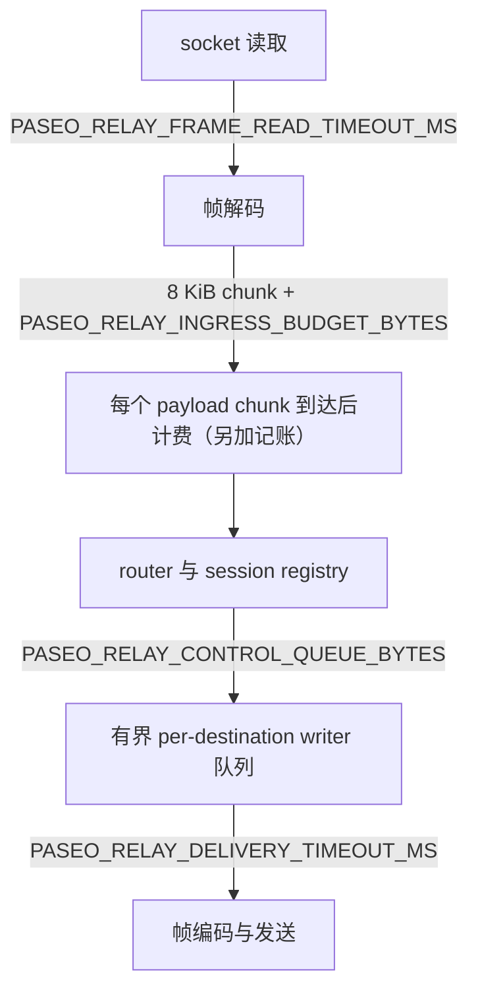

# 配置

[English](../configuration.md) | **简体中文**

relay 只从环境变量读取配置。启动时会校验；非法值（包括非法的
`PASEO_RELAY_LOG` filter）会带说明中止启动。可用
`paseo-relay --check-config` 校验部署环境（包括 TLS 证书/私钥是否为 relay 用户
可读的常规文件），用 `paseo-relay --dump-config` 打印生效配置（不含秘密）。

配置只来自环境变量，变量名拼错原本会被静默忽略。因此 relay 启动时会对任何它不认识的
`PASEO_RELAY_*` 变量给出警告，`--check-config` 也会打印同样的警告；见下文"启动警告"
一节。

## Runtime contract

| 变量 | 默认值 | 含义 |
|---|---|---|
| `PASEO_RELAY_HOST` | `127.0.0.1` | 监听 IP。容器镜像设为 `0.0.0.0`。 |
| `PASEO_RELAY_PORT` | `4000` | `/ws` 和 `/health` 的监听端口；运维端点也在这里，除非用 `PASEO_RELAY_OPS_PORT` 把它们移走。 |
| `PASEO_RELAY_OPS_HOST` | `127.0.0.1` | 运维监听的 IP；只有设置了 `PASEO_RELAY_OPS_PORT` 才生效。默认值只能从同一主机/容器内访问。要让探针和 Prometheus 访问，请设为内网地址（或在不对外发布该端口的 pod/容器内设为 `0.0.0.0`）。 |
| `PASEO_RELAY_OPS_PORT` | 未设置 | 设置后，`/ready`、`/metrics`、`/version` **只**在这个明文监听上提供（同时提供 `/health`），`PASEO_RELAY_PORT` 只保留 `/ws` 和 `/health`。该监听有自己独立的 64 个连接额度，所以公网监听打满 TCP 上限时探针和抓取仍然可用；`paseo-relay healthcheck` 会自动改用它。不设置 = 全部在 `PASEO_RELAY_PORT` 上。Kubernetes service-link 值（例如名为 `paseo-relay-ops` 的 Service 注入的 `tcp://10.96.0.5:4001`）会被拒绝，并给出说明原因的错误，而不是裸的解析失败。 |
| `PASEO_RELAY_DRAIN` | `false` | 启动即 draining：`/ready` 返回 503，新 `/ws` upgrade 被拒绝。SIGTERM/SIGINT 总会触发 drain。 |
| `PASEO_RELAY_MAX_CONNECTIONS` | `20000` | 最大 WebSocket 数。必须 `<= PASEO_RELAY_MAX_TCP_CONNECTIONS`，并让后者高于它（见下一行）。 |
| `PASEO_RELAY_MAX_TCP_CONNECTIONS` | `25000` | 最大 OS socket 数，包含 upgrade 前的 HTTP 和 upgrade 后的 WebSocket。slot 在整个 socket 生命周期内持有，因此要比 `PASEO_RELAY_MAX_CONNECTIONS` 留出余量（至少 64–128 个空槽，探针突发时更多），否则满 WebSocket 负载会在 accept 阶段拒绝 `/health`、`/ready`、`/metrics` 和探针。 |
| `PASEO_RELAY_MAX_SESSIONS` | `20000` | 最大存活 `serverId` session 数。 |
| `PASEO_RELAY_MAX_CONNECTIONS_PER_SESSION` | `512` | 每个 `serverId` session 允许的不同 v2 `connectionId` 上限，按 client 连接 id 与 daemon data 路由的 **并集** 计数（同一个 id 无论只有 client、只有 data 还是两者都有，都只占一个名额）。超限以 `1013` "Relay session connection capacity" 关闭。如果接受新 client 会让 control `sync` 消息超过 64 KiB，则新 client 以 `1013` "Relay session sync capacity" 拒绝，而不是让 daemon 收到它无法接收的状态。 |
| `PASEO_RELAY_MAX_CLIENTS_PER_CONNECTION` | `32` | 每个 `connectionId` 的最大 v2 client socket 数；超限 client 以 `1013` "Relay client capacity" 关闭。 |
| `PASEO_RELAY_INGRESS_BUDGET_BYTES` | `536870912` | 节点级加权 in-flight payload 预算。必须能容纳一条最大消息，包括 256 字节每消息开销和每 chunk 记账（每个 8 KiB chunk 192 加权单位，包含 1024 分片最坏情况）；具体下限用 `--check-config` 查看。129 MiB 的 Compose 预算（135,266,304）仍可通过，余量约 64.6 KB。单个连接最多持有 `min(budget, 4 × 一条最大消息的计费)`，或 `PASEO_RELAY_PER_CONNECTION_LIMIT_BYTES` 的显式值。 |
| `PASEO_RELAY_PER_CONNECTION_LIMIT_BYTES` | `0`（自动） | 单个连接的加权 in-flight 上限。`0` 时派生为 `min(PASEO_RELAY_INGRESS_BUDGET_BYTES, 4 × 一条最大消息的计费)`；默认配置下就等于整个预算，也就是已文档化的单 source 残余成本。非 0 值会被 **clamp** 到 `[一条最大消息的计费, PASEO_RELAY_INGRESS_BUDGET_BYTES]`（超出范围的调优值只会被收窄，不会导致启动失败），`--dump-config` 显示为 `per_connection_limit=...`；可用它限制单个慢 source 能占多少预算。低于 `4 ×` 一条最大消息计费的值会缩小预读流水线，在大帧流水线场景可能表现为可重试的 `1013`。当派生上限等于预算且 `PASEO_RELAY_PER_IP_MAX_CONNECTIONS=0` 时，启动会打印警告（见下文"启动警告"）。 |
| `PASEO_RELAY_INGRESS_SMALL_RESERVE_BYTES` | `16777216` | 在 `PASEO_RELAY_INGRESS_BUDGET_BYTES` 之外额外提供的加权预算，只有不超过 64 KiB 的消息可以使用，这样大传输占满主预算时握手和普通小帧仍能通过。`0` 关闭；否则必须能容纳一条 64 KiB 消息（默认权重下为 461,312）。 |
| `PASEO_RELAY_INGRESS_RECLAIM_MIN_RATE_BYTES` | `65536` | 当别的 source 在等预算时，最近一到两秒内每秒收到的 payload 不超过该值的未完成消息会被优先关闭以释放其预留。`0` 表示只针对完全没有收到数据的消息。 |
| `PASEO_RELAY_INGRESS_RECLAIM_AFTER_MS` | `60000` | 当别的 source 在等预算时，已经传输超过该时长的未完成消息要让位给更新的消息。`0` 关闭该规则；否则至少 `5000`。 |
| `PASEO_RELAY_INGRESS_WEIGHT` | `4` | 每 payload 字节的权重，另加每消息固定 256 字节开销。范围 `4..=16`；最小值 `4` 覆盖 2× 临时拷贝的安全余量。 |
| `PASEO_RELAY_INGRESS_WAIT_TIMEOUT_MS` | `5000` | 等待预算的最长时间；超时 source 以 `1013` 关闭。等待期间 relay 会从其他连接上停滞、过慢或传输过久的未完成消息回收预算（见下文"预算耗尽时"）。有效等待为 `min(本值, 剩余 FRAME_READ_TIMEOUT_MS/MESSAGE_READ_TIMEOUT_MS)`；预算耗尽和读超时都以 `1013` 关闭。 |
| `PASEO_RELAY_MAX_MESSAGE_BYTES` | `33554418` | 最大数据帧/重组消息 payload（`32 MiB - 14`）。 |
| `PASEO_RELAY_FRAME_READ_TIMEOUT_MS` | `300000` | 帧 header 之后接收 payload 的最长时间；超时 `1013`。 |
| `PASEO_RELAY_MESSAGE_READ_TIMEOUT_MS` | `600000` | 从第一个分片 header 到达起算，重组一条分片消息的最长时间；超时 `1013`。 |
| `PASEO_RELAY_READ_STALL_TIMEOUT_MS` | `30000` | 未完成的消息允许没有至少 8 KiB payload 进展（或结束消息）的最长时间。停滞超过该时间的消息——包括只发 ping 或 0/1 字节空/微小续帧——以 `1013` 关闭，而不是把预留一直占到 frame/message deadline。 |
| `PASEO_RELAY_WS_IDLE_TIMEOUT_MS` | `0` | 一个 WebSocket 在这么长时间内既没有发来任何帧、也没有任何数据帧转发给它时，以 `1013` "Idle timeout" 关闭。`0`（默认）表示从不关闭空闲 socket；否则至少 `1000`。任何帧（包括 ping）都算活动。上游 Paseo（按 v0.15.3 核对）每 10 秒 ping 一次 v2 control socket，client 每 10 秒发一次心跳，所以设成几分钟（例如 `300000`）只会清掉已死或被遗弃的 socket；在整个周期内双向都静默的 socket 会被关闭，并应当自行重连。 |
| `PASEO_RELAY_DATA_ATTACH_TIMEOUT_MS` | `15000` | v2 client 帧等待 daemon data socket 的最长时间。 |
| `PASEO_RELAY_DELIVERY_TIMEOUT_MS` | `30000` | 等待 destination writer 权限/写入的最长时间；慢 destination 被 `1013` shed。 |
| `PASEO_RELAY_CONTROL_QUEUE_BYTES` | `1048576` | **每个** destination writer 队列的字节下限（`CONTROL_` 这个名字是历史原因，用户数据 destination 同样适用）。有效队列为 `max(本值, PASEO_RELAY_MAX_MESSAGE_BYTES + 64 KiB)`，默认约 32 MiB（`33,619,954` 字节），因此一条最大消息总能放下，淘汰由 delivery deadline 触发而不是队列 slot 无法预留。 |
| `PASEO_RELAY_CONTROL_NUDGE_MS` | `10000` | v2 client 等 data 时，向 control 重发 `sync` 的延迟。 |
| `PASEO_RELAY_CONTROL_UNRESPONSIVE_MS` | `15000` | control 仍无响应则 `1011` 关闭的延迟；必须大于 nudge。 |
| `PASEO_RELAY_SESSION_IDLE_MS` | `30000` | 周期性兜底清理移除空 session 的年龄阈值。session 通常在最后一个 socket 关闭时立即移除，所以这个值很少起作用。 |
| `PASEO_RELAY_PER_IP_MAX_CONNECTIONS` | `0` | 每个客户端的 WebSocket 上限；`0` 不限制。设置后同时把该客户端打开的 TCP socket（含 upgrade 前的 HTTP）限制在本值再加四分之一（至少多 8 个）。IPv6 客户端按 /64 计数，IPv4-mapped 地址按 IPv4 计数。直连建议约 `256`；在 LB 后保持 `0`，在边缘限制。 |
| `PASEO_RELAY_SHUTDOWN_GRACE_MS` | `10000` | SIGTERM/SIGINT 后关闭剩余 socket（`1012`）前的 grace window。 |
| `PASEO_RELAY_TCP_KEEPALIVE_MS` | `60000` | 已接受 socket 的 TCP keepalive idle；`0` 关闭。 |
| `PASEO_RELAY_HTTP_HEADER_TIMEOUT_MS` | `15000` | 读取 HTTP header（slowloris 防护）以及冲刷停滞的 upgrade 前 HTTP 响应的最长时间。 |
| `PASEO_RELAY_TLS_CERT` | 未设置 | PEM 证书链路径。必须与 `PASEO_RELAY_TLS_KEY` 同时设置。收到 `SIGHUP` 或文件变化时会重新读取；见下文"信号"一节。 |
| `PASEO_RELAY_TLS_KEY` | 未设置 | PEM 私钥路径。两者都不设 = 明文（在边缘终止 TLS）。 |
| `PASEO_RELAY_ALLOWED_ORIGINS` | 未设置 | 逗号分隔的精确 `Origin` allowlist，用于 `/ws`；空 = 允许任意。没有 Origin 的 native client 始终允许；重复或无法解析的 `Origin` header 返回 `403`。 |
| `PASEO_RELAY_LOG` | `info` | `tracing` `EnvFilter`，如 `info`、`paseo_relay=debug`。启动时校验；非法指令会中止启动。 |
| `PASEO_RELAY_LOG_FORMAT` | `text` | `text` 或 `json` 结构化日志。 |
| `PASEO_RELAY_HEALTHCHECK_HOST` | 监听地址 / `127.0.0.1` | `paseo-relay healthcheck` 自检使用的 host 覆盖项。未设置时，若监听绑定到具体 IP 则跟随 `PASEO_RELAY_OPS_HOST`（启用 `PASEO_RELAY_OPS_PORT` 时）或 `PASEO_RELAY_HOST`；绑定通配地址时回退到 `127.0.0.1`（`::` 回退到 `::1`）。原生 TLS 下探针会固定 `PASEO_RELAY_TLS_CERT` 的 leaf 证书（DER SHA-256），只接受该证书，因此非 loopback 目标安全；证书不可读时拒绝非 loopback 目标（fail-closed）。明文监听没有可固定证书：允许非 loopback 探测，但无法认证，请只在可信网络使用，优先保持 loopback。 |
| `PASEO_RELAY_BUILD_REVISION` | 构建时推导 | 嵌入 `/version` 和指标的 revision；覆盖 git 推导值。 |

**`v0.1.3` 新增：** `PASEO_RELAY_OPS_HOST`、`PASEO_RELAY_OPS_PORT`、
`PASEO_RELAY_MAX_CONNECTIONS_PER_SESSION`、
`PASEO_RELAY_INGRESS_SMALL_RESERVE_BYTES`、
`PASEO_RELAY_INGRESS_RECLAIM_MIN_RATE_BYTES`、
`PASEO_RELAY_INGRESS_RECLAIM_AFTER_MS`、`PASEO_RELAY_READ_STALL_TIMEOUT_MS`、
`PASEO_RELAY_WS_IDLE_TIMEOUT_MS`。`v0.1.2` 镜像会忽略它们，并且收到 `SIGHUP` 时会直接
退出而不是重新加载 TLS。详见
[变更日志](https://github.com/kfxhjz/paseo-relay/blob/main/CHANGELOG.zh-CN.md)。
**`v0.1.4` 新增：** `PASEO_RELAY_PER_CONNECTION_LIMIT_BYTES`。`v0.1.3` 镜像会忽略
它，继续使用旧的派生上限。

监听冲突会在启动时拒绝：两个 listener 配置在同一个非 0 端口时，只要任一侧绑定通配地址
（`0.0.0.0` 或 `::`）就拒绝，跨地址族也一样，因为双栈 `::` 绑定也可能占住 IPv4 端口。
同一端口上的不同具体地址允许共存，端口 `0`（由 OS 分配，测试用）例外。

## Ingress 预算与有界队列

转发路径上的每个阶段都有上界。节点级加权 ingress 预算按 **payload 字节到达的
过程** 分批计费，而不是按声明的帧长度一次性预留：



data frame 的 payload 按 8 KiB chunk 读取，每个 chunk 到达后才计费，因此每个连接
最多只有一个 8 KiB chunk 在计费前被分配。每消息固定 256 字节开销 **每条消息只计
一次**，不再按分片重复计费。每连接 in-flight 上限为
`min(PASEO_RELAY_INGRESS_BUDGET_BYTES, 4 × 一条最大消息的计费)`，或配置的
`PASEO_RELAY_PER_CONNECTION_LIMIT_BYTES`，限制单个连接最多能持有的加权预算（4× 覆盖
reader 最多流水化 4 条消息）。一条消息最多 1024 个分片（固定策略，不可配置）；超过时
以 `1002` 关闭 source。

destination 的 writer 队列或写入超过 `PASEO_RELAY_DELIVERY_TIMEOUT_MS` 时以 `1013`
shed。frame/message 读超时，或消息在 `PASEO_RELAY_READ_STALL_TIMEOUT_MS` 内没有任何
进展，都以 `1013` 关闭 source；预算等待不会延长读取 deadline。session 和 socket 数量
分别由 `PASEO_RELAY_MAX_SESSIONS`、`PASEO_RELAY_MAX_CONNECTIONS` 限制。

### 两个预算池

`PASEO_RELAY_INGRESS_BUDGET_BYTES` 是主池，所有消息都可以使用。
`PASEO_RELAY_INGRESS_SMALL_RESERVE_BYTES` 是第二个池，只有不超过 64 KiB 的完整单帧
消息可以使用。这类消息优先从预留池计费，预留池满了再回落到主池，因此大传输不能仅靠占满
主池就饿死握手和普通小帧。分片消息（任何非终结帧及其续帧）一律从主池计费，避免发送方用
小首片锁占预留池后再追加数 MB 续片。最坏情况下的 in-flight 记账是两个池之和。

### 预算耗尽时

无法预留的 source 最多等待
`min(PASEO_RELAY_INGRESS_WAIT_TIMEOUT_MS, 剩余 frame/message 读取 deadline)`。
发送方唯一能自己控制寿命的预留，是它已经开始但还没发完的那条消息。所以在有 source
等待期间，relay 会按该等待方实际可用的池（主池等待方会跳过只占小消息预留池的持仓）关闭
**其他**连接上这类未完成的消息来释放预算，顺序如下：

1. 已停滞或到达很慢的消息：已经接收满两秒，且最近一到两秒内每秒不超过
   `PASEO_RELAY_INGRESS_RECLAIM_MIN_RATE_BYTES`（若慢速持仓不足以腾出所需字节，会继续
   执行规则 2–3）；
2. 等待方用掉一半等待时间后：传输时长超过 `PASEO_RELAY_INGRESS_RECLAIM_AFTER_MS`
   并且比等待方自己那条消息更久的消息，最老的优先；
3. 等待方用掉一半等待时间、且它自己是小消息（不超过 64 KiB）时：最大的那条未完成消息，
   前提是其持有量至少是等待方的 8 倍。

消息自己在等预算的那段时间，既不算慢，也不计入传输时长。被回收的 source 以 `1013`
"Relay ingress reclaimed" 关闭；等待方如果到点仍然腾不出预算，以 `1013`
"Relay ingress capacity" 关闭。没有人等待时不会回收任何东西：预算有余量的节点上，
慢速上传可以用满 frame/message deadline，只受 `PASEO_RELAY_READ_STALL_TIMEOUT_MS`
约束。

已经完整接收的消息永远不会被回收。它们的预算在投递完成时释放，这个时间由 relay 自己
约束：destination 不读时是 `PASEO_RELAY_DELIVERY_TIMEOUT_MS`，v2 data 路由一直不
attach 时是 `PASEO_RELAY_DATA_ATTACH_TIMEOUT_MS`。由此留下的缺口见
[SECURITY.zh-CN.md](https://github.com/kfxhjz/paseo-relay/blob/main/SECURITY.zh-CN.md)
的"残余可用性风险"。

## 内存规划（upgrade 前 HTTP 与 idle socket）

hyper HTTP/1.1 builder 限制了未认证的 upgrade 前请求路径：`max_buf_size` 16 KiB、
`max_header_size` 16 KiB、`max_headers` 64；`PASEO_RELAY_HTTP_HEADER_TIMEOUT_MS`
仍然限制 header 阶段。relay 在边缘后为明文时一个 idle 已接受 socket 仍约占
23 KiB，原生 TLS（rustls 缓冲）时约 33 KiB，因此按以下公式规划：

```text
PASEO_RELAY_MAX_TCP_CONNECTIONS × ~30 KiB ≈ idle 内存（明文）
PASEO_RELAY_MAX_TCP_CONNECTIONS × ~35 KiB ≈ idle 内存（原生 TLS）
```

内置默认值（25,000 TCP / 20,000 WebSocket）在没有任何 payload 流量前就需要约
700–800 MiB（明文）或约 850–900 MiB（原生 TLS）：512 MB 主机必须调低
`PASEO_RELAY_MAX_TCP_CONNECTIONS`、`PASEO_RELAY_MAX_CONNECTIONS` 和
`PASEO_RELAY_MAX_SESSIONS`（Compose 示例使用 5,000 / 4,000 / 4,000）。TCP slot 在整个 socket 生命周期内持有（包括 upgrade 后的
WebSocket），因此 `PASEO_RELAY_MAX_TCP_CONNECTIONS` 是文档化的 OS socket 总上限，
`MAX_CONNECTIONS <= MAX_TCP_CONNECTIONS` 仍然有意义。

payload 一侧要把两个池都算上：最坏情况下的 in-flight 记账是
`PASEO_RELAY_INGRESS_BUDGET_BYTES + PASEO_RELAY_INGRESS_SMALL_RESERVE_BYTES` 加权
字节。默认预留池为 16 MiB 加权，约合 4 MiB payload。

每个 socket 还占用一个文件描述符。进程的 open-file 上限必须高于
`PASEO_RELAY_MAX_TCP_CONNECTIONS`（systemd 用 `LimitNOFILE=`，其默认软限制只有 1024；
Compose 用 `ulimits.nofile`）。

## CLI

```text
paseo-relay                      # 运行
paseo-relay --help               # 用法
paseo-relay --version            # 版本 + build revision
paseo-relay --check-config       # 校验环境与 TLS 文件（常规且可读），打印警告，退出 0/1
paseo-relay --dump-config        # 打印生效配置
paseo-relay healthcheck          # 容器自检（支持 TLS，固定证书）
```

原生 TLS 下，`paseo-relay healthcheck` 会读取 `PASEO_RELAY_TLS_CERT` 的 leaf 证书，
固定其 DER SHA-256 指纹，只接受探测目标提供的这一张证书；其他证书（即使本身有效）会
导致探测失败。如果配置了原生 TLS 但证书文件不可读，探针只连接 loopback，对任何非
loopback 的 `PASEO_RELAY_HEALTHCHECK_HOST` 都 fail-closed。明文监听没有可固定证书：
允许非 loopback 探测，但无法认证。

服务本身没有命令行配置；请使用环境变量，这样 Docker、Kubernetes、systemd 和
release 镜像共享同一套契约。

## 启动警告

以下情况不会阻止 relay 启动。它们在启动时以 `warn` 级别记录，`--check-config` 也会
打印：

- **未知的 `PASEO_RELAY_*` 变量。** 该名字不是 relay 的设置，通常是拼写错误；它本想
  修改的设置仍是默认值。Kubernetes service link 变量（`PASEO_RELAY_SERVICE_HOST`、
  `PASEO_RELAY_PORT_4000_TCP` 等）会被识别，不会报告。
- **open-file 上限低于 `PASEO_RELAY_MAX_TCP_CONNECTIONS` + 128**（仅 Linux）。
  `accept` 会在达到 relay 自己的上限之前就开始失败。
- **原生 TLS 但没有 per-IP 上限。** 设置了 `PASEO_RELAY_TLS_CERT` 时客户端多半是直连，
  而 `PASEO_RELAY_PER_IP_MAX_CONNECTIONS=0` 允许单个客户端占满所有 WebSocket 槽位。
- **自动的每连接上限等于整个预算。** `PASEO_RELAY_PER_CONNECTION_LIMIT_BYTES` 未设置时，
  派生上限为 `min(budget, 4 × 一条最大消息的计费)`；默认配置下就是整个预算，且
  `PASEO_RELAY_PER_IP_MAX_CONNECTIONS=0` 时单个连接（或单个 peer 的多条连接）可以在
  delivery 窗口内占满全部预算。请调低 `PASEO_RELAY_PER_CONNECTION_LIMIT_BYTES` 和/或
  设置 per-IP 上限，或在边缘保留 per-source 限流。见
  [残余可用性风险](https://github.com/kfxhjz/paseo-relay/blob/main/SECURITY.zh-CN.md#威胁模型)。

有一种 Kubernetes 情况是错误而不是警告：名为 `paseo-relay` 的 Service 会让 kubelet 向
pod 注入 `PASEO_RELAY_PORT=tcp://<ip>:<port>`；名为 `paseo-relay-ops` 的 Service 也可能
在你没有显式设置 `PASEO_RELAY_OPS_PORT` 时注入同形式的 service link。relay 会拒绝这两种
值，并在报错里点名冲突的 Service。请显式设置端口，或使用 `enableServiceLinks: false`；
显式定义的变量不会被 service link 覆盖。

## 信号

- `SIGTERM` / `SIGINT`：优雅 drain（见
  [deployment.md](deployment.md)）。
- `SIGHUP`：重新读取 `PASEO_RELAY_TLS_CERT` 和 `PASEO_RELAY_TLS_KEY`。新连接使用新
  证书；已建立的会话不受影响。如果新的证书/私钥无法加载，继续使用旧证书并记录一条警告。
  relay 还会每 30 秒检查一次这两个文件，修改时间或大小变化时自动重新加载，所以原地续期
  的证书（或轮换后的 Kubernetes Secret 挂载）不发信号也会生效。路径不再是常规文件
  （FIFO、socket 或目录）时会记录警告并忽略，而不是打开它，因此坏挂载不会阻塞 reload；
  关闭时最多等待卡住的 watcher 2 秒。没有启用原生 TLS 时 `SIGHUP` 不做任何事。
  `v0.1.2` 及更早版本不处理 `SIGHUP`，收到会直接退出。

## 最小示例

```sh
PASEO_RELAY_HOST=127.0.0.1 \
PASEO_RELAY_PORT=4000 \
PASEO_RELAY_LOG_FORMAT=json \
PASEO_RELAY_TLS_CERT=/tls/cert.pem \
PASEO_RELAY_TLS_KEY=/tls/key.pem \
./paseo-relay
```
