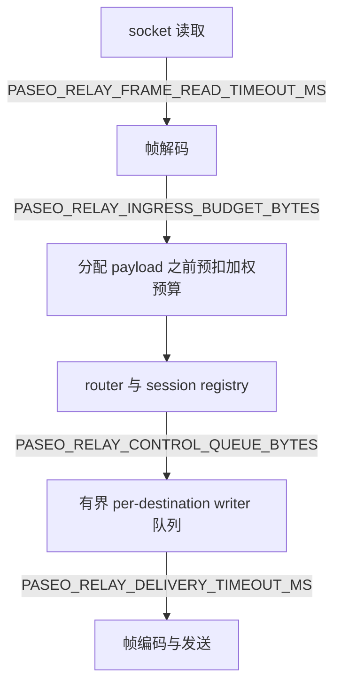

# 配置

[English](../configuration.md) | **简体中文**

relay 只从环境变量读取配置。启动时会校验；非法值会带说明退出。可用
`paseo-relay --check-config` 校验部署环境，用 `paseo-relay --dump-config`
打印生效配置（不含秘密）。

## Runtime contract

| 变量 | 默认值 | 含义 |
|---|---|---|
| `PASEO_RELAY_HOST` | `127.0.0.1` | 监听 IP。容器镜像设为 `0.0.0.0`。 |
| `PASEO_RELAY_PORT` | `4000` | HTTP/WebSocket/运维端点监听端口。 |
| `PASEO_RELAY_DRAIN` | `false` | 启动即 draining：`/ready` 返回 503，新 `/ws` upgrade 被拒绝。SIGTERM/SIGINT 总会触发 drain。 |
| `PASEO_RELAY_MAX_CONNECTIONS` | `20000` | 最大 WebSocket 数。必须 `<= PASEO_RELAY_MAX_TCP_CONNECTIONS`。 |
| `PASEO_RELAY_MAX_TCP_CONNECTIONS` | `25000` | 最大 TCP 连接数，包含 upgrade 前的 HTTP。 |
| `PASEO_RELAY_MAX_SESSIONS` | `20000` | 最大存活 `serverId` session 数。 |
| `PASEO_RELAY_MAX_CLIENTS_PER_CONNECTION` | `32` | 每个 `connectionId` 的最大 v2 client socket 数。 |
| `PASEO_RELAY_INGRESS_BUDGET_BYTES` | `536870912` | 节点级加权 in-flight payload 预算。必须能容纳一条最大消息。 |
| `PASEO_RELAY_INGRESS_WEIGHT` | `4` | 每 payload 字节的权重，另加每消息固定 256 字节开销。 |
| `PASEO_RELAY_INGRESS_WAIT_TIMEOUT_MS` | `5000` | 等待预算的最长时间；超时 source 以 `1013` 关闭。 |
| `PASEO_RELAY_MAX_MESSAGE_BYTES` | `33554418` | 最大数据帧/重组消息 payload（`32 MiB - 14`）。 |
| `PASEO_RELAY_FRAME_READ_TIMEOUT_MS` | `300000` | 帧 header 之后接收 payload 的最长时间；超时 `1013`。 |
| `PASEO_RELAY_MESSAGE_READ_TIMEOUT_MS` | `600000` | 重组一条分片消息的最长时间；超时 `1013`。 |
| `PASEO_RELAY_DATA_ATTACH_TIMEOUT_MS` | `15000` | v2 client 帧等待 daemon data socket 的最长时间。 |
| `PASEO_RELAY_DELIVERY_TIMEOUT_MS` | `30000` | 等待 destination writer 权限/写入的最长时间；慢 destination 被 `1013` shed。 |
| `PASEO_RELAY_CONTROL_QUEUE_BYTES` | `1048576` | 每 destination writer 队列下限；有效队列至少为 `MAX_MESSAGE_BYTES + 64 KiB`。 |
| `PASEO_RELAY_CONTROL_NUDGE_MS` | `10000` | v2 client 等 data 时，向 control 重发 `sync` 的延迟。 |
| `PASEO_RELAY_CONTROL_UNRESPONSIVE_MS` | `15000` | control 仍无响应则 `1011` 关闭的延迟；必须大于 nudge。 |
| `PASEO_RELAY_SESSION_IDLE_MS` | `30000` | 空 session 被清理前的 idle 时间。 |
| `PASEO_RELAY_PER_IP_MAX_CONNECTIONS` | `0` | 每 peer IP 的 WebSocket 上限；`0` 不限制。直连建议约 `256`；在 LB 后保持 `0`，在边缘限制。 |
| `PASEO_RELAY_SHUTDOWN_GRACE_MS` | `10000` | SIGTERM/SIGINT 后关闭剩余 socket（`1012`）前的 grace window。 |
| `PASEO_RELAY_TCP_KEEPALIVE_MS` | `60000` | 已接受 socket 的 TCP keepalive idle；`0` 关闭。 |
| `PASEO_RELAY_HTTP_HEADER_TIMEOUT_MS` | `15000` | 读取 HTTP header 的最长时间（slowloris 防护）。 |
| `PASEO_RELAY_TLS_CERT` | 未设置 | PEM 证书链路径。必须与 `PASEO_RELAY_TLS_KEY` 同时设置。 |
| `PASEO_RELAY_TLS_KEY` | 未设置 | PEM 私钥路径。两者都不设 = 明文（在边缘终止 TLS）。 |
| `PASEO_RELAY_ALLOWED_ORIGINS` | 未设置 | 逗号分隔的精确 `Origin` allowlist，用于 `/ws`；空 = 允许任意。没有 Origin 的 native client 始终允许。 |
| `PASEO_RELAY_LOG` | `info` | `tracing` `EnvFilter`，如 `info`、`paseo_relay=debug`。 |
| `PASEO_RELAY_LOG_FORMAT` | `text` | `text` 或 `json` 结构化日志。 |
| `PASEO_RELAY_HEALTHCHECK_HOST` | `127.0.0.1` | `paseo-relay healthcheck` 自检使用的 host。 |
| `PASEO_RELAY_BUILD_REVISION` | 构建时推导 | 嵌入 `/version` 和指标的 revision；覆盖 git 推导值。 |

## Ingress 预算与有界队列

转发路径上的每个阶段都有上界，节点级加权 ingress 预算在分配 payload 缓冲**之前**
预留：



预留的消息按每 payload 字节 `PASEO_RELAY_INGRESS_WEIGHT` 加权，另加固定 256 字节
开销。source 在 `PASEO_RELAY_INGRESS_WAIT_TIMEOUT_MS` 内无法预留时以 `1013` 关闭；
destination 的 writer 队列或写入超过 `PASEO_RELAY_DELIVERY_TIMEOUT_MS` 时以 `1013`
shed。session 和 socket 数量分别由 `PASEO_RELAY_MAX_SESSIONS`、
`PASEO_RELAY_MAX_CONNECTIONS` 限制。

## CLI

```text
paseo-relay                      # 运行
paseo-relay --help               # 用法
paseo-relay --version            # 版本 + build revision
paseo-relay --check-config       # 校验环境，退出 0/1
paseo-relay --dump-config        # 打印生效配置
paseo-relay healthcheck          # 容器自检（支持 TLS）
```

服务本身没有命令行配置；请使用环境变量，这样 Docker、Kubernetes、systemd 和
release 镜像共享同一套契约。

## 最小示例

```sh
PASEO_RELAY_HOST=127.0.0.1 \
PASEO_RELAY_PORT=4000 \
PASEO_RELAY_LOG_FORMAT=json \
PASEO_RELAY_TLS_CERT=/tls/cert.pem \
PASEO_RELAY_TLS_KEY=/tls/key.pem \
./paseo-relay
```
