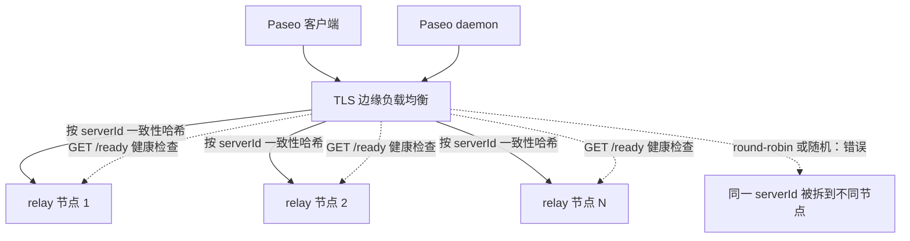
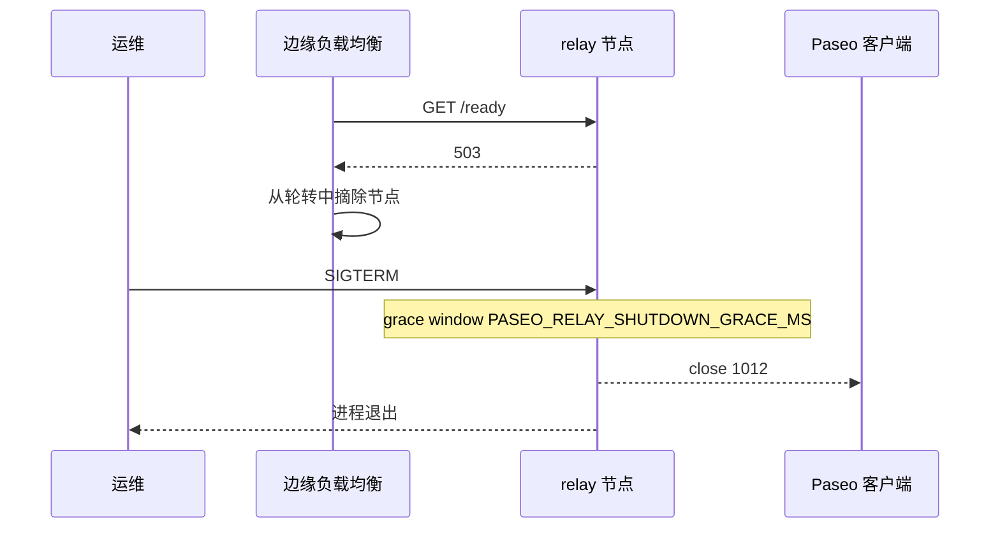

# 部署指南

[English](../deployment.md) | **简体中文**

Paseo Relay 是 **单节点** 组件。水平扩展和高可用由边缘负载均衡完成：同一个 Paseo
`serverId` 的所有 socket 必须落在同一个 relay 进程上。relay 本身没有内置集群、
ownership registry 或 409 reroute；这是刻意取舍（见[完整中文设计](https://github.com/kfxhjz/paseo-relay/blob/main/DESIGN.zh-CN.md)，英文规范 [DESIGN.md（英文）](https://github.com/kfxhjz/paseo-relay/blob/main/DESIGN.md)）。

## 选择拓扑

| 拓扑 | 适用场景 | 亲和性来源 |
|---|---|---|
| 单个 relay 节点 | 个人/小团队自托管 | 无需（单进程） |
| N 个 relay + 边缘 LB | 公网或多租户 | 对 `serverId` query 参数做一致性哈希 |
| 多个独立 relay | 不同信任域/租户 | 不同 DNS/endpoint |

**不要** 用 round-robin DNS、普通 `least_conn` 或随机负载均衡。同一 `serverId` 的
Paseo daemon 和 client 必须到达同一个 relay 进程，否则无法配对。

推荐的多节点拓扑：同一 `serverId` 的所有 socket 固定在同一 relay 节点，健康检查用
`/ready`：



## TLS

公网部署必须使用 `wss://`。可以：

- 在边缘终止 TLS（推荐），relay 只监听私网，并转发 WebSocket upgrade；或
- 挂载 PEM 证书链和私钥，设置 `PASEO_RELAY_TLS_CERT` / `PASEO_RELAY_TLS_KEY`，
  由 relay 用 rustls 直接提供 HTTPS/WSS。两者必须同时设置，否则启动失败；文件必须
  是 relay 用户（镜像内 UID 65532）可读的常规文件，`paseo-relay --check-config`
  会校验。

Paseo payload 虽然 E2EE，但 `serverId`、连接元数据和可用性仍会暴露给明文网络上的
被动/主动攻击者，所以公网不能只跑 `ws://`。

## 边缘负载均衡（多节点必需）

LB 必须：

1. 终止 TLS，并按 client IP 做连接/请求速率限制；
2. 解析 WebSocket query string，按 **`serverId` 参数值** 做一致性哈希
   （不是整个 URL，也不是 cookie）；
3. 保持 WebSocket 长连接（长 read/tunnel timeout）；
4. 后端健康检查用 `/ready`（不要只用 `/health`），这样 draining 节点会被摘除；
5. 不把 `/metrics` 暴露到公网。

示例：

- Nginx：[examples/nginx.conf](https://github.com/kfxhjz/paseo-relay/blob/main/examples/nginx.conf) —— TLS 边缘、一致性哈希、
  per-IP 连接/速率限制、屏蔽 `/metrics` 与 `/version` 且 `/ready` 只允许私网范围，
  访问日志不记录 query string。
- HAProxy：[examples/haproxy.cfg](https://github.com/kfxhjz/paseo-relay/blob/main/examples/haproxy.cfg) —— 一致性哈希、
  `/ready` 检查、拒绝运维端点、per-source 连接/速率限制，日志格式不记录 query string。
- Kubernetes + ingress-nginx：Ingress annotation 设为
  `nginx.ingress.kubernetes.io/upstream-hash-by: "$arg_serverId"`，liveness 用
  `/health`，readiness 用 `/ready`。示例还包含只允许 ingress-nginx namespace 访问
  4000 端口的 NetworkPolicy。见 [examples/kubernetes.yaml](https://github.com/kfxhjz/paseo-relay/blob/main/examples/kubernetes.yaml)。
- Envoy：使用 `RING_HASH` cluster，route hash policy 选
  `query_parameter: { name: serverId }`。

Nginx 和 HAProxy 示例假定它们直接终止 TLS，因此 per-IP 限制看到的是真实客户端。
如果前面还有一层代理/CDN，peer 地址就是那层代理：请把限制放到最外层（或配置
proxy protocol/real-IP 模块），不要收紧内层上限。Caddy 标准构建没有内置 per-IP
限流；需要 per-client 限制时用外部 CDN/WAF。同理，relay 自己的
`PASEO_RELAY_PER_IP_MAX_CONNECTIONS` 看到的也是代理 IP。

也可以自己写一个小 gateway 读 query 并做同样的哈希；relay 不依赖特定厂商。

### 代理后的源 IP

LB 终止连接后，relay 看到的每个连接都来自代理 IP。此时
`PASEO_RELAY_PER_IP_MAX_CONNECTIONS` 限制的是 **代理**，不是最终用户。请在代理后
保持默认 `0`，在边缘做 per-client 限制。如果是 relay 直接暴露、没有代理，再按用户
规模设置（例如 `256`）。

## 单节点容器

镜像已发布，是默认路径，不需要 Rust 工具链。先拉取 release，然后后台运行，并加重启
策略和比 drain 宽限期更长的 stop timeout（`--rm` 与 `--restart` 互斥）：

```sh
# 按约 512 MB 主机设置；提高内存时一起调高（见“容量规划”）。
docker pull ghcr.io/kfxhjz/paseo-relay:v0.1.2
docker run -d \
  --name paseo-relay \
  --restart unless-stopped \
  --stop-timeout 30 \
  --read-only --cap-drop ALL \
  --security-opt no-new-privileges \
  -p 127.0.0.1:4000:4000 \
  -e PASEO_RELAY_MAX_CONNECTIONS=4000 \
  -e PASEO_RELAY_MAX_SESSIONS=4000 \
  -e PASEO_RELAY_MAX_TCP_CONNECTIONS=5000 \
  -e PASEO_RELAY_INGRESS_BUDGET_BYTES=135266304 \
  ghcr.io/kfxhjz/paseo-relay:v0.1.2
```

只想临时前台试跑时，去掉 `-d`/`--restart`/`--stop-timeout`、加上 `--rm`，再用
`curl` 探测 `/health`（见 README 快速开始）。停止后台容器用
`docker stop paseo-relay`：SIGTERM 会触发优雅 drain。

上面的命令只发布到 loopback，因为 TLS 预期在边缘代理终止。如果要由 relay 直接提供
TLS，请挂载 PEM 证书、设置 `PASEO_RELAY_TLS_CERT` / `PASEO_RELAY_TLS_KEY`，并发布
TLS 端口（例如 `-p 0.0.0.0:443:4000`）。

`v0.1.2` 是当前 release tag，`latest` 跟随最新 **stable** release。预发布 tag
（任何包含 `-` 的 tag，例如 `v0.2.0-rc1`）不会移动 `latest`。如果需要不可变引用，
请改用 [release notes](https://github.com/kfxhjz/paseo-relay/releases/tag/v0.1.2) 中
`v0.1.2` 对应的多架构 index digest，而不是 tag：

```sh
# 按约 512 MB 主机设置；提高内存时一起调高（见“容量规划”）。
docker run -d \
  --name paseo-relay \
  --restart unless-stopped \
  --stop-timeout 30 \
  --read-only --cap-drop ALL \
  --security-opt no-new-privileges \
  -p 127.0.0.1:4000:4000 \
  -e PASEO_RELAY_MAX_CONNECTIONS=4000 \
  -e PASEO_RELAY_MAX_SESSIONS=4000 \
  -e PASEO_RELAY_MAX_TCP_CONNECTIONS=5000 \
  -e PASEO_RELAY_INGRESS_BUDGET_BYTES=135266304 \
  ghcr.io/kfxhjz/paseo-relay@sha256:<digest>
```

镜像是 `scratch` 中的静态 musl 二进制，以 UID/GID `65532` 运行，不写磁盘，并内置
`healthcheck` 子命令（镜像 `HEALTHCHECK` 调用 `/paseo-relay healthcheck`）。
不需要 shell 或 `curl`。

Compose 示例见 [examples/docker-compose.yml](https://github.com/kfxhjz/paseo-relay/blob/main/examples/docker-compose.yml)：
同样默认拉取已发布镜像，并把连接上限按 512 MB 容器设置
（`PASEO_RELAY_MEM_LIMIT`、`MAX_CONNECTIONS=4000`、`MAX_SESSIONS=4000`、
`MAX_TCP_CONNECTIONS=5000`）；调高内存上限时请一起调高这些值。

只有在修改 relay 本身时才需要从源码构建：使用 build override
（[examples/docker-compose.build.yml](https://github.com/kfxhjz/paseo-relay/blob/main/examples/docker-compose.build.yml)），
或直接 `docker build -t paseo-relay .`：

```sh
docker compose -f examples/docker-compose.yml \
  -f examples/docker-compose.build.yml up -d --build
```

## Kubernetes

以 [examples/kubernetes.yaml](https://github.com/kfxhjz/paseo-relay/blob/main/examples/kubernetes.yaml) 为起点。关键配置：

- `runAsNonRoot: true`、`runAsUser: 65532`、`readOnlyRootFilesystem: true`、
  `allowPrivilegeEscalation: false`，drop `ALL` capabilities；
- `automountServiceAccountToken: false` —— relay 不调用 Kubernetes API；
- readiness probe `GET /ready`，让 draining 节点从 Service endpoints 摘除；
- liveness/startup probe `GET /health`；
- `terminationGracePeriodSeconds` 大于 `PASEO_RELAY_SHUTDOWN_GRACE_MS`
  （默认 10 s），例如 30 s；
- 容量 env 按容器 limit 设置（示例用 1Gi limit，`MAX_CONNECTIONS=8000`、
  `MAX_SESSIONS=8000`、`MAX_TCP_CONNECTIONS=10000`，ingress 预算 129 MiB）；
- NetworkPolicy：只允许 ingress controller/proxy namespace 访问 4000 端口；
  `/metrics` 只给监控（NetworkPolicy 只到 L3/L4，运维路径要在 ingress 过滤，或从
  内网 Service 抓取）。部分 CNI 也会把 NetworkPolicy 应用到 kubelet 探针流量；如果
  探针失败，按示例注释允许 node CIDR 访问 4000；
- 保持 replicas 稳定。扩容时增加 relay 节点并更新边缘一致性哈希环；不要用会让
  环频繁重排的 HPA。

## systemd

示例 unit 见 [examples/paseo-relay.service](https://github.com/kfxhjz/paseo-relay/blob/main/examples/paseo-relay.service)。
用 `EnvironmentFile=` 提供 runtime contract，`Restart=always`，并给
`TimeoutStopSec` 留出大于 drain grace 的时间（例如 `TimeoutStopSec=30`）。

## 健康检查、readiness 与 drain

- `GET /health` — liveness；draining 期间仍 200。
- `GET /ready` — 仅在愿意接受新工作时 200；draining、shutting down、WebSocket/session
  满或 capacity 异常时 503。
- `SIGTERM`/`SIGINT` — 停止 accept，`/ready` 变 503；现有 session 继续运行
  `PASEO_RELAY_SHUTDOWN_GRACE_MS`，然后以 `1012` 关闭并退出。
- `PASEO_RELAY_DRAIN=true` — 启动即 unready；适合维护启动或先摘流再停止。

推荐滚动流程：先从 LB 摘除（readiness），等 LB 观察到 `/ready=503`，发 SIGTERM，
等待至少 grace window，再在必要时 kill。

单个节点的 drain/滚动顺序：



## 指标与告警

从内网抓取 `/metrics`。指标只有聚合值，没有 `serverId` label。示例见
[examples/prometheus.yml](https://github.com/kfxhjz/paseo-relay/blob/main/examples/prometheus.yml)、
[examples/alerts.yml](https://github.com/kfxhjz/paseo-relay/blob/main/examples/alerts.yml)，指标说明见
[operations.md](operations.md)。

## 容量规划

内存分两部分：idle/upgrade 前 socket 与 in-flight payload 记账。

- **Idle socket。** relay 在边缘后为明文时（hyper 读写缓冲加 task）一个已接受
  socket 约占 23 KiB，原生 TLS（rustls 缓冲）时约 33 KiB，因此 idle 时按
  `MAX_TCP_CONNECTIONS × ~30 KiB`（明文）或 `× ~35 KiB`（原生 TLS）预留。内置默认值
  （25,000 TCP / 20,000 WebSocket）在没有任何 payload 流量前就需要约
  700–800 MiB（明文）或约 850–900 MiB（原生 TLS）；512 MB 容器必须调低
  `PASEO_RELAY_MAX_TCP_CONNECTIONS`、`PASEO_RELAY_MAX_CONNECTIONS` 和
  `PASEO_RELAY_MAX_SESSIONS`（Compose 示例使用 5,000 / 4,000 / 4,000）。hyper
  builder 限制了 upgrade 前请求缓冲（`max_buf_size` 16 KiB、`max_header_size`
  16 KiB、`max_headers` 64），`PASEO_RELAY_HTTP_HEADER_TIMEOUT_MS` 限制 header
  阶段，但这些限制不会让 idle socket 变得免费。
- `PASEO_RELAY_INGRESS_BUDGET_BYTES`（默认 512 MiB 加权）限制 in-flight payload
  记账；每个 8 KiB chunk 到达时按 `chunk_bytes × weight + 192` 计费（每 chunk
  记账），单个连接最多持有 `min(budget, 4 × 一条最大消息的计费)`。校验器要求预算
  能容纳一条最大消息及这些记账；具体下限用 `--check-config` 查看（129 MiB 的
  Compose 预算仍然通过）。
- `PASEO_RELAY_MAX_TCP_CONNECTIONS` 是 OS socket 总上限，包含 upgrade 后的
  WebSocket（slot 在整个 socket 生命周期内持有），因此必须满足
  `MAX_CONNECTIONS <= MAX_TCP_CONNECTIONS`。同时要在 `MAX_CONNECTIONS` 之上留出
  余量（至少 64–128 个空槽，探针突发时更多）：否则满 WebSocket 负载会占满 TCP
  slot，`/health`、`/ready`、`/metrics`、镜像 HEALTHCHECK 和 k8s 探针都会在 accept
  阶段被拒绝。仓库示例使用 4000/5000 和 8000/10000；内置默认值是 20000/25000。
- `PASEO_RELAY_MAX_SESSIONS`（默认 20,000）限制 idle `serverId` 条目。
- `PASEO_RELAY_CONTROL_QUEUE_BYTES` / writer 队列限制每 destination 缓冲。

relay 自身内存与活跃 socket 和排队 payload 成正比；请用 `/metrics` 和容器
RSS 在真实负载下测量。
