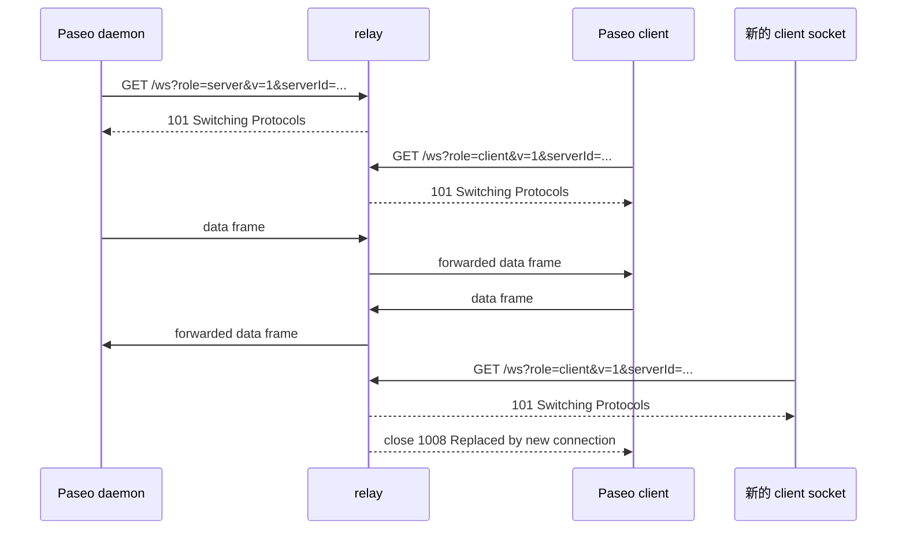
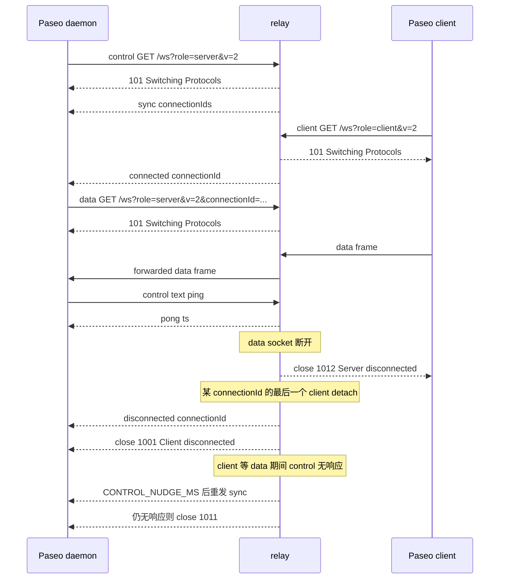

# Wire protocol

[English](../protocol.md) | **简体中文**

本文是 Paseo relay 协议的详细契约。运行时设置见
[configuration.md](configuration.md)，与 Elixir relay 的兼容性见
[compatibility.md](compatibility.md)。

## Endpoint 与 query

`GET /ws`，标准 RFC 6455 WebSocket upgrade。relay 会在创建任何 session 状态之前
校验 upgrade header（包括 16 字节 `Sec-WebSocket-Key` 和
`Sec-WebSocket-Version: 13`）。

| 参数 | 必填 | 含义 |
|---|---|---|
| `serverId` | 是 | 路由 key；1..=256 字节，合法 UTF-8，不能包含控制字符或空白 |
| `role` | 是 | `server`（daemon）或 `client` |
| `v` | 否 | `1`（默认）或 `2` |
| `connectionId` | 仅 v2 | daemon data socket 的路由 id。client 通常省略，relay 生成 `conn_<16 hex>`；v2 daemon control socket 传空值 |

Paseo client/daemon 把 `serverId` 当作 bearer secret：知道它的人可以 attach 到该
session。relay 按设计不增加认证；安全模型见 README 与 `SECURITY.md`。

请只发送一个未编码的 `serverId`。同一 query 参数出现多次时，relay 使用 **最后
一个** 值（last-wins，与 Elixir 实现的 `Map.new/1` 一致）。边缘一致性哈希通常对
原始 query 值做哈希，因此重复或 percent-encoded 的形式可能把同一 session 的两端
路由到不同 relay 节点。

## v1

每个 `serverId` 一个 server socket、一个 client socket。同一 role 的新 socket 会
替换旧 socket，旧连接收到 close `1008` "Replaced by new connection"。数据帧转发给
对端 role，保留 WebSocket opcode。对端不存在时该帧被丢弃，session 拓扑不变。

v1 的配对与替换流程：

## v2

daemon 会打开：

- 一个 **control socket**：`role=server`，空 `connectionId`；
- 每个 client connection 一个 **data socket**：非空 `connectionId`。

行为：

- control attach 时，relay 发送
  `{"type":"sync","connectionIds":[...]}`，并替换之前的 control socket（`1008`）。
- client attach 时，relay 向 control 发送
  `{"type":"connected","connectionId":"..."}`。
- 某 `connectionId` 的最后一个 client detach 时，relay 向 control 发送
  `{"type":"disconnected","connectionId":"..."}`，并以 `1001` "Client disconnected"
  关闭 data socket。
- data socket 断开时，该 `connectionId` 下所有 client 以 `1012` "Server disconnected"
  关闭。
- client 帧最多等待 data socket `DATA_ATTACH_TIMEOUT_MS`（默认 15 s）；超时仍不存在
  则 client 以 `1013` "Data route unavailable" 关闭。
- client 等待 data 期间，control watchdog 在 `CONTROL_NUDGE_MS` 后重发 `sync`，
  在 `CONTROL_UNRESPONSIVE_MS` 后若仍无响应则以 `1011` 关闭 control socket。
- control 输入除文本 `{"type":"ping"}` 外忽略；ping 回复
  `{"type":"pong","ts":<unix ms>}`。control 上的二进制帧忽略。

v2 的 control/data 流程与 close 传播：

## 帧与限制

| 项目 | 限制/行为 |
|---|---|
| client 数据帧 / 重组消息 | `32 MiB - 14` 字节；超限 close `1009` |
| 每条消息的分片数 | 最多 1024；超过 close `1002` |
| 长度编码 | 126/127 长度形式必须是最小编码；非最小编码 close `1002` |
| v2 control 帧 | 每帧/消息 64 KiB |
| WebSocket control 帧 | 遵循 RFC 6455（≤125 字节，不能分片） |
| Close payload | 空，或至少 2 字节且状态码合法；非法 code close `1002` |
| 压缩 | 不协商 |
| Masking | client 帧必须 mask；未 mask close `1002` |
| Text 消息非法 UTF-8 | close `1007` |
| 分片消息 | 重组后作为一个消息转发；保留 opcode |
| 帧 payload 读取 | 必须在 `FRAME_READ_TIMEOUT_MS` 内完成；否则 `1013` |
| 分片消息 | 必须在 `MESSAGE_READ_TIMEOUT_MS` 内完成；否则 `1013` |
| 帧之间的 idle/header timeout | WebSocket 帧之间没有 timeout；idle 连接按设计继续占用 slot，需在边缘做 idle 限制 |
| 源端 payload 记账 | data payload 按 8 KiB chunk 读取，每个 chunk 到达后才计费；每个连接在计费前最多分配一个 8 KiB chunk |
| 每连接 in-flight 上限 | `min(PASEO_RELAY_INGRESS_BUDGET_BYTES, 4 × 一条最大消息的计费)` |
| 慢 destination | 有界 writer 队列 + deadline；destination 被 `1013` shed |

Ingress 记账有两个对滥用上限很重要的细节：

- 每消息固定 256 字节开销 **每条消息只计一次**，不按分片重复计费，因此一条分片
  消息不会因为 header 被计上千次；
- data frame 的 payload 按 8 KiB chunk 读取，每个 chunk 到达后才计费，因此每个
  连接在计费前最多分配一个 8 KiB chunk。停滞帧无法为它从未发送的字节预留预算。

## 握手 key 卫生检查

对于 client 发来的、≤64 KiB 且首个非空白字节为 `{` 的 text/binary 帧，relay 会解析
JSON。如果 `type` 是 `hello` 或 `e2ee_hello`，`key` 必须是 canonical padded Base64
的 canonical 32 字节 X25519 公钥，且不是已知低阶/不支持点。不满足时 close `1008`
"Invalid handshake key"，且不会转发。

这是协议卫生检查，**不是安全边界**：Paseo 的 E2EE 握手由两端认证，relay 按设计
不可信。大于 64 KiB 的 JSON 形状帧不会经过此检查。

## Close code

| Code | 含义 |
|---|---|
| `1000` | 正常关闭；收到的合法 code 会回显 |
| `1001` | v2 最后一个 client detach，data socket 关闭 |
| `1002` | 协议错误：坏帧/masking、非最小长度编码、分片过多，或 close payload/code 非法 |
| `1007` | text 消息非法 UTF-8 |
| `1008` | 被新 socket 替换、handshake key 非法或策略关闭 |
| `1009` | 帧/消息过大 |
| `1011` | control socket 无响应 |
| `1012` | relay 正在 shutdown，或 v2 server data socket 断开 |
| `1013` | ingress 预算/读超时、data route 不可用或 delivery 不可用（可重试） |

合法的 close code 是 `1000..=1003`、`1007..=1014` 和 `3000..=4999`。空 close
payload 允许；单字节 payload 不允许。`1005`/`1006`/`1015` 保留给本地使用，不会出现
在 wire 上。小于 `1000`、`1004`、`1005`、`1006`、`1015`、`1016..=2999` 以及大于
`4999` 的 code 会以 `1002` 拒绝。`1002` 表示 peer 违反了 framing/协议契约；relay
关闭连接，不重试。

## HTTP endpoints

- `GET /health` — 存活探针，进程存活期间 200。
- `GET /ready` — 仅在愿意接受新工作时 200；draining、shutting down、WebSocket/session
  WebSocket/session 容量满时 503。
- `GET /metrics` — Prometheus 文本，只有聚合值，无 ID。
- `GET /version` — `{"version":"...","revision":"..."}`。
- `GET /ws` — WebSocket upgrade。
- 其他路径 — 404。

upgrade admission 失败：`400` query/handshake 非法，`403` Origin 不允许，`426` 不是
upgrade，`429` per-IP WebSocket 超限，`503` draining/容量不足。
