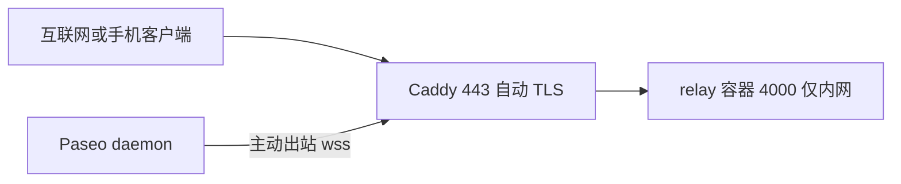

# 五分钟 VPS 快速部署

[English](../quickstart.md) | **简体中文**

这是 **大多数自托管用户** 的路径：一台公网 VPS、一个 relay 节点、
`relay.example.com` 自动 HTTPS。不需要负载均衡，也不需要集群。

## 你需要什么

- 有公网 IPv4 的 VPS（自动 TLS 需要域名）。
- 为 `relay.example.com` 之类域名配置 DNS `A` 记录（用 IPv6 再加 `AAAA`），
  指向 VPS。
- Docker + Compose v2，并在防火墙/安全组开放入站 TCP `80`/`443`
  （HTTP/3 可选 UDP `443`）。
- 使用下面的 Compose 默认值时约 **512 MB 内存**（128 MiB ingress 预算）。relay
  本身很小，但要给 Caddy 和连接峰值留余量。如果把
  `PASEO_RELAY_INGRESS_BUDGET_BYTES` 提到内置默认 512 MiB，建议至少 ~1 GB。
  从源码构建需要至少 ~1 GB 和几分钟。

## 部署已发布镜像

直接使用已发布镜像，不需要 Rust 工具链。

```sh
git clone https://github.com/kfxhjz/paseo-relay.git
cd paseo-relay

RELAY_DOMAIN=relay.example.com \
docker compose -f examples/docker-compose.caddy.yml up -d
```

Compose 会拉取当前 release `ghcr.io/kfxhjz/paseo-relay:v0.1.0`；`latest` 跟随
最新 release。可用 `PASEO_RELAY_IMAGE` 覆盖版本；如果需要固定不可变的 digest，
见[部署指南](deployment.md)。

Caddy 会自动申请证书。验证：

```sh
curl https://relay.example.com/health   # {"status":"ok"}
```

relay 本身不映射到宿主机端口，只有 Caddy 对外；relay 以 read-only、非 root、
drop 所有 capability 运行。`/metrics` 和 `/ready` 被 Caddy 屏蔽；如果要 Prometheus，
请在 Compose 内网抓取。

各组件运行位置：



## 从源码构建（可选）

只在你要改 relay 本身时使用；正常部署直接用已发布镜像。需要至少 ~1 GB 内存和
支持 Rust 的 Docker builder：

```sh
RELAY_DOMAIN=relay.example.com \
docker compose \
  -f examples/docker-compose.caddy.yml \
  -f examples/docker-compose.caddy.build.yml \
  up -d --build
```

## 让 Paseo 接进来

在运行 Paseo daemon 的机器上：

```sh
export PASEO_RELAY_ENDPOINT=relay.example.com:443
export PASEO_RELAY_PUBLIC_ENDPOINT=relay.example.com:443
export PASEO_RELAY_USE_TLS=true
export PASEO_RELAY_PUBLIC_USE_TLS=true
export PASEO_RELAY_ENABLED=true
paseo daemon pair --relay
```

请在 **运行中的 daemon** 环境（或 `config.json`）设置这些变量，而不是只在执行
`pair` 的 shell 里设置；已经在运行的 daemon 可能不会读取一次性环境变量。

用 Paseo App 扫描/打开配对链接。daemon 会 **主动出站** 连接 relay，不需要为
daemon 做端口映射；手机客户端必须能访问 `relay.example.com:443`。

## 升级

```sh
git pull
docker compose -f examples/docker-compose.caddy.yml up -d
```

relay 状态是临时的：Paseo 客户端会重连，E2EE 配对是端到端的，不存储在 relay。
不要 `SIGKILL`；Compose 会发 `SIGTERM`，relay 会在 grace window 内 drain。

## 排障

| 现象 | 检查 |
|---|---|
| Caddy 申请证书失败 | DNS 是否指向 VPS；80/443 是否可达；看 Caddy 日志 |
| `/health` 正常但配对失败 | 使用 `wss`/443；手机是否能访问同一公网 endpoint |
| Caddy 返回 502/504 | relay 容器是否 healthy；`docker compose logs relay` |
| 所有连接被拒 | 检查 `PASEO_RELAY_MAX_CONNECTIONS`、`/ready` 和 relay 日志 |
| 看不到 metrics | `/metrics` 和 `/ready` 被 Caddy 屏蔽；从内网抓 relay |
| 要下线节点 | 先从边缘摘除，再发 SIGTERM，等待 grace window |
| OOM 或构建失败 | 使用预构建镜像，或给构建至少 ~1 GB 内存 |

## 什么情况下不要用这条路径

- **多 relay 节点**：需要边缘按 `serverId` query 做一致性哈希
  （Nginx/HAProxy/Envoy）；见 [deployment.md](deployment.md)。
- **需要 relay 级认证**：本项目按设计没有；请放在 VPN/mTLS 或带认证的边缘后。
- **无法开放 80/443**：使用 tunnel/VPN 或在别处终止 TLS；见
  [deployment.md](deployment.md)。
